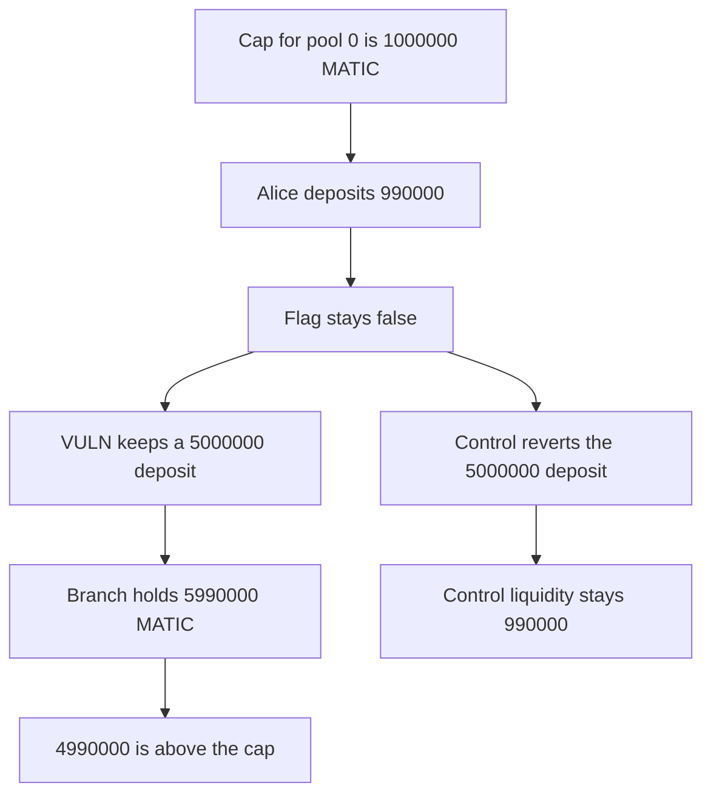

# Cedro Finance: the deposit that crosses the cap is kept

> **Vulnerability classes:** `vuln/logic/missing-check` · `vuln/logic/wrong-condition`

<!-- non-defihacklabs -->
<!-- source-auditvault: https://github.com/Auditware/AuditVault/blob/main/findings/37518-method-depositrequest-allows-the-last-deposit-to-be-more-tha.md -->
<!-- date: 2024-03 -->

## Key info

| Field | Value |
|---|---|
| **Loss** | 4,990,000 MATIC accepted above a 1,000,000 cap. Branch custody is 5,990,000 |
| **Vulnerable contract** | `Branch.depositRequest` |
| **Attacker EOA** | `0x1111111111111111111111111111111111111111` |
| **Attack contract** | `Exploit` |
| **Attack tx** | `Exploit.run()` |
| **Chain / block / date** | Ethereum model · block 0 · 2024-03 |
| **Compiler** | solc 0.8.27, cancun, via IR |
| **Bug class** | Cap flag is written after the tokens are taken, and the over-cap call does not revert |

## TL;DR

`depositRequest` only reverts when `depositCapReached[id]` is already true. That flag is set after `liquidity` has been increased, and only when the new total is already above `capAmount`. A 990,000 MATIC deposit leaves the flag false. The next call deposits 5,000,000 and is kept. The branch then holds 5,990,000 against a 1,000,000 cap. Checking `liquidity + amount > capAmount` before the transfer reverts the second deposit and leaves liquidity at 990,000.

## Background

Zokyo's 19 March 2024 Cedro Finance report, on `Branch.sol`. The report's example is a 1,000,000 MATIC cap, a 990,000 deposit, then a 5,000,000 deposit. The same order is what this reduction runs. The report marks the issue resolved and recommends reverting when the current deposit would pass the cap for that pool id.

## The vulnerable code

```solidity
if (depositCapReached[id]) revert DepositCapReached(TAG, id);
matic.transferFrom(msg.sender, address(this), amount);
liquidity[id] += amount;
if (liquidity[id] > capAmount[id]) { // @> VULN: the over-cap deposit is kept; the flag only blocks the next one
    depositCapReached[id] = true;
}
```

The flag is a latch for later calls. It is not a check on this call. The recommended change refuses the deposit that would cross the cap:

```diff
- if (depositCapReached[id]) revert DepositCapReached(TAG, id);
- // transfer, then set the flag if liquidity > cap
+ if (liquidity[id] + amount > capAmount[id]) revert DepositCapReached(TAG, id);
```

## Root cause

The cap is enforced on a boolean that becomes true only after the offending balance update. Any single call can therefore be larger than the remaining room, including a call larger than the cap itself.

## Preconditions

- `capAmount[0]` is 1,000,000 MATIC and `depositCapReached[0]` is false.
- Alice has already deposited 990,000, so 10,000 of room remains.
- The caller can transfer MATIC into the branch. No role is required.

## Attack walkthrough

1. The cap for pool 0 is set to 1,000,000.
2. Alice deposits 990,000. Liquidity is under the cap, so the flag stays false.
3. The next caller deposits 5,000,000. The flag check does not revert.
4. Liquidity becomes 5,990,000 and the flag is set only after the tokens are in the branch.
5. The branch's MATIC balance is 5,990,000. The excess over the cap is 4,990,000.
6. The control reverts that 5,000,000 deposit and leaves liquidity at 990,000.

## Diagrams



## Impact

The branch custodies 5,990,000 MATIC after a cap of 1,000,000. The 4,990,000 that should have been rejected is in the contract, and the flag then blocks every later deposit. The control does not take the 5,000,000.

## Remediation

Revert before the transfer when `liquidity[id] + amount` exceeds `capAmount[id]`. Do not rely on a flag that is written after the balance update.

## How to reproduce

```bash
cd 37518-method-depositrequest-allows-the-last-deposit-to-be-more-tha_exp
forge test -vv
```

`test_exploit_last_deposit_clears_the_cap` asserts liquidity and the MATIC balance are both 5,990,000 and the flag is set. `test_control_over_cap_deposit_reverts` asserts the fixed check reverts the 5,000,000 deposit and leaves liquidity at 990,000.

## Sources

- AuditVault finding: https://github.com/Auditware/AuditVault/blob/main/findings/37518-method-depositrequest-allows-the-last-deposit-to-be-more-tha.md
- Zokyo report: https://github.com/solodit/solodit_content/blob/main/reports/Zokyo/2024-03-19-Cedro%20Finance.md
- Quoted lines: `Branch.depositRequest`, the `depositCapReached` check and the post-deposit flag write
