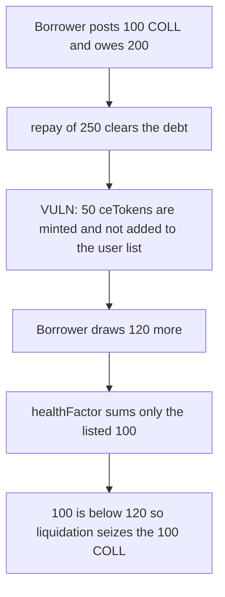

# Cedro — repay mints ceTokens the health factor never sees

> **Vulnerability classes:** vuln/logic/missing-check · vuln/logic/incorrect-state-transition

<!-- non-defihacklabs -->
<!-- source-auditvault: https://github.com/Auditware/AuditVault/blob/main/findings/37520-minted-cetokens-not-added-to-users-list-if-minted-using-repa.md -->
<!-- date: 2024-03 -->

## Key info

| | |
|---|---|
| **Protocol** | Cedro Finance |
| **Finding** | Zokyo, AuditVault 37520 |
| **Vulnerable code** | `Core.repay` |
| **Harm** | Liquidator seizes 100 COLL. The borrower had 50 ceTokens that would have made 150 collateral against 120 debt. Those ceTokens were never added to the user list. |
| **Chain** | local synthetic |

## TL;DR

`repay` lets a user pay more than the debt. The extra amount mints ceTokens. It does not call `_addToken`, so `users[user]` does not contain the new id. `healthFactor` only sums ids on that list. After the overpayment the borrower still has 100 listed COLL plus 50 invisible ceTokens, then borrows 120. The protocol sees 100 against 120 and liquidates. Counting the ceTokens would show 150 against 120, and the liquidation would revert.

## The vulnerable code

```solidity
function repay(uint256 payment) external {
    uint256 owed = debt[msg.sender];
    uint256 pay = payment > owed ? owed : payment;
    debt[msg.sender] = owed - pay;
    uint256 excess = payment - pay;
    if (excess != 0) {
        // @> VULN: ceTokens minted by repay are not pushed onto users[user]
        balance[msg.sender][CE_ID] += excess;
    }
}

function healthFactor(address user) public view returns (uint256 collValue, uint256 debt_) {
    debt_ = debt[user];
    uint256 len = _users[user].length;
    for (uint256 i; i < len; ++i) {
        collValue += balance[user][_users[user][i]];
    }
}
```

A normal `deposit` both credits the balance and calls `_addToken`. The report's fix is the same call on the repay path. The control does that. Health then returns 150, and `liquidate` reverts. The borrower keeps the 100 COLL.

## Root cause

Collateral that counts is not "every ceToken balance". It is "every id stored in `users[user]`". Repay updates the balance mapping and skips the list. Later reads of health, borrow limits, and liquidation all walk the list, so the minted ceTokens are invisible. The position is judged on the old collateral only.

## Preconditions

The borrower has posted 100 COLL, which is on the list, and owes 200. They call `repay` with 250. They then borrow 120. Liquidation fires when listed collateral is strictly below debt. No admin key is required. `repay` is external.

## Attack walkthrough

1. The borrower deposits 100 COLL. Token id 1 is pushed onto their list.
2. They borrow 200.
3. They repay 250. 200 clears the debt. The extra 50 mints ceToken id 2. The list length stays 1.
4. They borrow 120. True collateral is 150. Listed collateral is 100.
5. `healthFactor` loops the list, adds 100, and does not see the 50.
6. 100 is below 120, so `liquidate` transfers the 100 COLL to the caller.
7. The 50 ceTokens are still on the account and still off the list. The debt is wiped by the liquidation, not by a repayment.

The fixed `repay` pushes id 2. The same 120 borrow then has health 150. Liquidation reverts. The liquidator receives nothing.

## Diagrams



## Impact

The liquidator receives the borrower's 100 COLL. The borrower is solvent if the 50 ceTokens count: 150 collateral against 120 debt. They are liquidated because the protocol cannot see that collateral. The ceTokens remain, but they did not protect the position they were minted to support.

## Remediation

Call `_addToken(msg.sender, CE_ID)` in the same branch that mints ceTokens from a repay overpayment. `healthFactor` should then include that balance before a borrow or a liquidation is allowed.

## How to reproduce

```bash
cd 37520-minted-cetokens-not-added-to-users-list-if-minted-using-repa_exp
forge test -vv
```

## Sources

- AuditVault finding: https://github.com/Auditware/AuditVault/blob/main/findings/37520-minted-cetokens-not-added-to-users-list-if-minted-using-repa.md
- Zokyo report: https://github.com/solodit/solodit_content/blob/main/reports/Zokyo/2024-03-19-Cedro%20Finance.md
