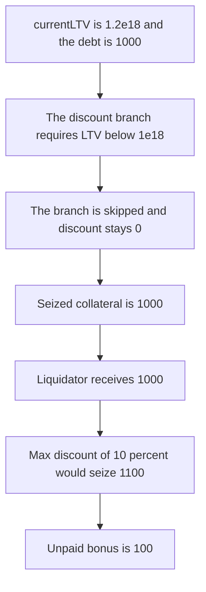

# Cedro — liquidation bonus is zero above 100 percent LTV

> **Vulnerability classes:** vuln/logic/liquidation-logic · vuln/logic/reward-calculation

> **Reproduction:** a self-contained Foundry PoC that compiles and runs offline
> with only `forge-std` — no fork and no RPC. Trace: [output.txt](output.txt).
> PoC: [test/37521-liquidation-bonus-is-0-when-currentltv-1e18-zokyo-none-cedro_exp.sol](test/37521-liquidation-bonus-is-0-when-currentltv-1e18-zokyo-none-cedro_exp.sol).

<!-- non-defihacklabs -->
<!-- source-auditvault: https://github.com/Auditware/AuditVault/blob/main/findings/37521-liquidation-bonus-is-0-when-currentltv-1e18-zokyo-none-cedro.md -->
<!-- date: 2024-03 -->

---

## Key info

| | |
|---|---|
| **Impact** | **HIGH** — at **1.2e18** LTV the discount stays **0**. A **1000** debt seizes **1000** collateral. The **10 percent** max discount would seize **1100**. The unpaid bonus is **100** |
| **Protocol** | Cedro `LiquidationManager.liquidate` |
| **Vulnerable code** | `discount` is assigned only inside `if (currentLTV < 1e18)` |
| **Bug class** | No liquidation bonus once LTV reaches 100 percent |
| **Finding** | Zokyo — Cedro Finance, 19 March 2024 · id 37521 |
| **Report** | [Zokyo Cedro Finance report](https://github.com/solodit/solodit_content/blob/main/reports/Zokyo/2024-03-19-Cedro%20Finance.md) |
| **Source** | [AuditVault finding](https://github.com/Auditware/AuditVault/blob/main/findings/37521-liquidation-bonus-is-0-when-currentltv-1e18-zokyo-none-cedro.md) |
| **Status** | Acknowledged by the client as a spiral guard. The report still recommends a discount. Reproduced here as a local synthetic. |
| **Compiler** | solc 0.8.27, cancun, via IR |

---

## TL;DR

`liquidate` computes a discount only when `currentLTV < 1e18`, using `1e36 / currentLTV - 0.999e18`, capped by `liqMaxDiscount`. At **1.2e18** that branch is skipped and `discount` stays **0**.

A debt of **1000** then seizes `1000 * (1e18 + 0) / 1e18 = 1000` collateral. `liqMaxDiscount` is **0.1e18**. Applying it seizes **1100**. The liquidator is unpaid by **100** collateral, which is the bonus the report says is needed for someone to liquidate.

`run()` does not warp.

## The vulnerable code

```solidity
uint256 discount;
if (currentLTV < 1e18) {
    discount = 1e36 / currentLTV - 999000000000000000;
    if (discount > config.liqMaxDiscount) {
        discount = config.liqMaxDiscount;
    }
}
// @> VULN: currentLTV >= 1e18 leaves discount at 0, so the bonus is not paid
lastDiscount = discount;
seized = debt * (1e18 + discount) / 1e18;
```

The fixed function sets `discount = config.liqMaxDiscount` when `currentLTV` is not below **1e18**. The same **1000** debt at **1.2e18** LTV then seizes **1100**.

## Root cause

The discount expression is gated on LTV being under 100 percent. The positions that most need a liquidator are the ones at or above that line, and those are exactly the ones that pay a zero bonus.

## Preconditions

- `currentLTV` is **1.2e18**.
- Debt is **1000**. Collateral price is 1, so seized units equal the discounted debt.
- `liqMaxDiscount` is **0.1e18**. The manager holds at least **1100** collateral. Here it holds **2000**.
- No timestamp change happens inside `run()`.

## Attack walkthrough

1. The liquidator calls `liquidate(1.2e18, 1000, liquidator)`.
2. `currentLTV < 1e18` is false. `discount` stays **0**.
3. Seized collateral is **1000**.
4. **1000** collateral is transferred. The fair amount at the max discount is **1100**.
5. The unpaid bonus is **100**.

Control: the same inputs, with the else branch setting the discount to **0.1e18**. The liquidator receives **1100** collateral.

## Diagrams



## Impact

A liquidator who repays **1000** of debt receives **1000** collateral and **0** bonus. The configured maximum bonus would have paid **100** more, for a seize of **1100**. At this LTV there is no payment for taking the position, so the debt can sit unliquidated.

## Remediation

When `currentLTV` is at least **1e18**, set the discount to `liqMaxDiscount` instead of leaving it at **0**.

## Sources

- [AuditVault finding 37521](https://github.com/Auditware/AuditVault/blob/main/findings/37521-liquidation-bonus-is-0-when-currentltv-1e18-zokyo-none-cedro.md)
- [Zokyo Cedro Finance report, 19 March 2024](https://github.com/solodit/solodit_content/blob/main/reports/Zokyo/2024-03-19-Cedro%20Finance.md)

### Taxonomy

- `severity/high`
- `vuln/logic/liquidation-logic`
- `vuln/logic/reward-calculation`
