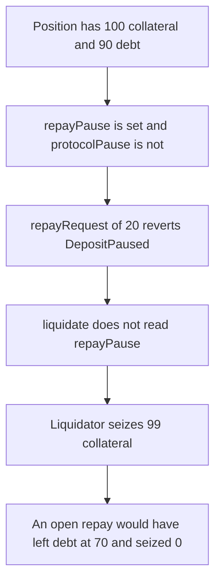

# Cedro Finance — repay is paused while liquidation stays open

> **Vulnerability classes:** vuln/logic/liquidation-logic · vuln/logic/missing-check

> **Reproduction:** a self-contained Foundry PoC that compiles and runs offline
> with only `forge-std` — no fork and no RPC. Trace: [output.txt](output.txt).
> PoC: [test/37522-repay-paused-but-liquidation-enabled-zokyo-none-cedro-financ_exp.sol](test/37522-repay-paused-but-liquidation-enabled-zokyo-none-cedro-financ_exp.sol).

<!-- non-defihacklabs -->
<!-- source-auditvault: https://github.com/Auditware/AuditVault/blob/main/findings/37522-repay-paused-but-liquidation-enabled-zokyo-none-cedro-financ.md -->
<!-- date: 2024-03 -->

---

## Key info

| | |
|---|---|
| **Impact** | **HIGH** — the borrower cannot repay **20** of a **90** debt. Liquidation seizes **99** collateral. The same repay, while repay is open, drops the debt to **70** and liquidation takes **0** |
| **Protocol** | Cedro Finance `repayRequest` / `LiquidationManager.liquidate` |
| **Vulnerable code** | `liquidate` does not revert on `repayPause[id]`, while `repayRequest` does |
| **Bug class** | Repay can be paused without pausing liquidation |
| **Finding** | Zokyo — Cedro Finance, 19 March 2024 · id 37522 |
| **Report** | [Zokyo Cedro Finance, 2024-03-19](https://github.com/solodit/solodit_content/blob/main/reports/Zokyo/2024-03-19-Cedro%20Finance.md) |
| **Source** | [AuditVault finding](https://github.com/Auditware/AuditVault/blob/main/findings/37522-repay-paused-but-liquidation-enabled-zokyo-none-cedro-financ.md) |
| **Status** | Acknowledged. Reproduced here as a local synthetic. |
| **Compiler** | solc 0.8.27, cancun, via IR |

---

## TL;DR

`repayRequest` reverts when `repayPause[id]` is set. `liquidate` never reads that flag.

The position has **100** collateral and **90** debt. At an 80% maximum LTV it is underwater. Repaying **20** would leave **70** debt, which is healthy, and would keep all **100** collateral. With repay paused, that call reverts `DepositPaused`. The borrower still holds the **20** debt tokens.

Liquidation then seizes `debt * 110 / 100` = **99** collateral. **1** collateral stays on the position. The debt is wiped. The **99** is collateral a **20** repay would have saved.

`protocolPause` stays false, so the global pause is not what blocks the borrower. `run()` does not warp.

## The vulnerable code

```solidity
function repayRequest(
    bytes32 id,
    uint256 amount,
    bytes32 route,
    uint256 airdropAmount
) external payable nonReentrant {
    if (protocolPause) revert ProtocolPaused(TAG);
    if (repayPause[id]) revert DepositPaused(TAG, id);
}
```

`liquidate` goes straight to the LTV check:

```solidity
// @> VULN: repayPause[id] is not checked
require(debt * 100 > collateral * 80, "healthy");
seized = debt * 110 / 100;
```

The control does not set `repayPause`. The **20** repay is accepted, debt becomes **70**, and `liquidate` reverts `"healthy"`. The pool still holds **100** collateral.

## Root cause

The two pause flags are independent. A per-market repay pause is enough to stop borrowers from curing an underwater position, and nothing on the liquidation path requires the same pause.

## Preconditions

- One position: 100 collateral, 90 debt. 90/100 is above the 80% LTV, so liquidation is allowed.
- The borrower holds 20 debt tokens and has approved the pool. The repay would succeed if the flag were clear.
- `repayPause[id]` is true. `protocolPause` is false.
- No timestamp change happens inside `run()`.

## Attack walkthrough

1. Seed the position and set `repayPause` for its id.
2. Fund the borrower with 20 debt tokens.
3. `repayRequest` passes the global pause check and reverts `DepositPaused`. The 20 tokens stay with the borrower.
4. `liquidate` does not read `repayPause`. It seizes **99** collateral and clears the debt.
5. The liquidator holds **99** collateral. The position has **1** left.

Control: no repay pause. The borrower pays 20. Debt is **70**. Liquidation reverts. The pool still holds **100** collateral and the liquidator holds **0**.

## Diagrams



## Impact

The borrower is blocked from the **20** repay that would have saved the position, and loses **99** collateral to the liquidator. With repay open, that **20** is accepted and liquidation takes nothing.

## Remediation

If `repayPause[id]` is set, `liquidate` for that id must revert as well. Clearing the two flags should not be required as two independent actions.

## Sources

- [AuditVault finding 37522](https://github.com/Auditware/AuditVault/blob/main/findings/37522-repay-paused-but-liquidation-enabled-zokyo-none-cedro-financ.md)
- [Zokyo, Cedro Finance, 19 March 2024](https://github.com/solodit/solodit_content/blob/main/reports/Zokyo/2024-03-19-Cedro%20Finance.md)

### Taxonomy

- `severity/high`
- `vuln/logic/liquidation-logic`
- `vuln/logic/missing-check`
