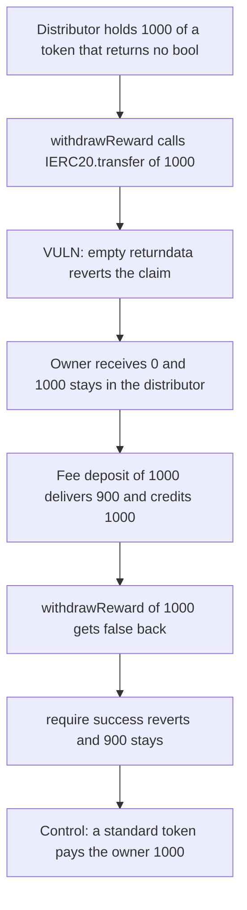

# Cyber Finance: a reward token with no bool return, or a fee, stays locked in the distributor

> **Vulnerability classes:** vuln/dependency/unchecked-return-value · vuln/dos/frozen-funds · vuln/input-validation/wrong-type

<!-- non-defihacklabs -->
<!-- source-auditvault: https://github.com/Auditware/AuditVault/blob/main/findings/37590-non-standard-erc20-tokens-could-be-locked-in-the-contract-zo.md -->
<!-- date: 2024-07 -->

## Key info

| | |
|---|---|
| **Protocol** | Cyber Finance |
| **Finding** | Zokyo, AuditVault 37590 |
| **Vulnerable code** | `RewardDistributor.withdrawReward` |
| **Harm** | 1000 of a no-return reward token stays in the distributor and the owner receives 0. A 1000 deposit of a 10% fee token leaves 900 stuck and the owner receives 0. The same function with a standard token pays the owner 1000 |
| **Chain** | local synthetic |

## TL;DR

`withdrawReward` pays the owner with `IERC20(rewardToken).transfer(owner(), amount)` and then `require(success, "Token transfer failed")`. A token that returns no bool makes that call revert, so 1000 stays in the distributor and the owner receives 0. A fee token that returns false when the balance cannot cover the credited amount hits the same require: a 1000 deposit delivers 900, the withdraw of 1000 reverts, and 900 stays. A standard token that returns true pays the owner 1000 and leaves the distributor at 0.

## The vulnerable code

```solidity
function withdrawReward(uint256 amount) external {
    // @> VULN: high-level transfer requires a bool. Empty returndata reverts this call. A false return fails the require below. Either way the reward balance stays here.
    bool success = IERC20(rewardToken).transfer(owner(), amount);
    require(success, "Token transfer failed");
}
```

The fix is `SafeERC20.safeTransfer(IERC20(rewardToken), owner(), amount)`, which treats empty returndata as success and still reverts when a bool return is false.

## Root cause

The high-level `IERC20.transfer` binding demands 32 bytes of returndata. USDT-style tokens return nothing, so the Solidity call reverts before `success` is stored and the whole claim rolls back. Tokens that were already in the distributor cannot leave through this function. A fee-on-transfer token can return a bool and still fail the require: `deposit` credits the requested 1000, the token keeps 100, and `withdrawReward(1000)` gets `false` because the distributor only holds 900. `require(success)` reverts, so the 900 cannot be paid out either.

## Preconditions

The distributor holds 1000 of the no-return token, sent in by a plain `transfer` that does not go through `IERC20`. The fee path mints 1000 to the caller, approves the distributor, and `deposit`s 1000. The fee is 10 percent of the transferred amount. The control path funds an identical distributor with 1000 of a standard token. `run()` does not warp. The owner is the fixed address `0x0000000000000000000000000000000000000B0b`.

## Attack walkthrough

1. Mint 1000 NRWD to the exploit and transfer it into the no-return distributor.
2. Call `withdrawReward(1000)`. The blamed `transfer` reverts on empty returndata.
3. The distributor still holds 1000. The owner's NRWD balance is 0.
4. Deposit 1000 FRWD. The token delivers 900 and `credited` becomes 1000.
5. Call `withdrawReward(1000)`. `transfer` returns false. `require(success, "Token transfer failed")` reverts.
6. The fee distributor still holds 900. The owner's FRWD balance is 0.
7. The control distributor, holding 1000 of a standard token, calls the same `withdrawReward(1000)`. The owner receives 1000 and the distributor is empty.

## Diagrams



## Impact

The owner cannot withdraw 1000 NRWD. Those tokens remain in the distributor. On the fee path the owner cannot withdraw the 900 FRWD that actually arrived, because the only exit tries to send the credited 1000 and reverts. The same code pays the owner 1000 when the reward token is a standard ERC20.

## How to reproduce

```bash
cd 37590-non-standard-erc20-tokens-could-be-locked-in-the-contract-zo_exp
forge test -vv
```

`run()` does not warp. The no-return distributor ends at 1000, the fee distributor ends at 900, and the control owner ends at 1000.

## Sources

- AuditVault finding: https://github.com/Auditware/AuditVault/blob/main/findings/37590-non-standard-erc20-tokens-could-be-locked-in-the-contract-zo.md
- Zokyo report (Cyber Finance, 25 July 2024): https://github.com/zokyo-sec/audit-reports/blob/main/Cyber%20Finance/Cyber_Finance_Zokyo_audit_report_July25th_2024.pdf
- Solodit mirror: https://github.com/solodit/solodit_content/blob/main/reports/Zokyo/2024-06-25-Cyber%20Finance.md
- The finding quotes the blamed `transfer` line. No audited source commit is attached to the report, so the synthetic keeps that line verbatim.
