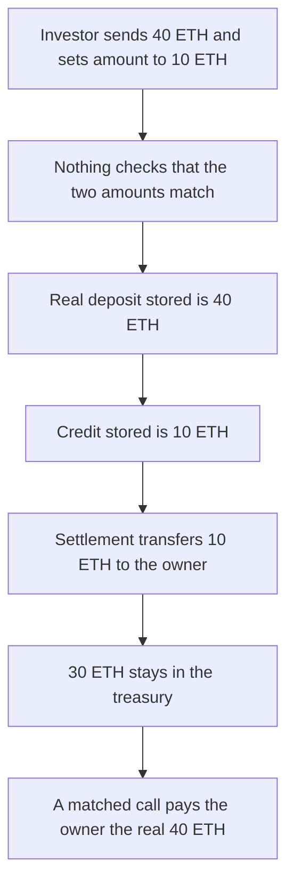

# Devve — settlement pays the claimed amount, not the ETH received

> **Vulnerability classes:** vuln/logic/missing-check · vuln/logic/state-update

> **Reproduction:** a self-contained Foundry PoC that compiles and runs offline
> with only `forge-std` — no fork and no RPC. Trace: [output.txt](output.txt).
> PoC: [test/37615-incorrect-handling-of-investment-amounts-zokyo-none-devve-ma_exp.sol](test/37615-incorrect-handling-of-investment-amounts-zokyo-none-devve-ma_exp.sol).

<!-- non-defihacklabs -->
<!-- source-auditvault: https://github.com/Auditware/AuditVault/blob/main/findings/37615-incorrect-handling-of-investment-amounts-zokyo-none-devve-ma.md -->
<!-- date: 2024-06 -->

---

## Key info

| | |
|---|---|
| **Impact** | **HIGH** — the investor sends **40 ETH** and is credited **10 ETH**. The owner is paid **10 ETH**. **30 ETH** stays in the treasury. The control records and pays the real **40 ETH** |
| **Protocol** | Devve `Treasury.investInProjects` / `settleProjectOwnerFunds` |
| **Vulnerable code** | `msg.value` is not checked against `users.amount`, and settlement transfers `users.amount` |
| **Bug class** | Recorded investment and the ETH actually sent diverge |
| **Finding** | Zokyo — Devve, 30 June 2024 · id 37615 |
| **Report** | [Zokyo Devve, 2024-06-30](https://github.com/solodit/solodit_content/blob/main/reports/Zokyo/2024-06-30-Devve.md) |
| **Source** | [AuditVault finding](https://github.com/Auditware/AuditVault/blob/main/findings/37615-incorrect-handling-of-investment-amounts-zokyo-none-devve-ma.md) |
| **Status** | Resolved. Reproduced here as a local synthetic. |
| **Compiler** | solc 0.8.27, cancun, via IR |

---

## TL;DR

`investInProjects` adds `msg.value` to `investorInvestedAmountPerProjectInETH` and never checks that it equals `users.amount`. `settleProjectOwnerFunds` sets `_amountToWithdraw` to `users.amount` and transfers that.

An investor sends **40 ETH** with `users.amount` of **10 ETH**. The real deposit stored is **40 ETH**. The credit stored is **10 ETH**. Settlement pays the project owner **10 ETH**. The treasury still holds **30 ETH**.

The control requires `msg.value == users.amount` and transfers `investorInvestedAmountPerProjectInETH`. The same **40 ETH** is credited and paid. The treasury ends at **0**.

`run()` does not warp. The 40 ETH is `msg.value` on the single call.

## The vulnerable code

```solidity
function investInProjects(Whitelist memory users) external payable {
    // @> VULN: msg.value is not required to equal users.amount
    investorInvestedAmountPerProjectInETH[users.projectId][msg.sender] += msg.value;
    creditedAmount[users.projectId][msg.sender] = users.amount;
}

function settleProjectOwnerFunds(Whitelist memory users) external {
    uint256 _amountToWithdraw = users.amount;
    // @> VULN: pays users.amount, not investorInvestedAmountPerProjectInETH
    payable(users.userAddress).transfer(_amountToWithdraw);
}
```

The fee check uses `projectTotalCollectedInETH`, which was increased by the real 40 ETH, so a 10 ETH withdrawal passes. The comment on the transfer in the report says that value should be the invested ETH.

## Root cause

Two fields describe one investment and nothing forces them to be equal. The balance mapping follows the ETH that arrived. The payout follows the amount in the calldata. Settlement then moves the calldata amount.

## Preconditions

- `users.amount` is 10 ETH. `msg.value` is 40 ETH. `platformFee` is 0, so the fee does not hide the gap.
- The owner address is the `userAddress` on the whitelist passed to settlement.
- Settlement runs once.
- No timestamp change happens inside `run()`.

## Attack walkthrough

1. The investor calls `investInProjects` with 40 ETH and `amount` 10 ETH.
2. `investorInvestedAmountPerProjectInETH` becomes **40 ETH**. `creditedAmount` becomes **10 ETH**.
3. `settleProjectOwnerFunds` sets `_amountToWithdraw` to **10 ETH** and transfers it to the owner.
4. The owner holds **10 ETH**. The treasury holds **30 ETH**.

Control: `amount` is 40 ETH and `msg.value` is 40 ETH. The credit is **40 ETH**. Settlement transfers the invested balance, **40 ETH**. The treasury holds **0**.

## Diagrams



## Impact

The investor paid **40 ETH** and is credited **10 ETH**. The owner is paid **10 ETH** instead of **40 ETH**. **30 ETH** remains in the treasury.

## Remediation

Require `msg.value == users.amount` in `investInProjects`. In `settleProjectOwnerFunds`, transfer `investorInvestedAmountPerProjectInETH` for that investor, not `users.amount`.

## Sources

- [AuditVault finding 37615](https://github.com/Auditware/AuditVault/blob/main/findings/37615-incorrect-handling-of-investment-amounts-zokyo-none-devve-ma.md)
- [Zokyo, Devve, 30 June 2024](https://github.com/solodit/solodit_content/blob/main/reports/Zokyo/2024-06-30-Devve.md)

### Taxonomy

- `severity/high`
- `vuln/logic/missing-check`
- `vuln/logic/state-update`
