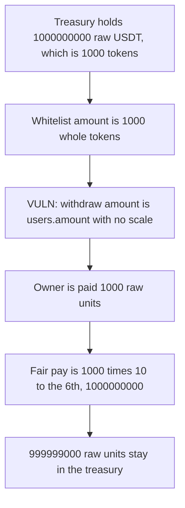

# Devve Treasury — settlement pays USDT with no decimal scale

> **Vulnerability classes:** vuln/arithmetic/decimal-mismatch

<!-- non-defihacklabs -->
<!-- source-auditvault: https://github.com/Auditware/AuditVault/blob/main/findings/37616-missing-decimals-conversion-in-settleprojectownerfunds-zokyo.md -->
<!-- date: 2024-06 -->

## Key info

| | |
|---|---|
| **Protocol** | Devve |
| **Finding** | Zokyo 2024-06-30, AuditVault 37616 |
| **Vulnerable code** | `Treasury.settleProjectOwnerFunds` |
| **Harm** | The project owner is paid 1000 raw USDT units. The fair amount is 1000000000. 999999000 raw units stay in the treasury. |
| **Chain** | local synthetic |

## TL;DR

`settleProjectOwnerFunds` sets `_amountToWithdraw` to `users.amount` and transfers that many token units. `users.amount` is 1000 whole USDT. USDT has 6 decimals, so the owner is owed `1000 * 10**6 = 1000000000` raw units. The transfer sends 1000. The treasury keeps 999999000 raw units, which is 999.999 USDT of a 1000 USDT collection. The control multiplies by `10**decimals` and pays the full 1000000000.

## The vulnerable code

```solidity
uint _amountToWithdraw = users.amount ;
// @> VULN: this posts the unscaled users.amount, not amount times 10**decimals
fundsWithdrawn[users.projectId][users.inETH] += _amountToWithdraw;
projectTotalCollectedInUSDT[users.projectId] -= _amountToWithdraw;
require(usdt.transfer(users.userAddress, _amountToWithdraw), "transfer");
```

The audited assignment is `uint _amountToWithdraw = users.amount`. The compiler inlines that copy into the `fundsWithdrawn` update, which is the executed use of the unscaled amount. Zokyo's fix for USDT is to multiply by `10**6`. The control reads `decimals()` and multiplies by `10**decimals`, which is the same scale for this token.

## Root cause

The amount stored on the whitelist is a whole-token count. The USDT balance is stored in base units. Settlement copies the count into the transfer with no scale. A 6-decimal token makes that transfer one million times too small.

## Preconditions

Project 1 has collected 1000 USDT, seated as 1000000000 raw units. The whitelist amount is 1000. `inETH` is false, so the USDT branch runs. The caller is the treasury owner. The token reports `decimals() == 6`.

## Attack walkthrough

1. The scale `10**decimals` is 1000000. The fair payout is 1000 times that, 1000000000 raw units.
2. Those 1000000000 units are minted onto the treasury and recorded as collected for project 1.
3. Settlement passes the owner check and takes the USDT branch.
4. `_amountToWithdraw` becomes 1000. The USDT transfer sends 1000 raw units to the project owner.
5. The owner holds 1000. The treasury holds 999999000.

The control uses `_amountToWithdraw = users.amount * 10**decimals`. The owner receives 1000000000 and the treasury ends at 0.

## Diagrams



## Impact

The project owner receives 0.001 USDT instead of 1000 USDT. 999.999 USDT remains in the treasury. The same settlement with the decimal scale pays 1000000000 raw units and leaves the treasury empty.

## Remediation

Set `_amountToWithdraw = users.amount * 10 ** usdt.decimals()` before the transfer. For this USDT that is a multiplication by `10**6`.

## How to reproduce

```bash
cd 37616-missing-decimals-conversion-in-settleprojectownerfunds-zokyo_exp
forge test -vv
```

## Sources

- AuditVault finding: https://github.com/Auditware/AuditVault/blob/main/findings/37616-missing-decimals-conversion-in-settleprojectownerfunds-zokyo.md
- Zokyo report: https://github.com/solodit/solodit_content/blob/main/reports/Zokyo/2024-06-30-Devve.md
- Vulnerable function: `Treasury.settleProjectOwnerFunds` in `treasury.sol` around the audited line `uint _amountToWithdraw = users.amount`
