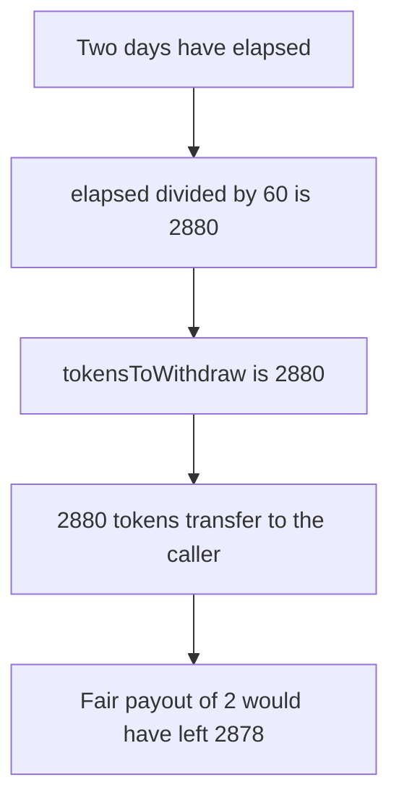

# Devve — airdrop withdrawal counts minutes as days

> **Vulnerability classes:** vuln/logic/reward-calculation · vuln/arithmetic/precision-loss

> **Reproduction:** a self-contained Foundry PoC that compiles and runs offline
> with only `forge-std` — no fork and no RPC. Trace: [output.txt](output.txt).
> PoC: [test/37617-calculation-of-tokenstowithdraw-is-wrong-zokyo-none-devve-ma_exp.sol](test/37617-calculation-of-tokenstowithdraw-is-wrong-zokyo-none-devve-ma_exp.sol).

<!-- non-defihacklabs -->
<!-- source-auditvault: https://github.com/Auditware/AuditVault/blob/main/findings/37617-calculation-of-tokenstowithdraw-is-wrong-zokyo-none-devve-ma.md -->
<!-- date: 2024-06 -->

---

## Key info

| | |
|---|---|
| **Impact** | **HIGH** — two days of vesting pays **2880** tokens instead of **2**. The extra is **2878** |
| **Protocol** | Devve `withdrawAirdropTokens` / `getCurrentAirdropBalance` |
| **Vulnerable code** | `airdropTokensPerDay * (elapsed / 60)` |
| **Bug class** | Minutes used where the formula says days |
| **Finding** | Zokyo — Devve · id 37617 |
| **Report** | [Zokyo Devve, 30 Jun 2024](https://github.com/solodit/solodit_content/blob/main/reports/Zokyo/2024-06-30-Devve.md) |
| **Source** | [AuditVault finding](https://github.com/Auditware/AuditVault/blob/main/findings/37617-calculation-of-tokenstowithdraw-is-wrong-zokyo-none-devve-ma.md) |
| **Status** | The report says the issue was resolved. Reproduced as a local synthetic. |
| **Compiler** | solc 0.8.27, cancun, via IR |

---

## TL;DR

`tokensToWithdraw` is supposed to be `airdropTokensPerDay` times the number of days since the last withdrawal. The code divides the elapsed seconds by **60**. Two days is **172800** seconds, **2880** minutes, and **2** days. The caller receives **2880** tokens. Dividing by one day pays **2** and leaves **2878** in the contract.

`run()` does not warp. The block timestamp is already two days after `lastWithdraw`, which was stored when the contract was constructed. The same clock is used for the preview and the withdrawal.

## The vulnerable code

```solidity
uint256 elapsed = block.timestamp - lastWithdraw[msg.sender];
// @> VULN: tokensToWithdraw multiplies airdropTokensPerDay by minutes, not days
tokensToWithdraw = airdropTokensPerDay * (elapsed / 60);
```

`getCurrentAirdropBalance` uses the same division.

## Root cause

The report says both functions multiply `airdropTokenPerDay` by minutes passed, not by days passed.

## Preconditions

- `airdropTokensPerDay` is **1** token.
- `lastWithdraw` is **172800** seconds before the block timestamp.
- The contract holds at least **2880** tokens.

## Attack walkthrough

1. `getCurrentAirdropBalance` returns **2880** tokens.
2. `withdrawAirdropTokens` computes the same number and transfers it.
3. The contract balance is **0**. The fair amount is **2**.

## Diagrams



## Impact

The caller takes **2878** tokens that the daily rate did not vest. Every other claimant is paid from a balance that is already short.

## Remediation

Divide elapsed time by one day before multiplying by `airdropTokensPerDay`, in both the withdrawal and the view.

## How to reproduce

```bash
cd evm-hack-registry/37617-calculation-of-tokenstowithdraw-is-wrong-zokyo-none-devve-ma_exp
forge test -vv
```

The test warps once, before either contract is constructed. `run()` itself does not warp.

## Sources

- AuditVault finding 37617
- Zokyo, Devve, 30 June 2024
