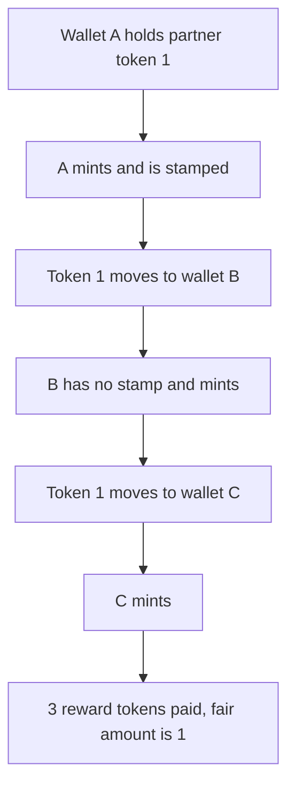

# Heurist — one partner NFT mints again after each transfer

> **Vulnerability classes:** vuln/logic/missing-check · vuln/logic/state-update

> **Reproduction:** a self-contained Foundry PoC that compiles and runs offline
> with only `forge-std` — no fork and no RPC. Trace: [output.txt](output.txt).
> PoC: [test/37688-unrestricted-repeated-minting-via-partner-nft-transfer-explo_exp.sol](test/37688-unrestricted-repeated-minting-via-partner-nft-transfer-explo_exp.sol).

<!-- non-defihacklabs -->
<!-- source-auditvault: https://github.com/Auditware/AuditVault/blob/main/findings/37688-unrestricted-repeated-minting-via-partner-nft-transfer-explo.md -->
<!-- date: 2024-07 -->

---

## Key info

| | |
|---|---|
| **Impact** | **HIGH** — partner token **1** mints **3** times in one block and takes **3** reward tokens. The per-id limit allows **1** |
| **Protocol** | Heurist `partnerFreeMint` |
| **Vulnerable code** | `lastMinted[msg.sender]` |
| **Bug class** | The 24h limit is stored per wallet, not per partner token id |
| **Finding** | Zokyo — Heurist · id 37688 |
| **Report** | [Zokyo Heurist, 1 Jul 2024](https://github.com/solodit/solodit_content/blob/main/reports/Zokyo/2024-07-01-Heurist.md) |
| **Source** | [AuditVault finding](https://github.com/Auditware/AuditVault/blob/main/findings/37688-unrestricted-repeated-minting-via-partner-nft-transfer-explo.md) |
| **Status** | The report says the issue was resolved by tracking each partner token id. Reproduced as a local synthetic. |
| **Compiler** | solc 0.8.27, cancun, via IR |

---

## TL;DR

`partnerFreeMint` requires the caller to hold some partner NFT and stamps `lastMinted` on the caller. It never reads the token id. Transferring partner token **1** to a new wallet gives that wallet a zero stamp, so it can mint immediately. Three wallets mint. The treasury pays **3** reward tokens. A version that stamps the token id reverts the second mint, and **2** tokens stay in the treasury. `run()` does not warp.

## The vulnerable code

```solidity
require(partner.balanceOf(msg.sender) > 0, "partner");
require(lastMinted[msg.sender] == 0 || block.timestamp >= lastMinted[msg.sender] + 1 days, "24h");
// @> VULN: lastMinted is per wallet, so the partner token id is never checked
lastMinted[msg.sender] = block.timestamp == 0 ? 1 : block.timestamp;
```

## Root cause

The report says users transfer the partner NFT between wallets because the contract does not record which token id was used.

## Preconditions

- One partner NFT, id **1**.
- The treasury holds **3** reward tokens, one per mint.
- No wallet has minted yet, so no 24h wait is required for a fresh address.

## Attack walkthrough

1. The first wallet calls `partnerFreeMint` and receives **1** reward token.
2. It transfers partner token **1** to a second wallet.
3. The second wallet mints and forwards the same token to a third wallet.
4. The third wallet mints. `minted` is **3**. The caller holds **3** reward tokens.

## Diagrams



## Impact

One partner NFT produces three free mints and drains **2** extra reward tokens from the treasury.

## Remediation

Store the last mint time under the partner token id, and require the caller to own that id.

## How to reproduce

```bash
cd evm-hack-registry/37688-unrestricted-repeated-minting-via-partner-nft-transfer-explo_exp
forge test -vv
```

## Sources

- AuditVault finding 37688
- Zokyo, Heurist, 1 July 2024, `partnerFreeMint`
