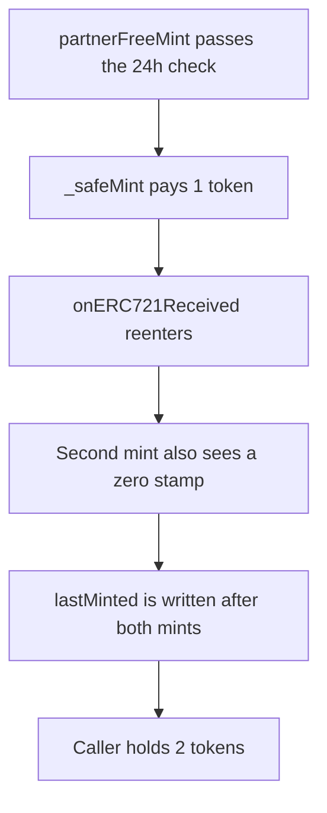

# Heurist — partnerFreeMint reenters before lastMinted is set

> **Vulnerability classes:** vuln/reentrancy/single-function

> **Reproduction:** a self-contained Foundry PoC that compiles and runs offline
> with only `forge-std` — no fork and no RPC. Trace: [output.txt](output.txt).
> PoC: [test/37689-reentrance-in-partnerfreemint-zokyo-none-heurist-markdown_exp.sol](test/37689-reentrance-in-partnerfreemint-zokyo-none-heurist-markdown_exp.sol).

<!-- non-defihacklabs -->
<!-- source-auditvault: https://github.com/Auditware/AuditVault/blob/main/findings/37689-reentrance-in-partnerfreemint-zokyo-none-heurist-markdown.md -->
<!-- date: 2024-07 -->

---

## Key info

| | |
|---|---|
| **Impact** | **HIGH** — one call mints **2** NFTs and pays **2** reward tokens. The 24h limit allows **1** |
| **Protocol** | Heurist `partnerFreeMint` |
| **Vulnerable code** | `lastMinted[msg.sender] = ...` after `_safeMint` |
| **Bug class** | Checks-effects-interactions. The stamp is the effect and it is last |
| **Finding** | Zokyo — Heurist · id 37689 |
| **Report** | [Zokyo Heurist, 1 Jul 2024](https://github.com/solodit/solodit_content/blob/main/reports/Zokyo/2024-07-01-Heurist.md) |
| **Source** | [AuditVault finding](https://github.com/Auditware/AuditVault/blob/main/findings/37689-reentrance-in-partnerfreemint-zokyo-none-heurist-markdown.md) |
| **Status** | The report says the client moved the `lastMinted` write before `_safeMint` and later added a reentrancy guard. Reproduced as a local synthetic. |
| **Compiler** | solc 0.8.27, cancun, via IR |

---

## TL;DR

`partnerFreeMint` calls `_safeMint` and only then writes `lastMinted`. `_safeMint` calls `onERC721Received`. The receiver calls `partnerFreeMint` again. `lastMinted` is still zero, so the 24h check passes. Two NFTs are minted and **2** reward tokens are paid.

Writing `lastMinted` before `_safeMint` makes the reentered call revert. Only **1** token is paid and token id **2** is never created. `run()` does not warp.

## The vulnerable code

```solidity
_safeMint(to);
// @> VULN: lastMinted is written after _safeMint, so the receiver reenters inside the 24h window
lastMinted[msg.sender] = block.timestamp == 0 ? 1 : block.timestamp;
```

## Root cause

The report says `_safeMint` runs before `lastMinted` is updated, so a contract receiver can reenter and bypass the 24 hour limit.

## Preconditions

- The caller holds a partner NFT.
- `lastMinted` for that caller is zero.
- The treasury holds **2** reward tokens.
- The mint recipient is a contract.

## Attack walkthrough

1. `partnerFreeMint` passes the 24h check and calls `_safeMint`.
2. The first reward token is transferred. `onERC721Received` runs.
3. The receiver calls `partnerFreeMint` again. The stamp is still zero.
4. A second NFT and a second reward token are paid.
5. Both frames then write `lastMinted`. The caller holds **2** tokens.

## Diagrams



## Impact

One partner holder mints twice and takes **1** extra reward token. The 24h limit never gets a chance to reject the second mint.

## Remediation

Update `lastMinted` before `_safeMint`, as the report's fix does.

## How to reproduce

```bash
cd evm-hack-registry/37689-reentrance-in-partnerfreemint-zokyo-none-heurist-markdown_exp
forge test -vv
```

## Sources

- AuditVault finding 37689
- Zokyo, Heurist, 1 July 2024, `partnerFreeMint`, fix commit noted as `a27af000`
