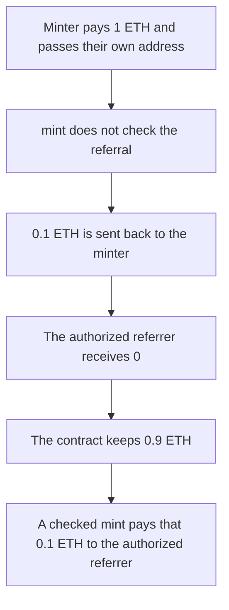

# Heurist — mint pays the referral fee to any address

> **Vulnerability classes:** vuln/input-validation/missing · vuln/logic/fee-calculation

> **Reproduction:** a self-contained Foundry PoC that compiles and runs offline
> with only `forge-std` — no fork and no RPC. Trace: [output.txt](output.txt).
> PoC: [test/37690-insufficient-validation-of-referral-address-in-mint-zokyo-no_exp.sol](test/37690-insufficient-validation-of-referral-address-in-mint-zokyo-no_exp.sol).

<!-- non-defihacklabs -->
<!-- source-auditvault: https://github.com/Auditware/AuditVault/blob/main/findings/37690-insufficient-validation-of-referral-address-in-mint-zokyo-no.md -->
<!-- date: 2024-07 -->

---

## Key info

| | |
|---|---|
| **Impact** | **HIGH** — a self-referral keeps the **0.1 ETH** referral fee. The authorized referrer receives **0**. The checked mint pays that **0.1 ETH** to the real referrer and rejects the caller and `address(0)` |
| **Protocol** | Heurist `ZkImagine.mint` |
| **Vulnerable code** | `mint` forwards the referral fee to the passed address with no check |
| **Bug class** | Referral address is not validated |
| **Finding** | Zokyo — Heurist, 1 July 2024 · id 37690 |
| **Report** | [Zokyo Heurist, 2024-07-01](https://github.com/solodit/solodit_content/blob/main/reports/Zokyo/2024-07-01-Heurist.md) |
| **Source** | [AuditVault finding](https://github.com/Auditware/AuditVault/blob/main/findings/37690-insufficient-validation-of-referral-address-in-mint-zokyo-no.md) |
| **Status** | Acknowledged. Reproduced here as a local synthetic. |
| **Compiler** | solc 0.8.27, cancun, via IR |

---

## TL;DR

`mint` charges **1 ETH** and forwards **0.1 ETH** (10 percent) to the referral address. That address is not checked. It can be the minter, `address(0)`, or any other account.

The minter passes their own address. The contract sends the **0.1 ETH** referral fee back to them. The authorized referrer’s balance stays **0**. The contract keeps the other **0.9 ETH**, and one NFT is minted.

The control rejects the caller and `address(0)`, requires an authorized referrer, and pays that referrer the same **0.1 ETH**.

`run()` does not warp. The 1 ETH is `msg.value` on the single call.

## The vulnerable code

```solidity
function mint(address referral) external payable {
    require(msg.value == MINT_FEE, "fee");
    // @> VULN: referral is not checked, so the minter can pass their own address
    (bool ok,) = referral.call{value: REFERRAL_FEE}("");
    require(ok, "pay");
    minted[msg.sender] += 1;
}
```

`MINT_FEE` is 1 ETH. `REFERRAL_FEE` is 0.1 ETH. An authorized referrer is stored and never read.

The fixed mint reverts unless `referral` is nonzero, is not the caller, and is authorized. The same 0.1 ETH is then sent to that referrer.

## Root cause

The discount is implemented as a payment to an address chosen by the buyer. Nothing ties that address to a referrer the protocol actually registered, and nothing stops the buyer from naming themselves.

## Preconditions

- Mint fee is 1 ETH. The referral cut is 0.1 ETH.
- An authorized referrer exists. `mint` does not consult that flag.
- The caller can receive ETH.
- No timestamp change happens inside `run()`.

## Attack walkthrough

1. The minter calls `mint` with 1 ETH and their own address.
2. The fee check passes. The referral is not compared to the caller or to the authorized referrer.
3. **0.1 ETH** is sent to the minter. The contract keeps **0.9 ETH**.
4. The authorized referrer’s balance is **0**. One NFT was minted.

Control: `mint(minter)` and `mint(address(0))` revert. `mint(authorized)` pays **0.1 ETH** to that referrer and leaves **0.9 ETH** in the contract.

## Diagrams



## Impact

The **0.1 ETH** referral fee is paid to the minter. The authorized referrer receives nothing. The same mint, with the check, pays that **0.1 ETH** to the referrer and refuses the caller and `address(0)`.

## Remediation

Reject `address(0)` and the caller. Pay the referral fee only to an authorized referrer.

## Sources

- [AuditVault finding 37690](https://github.com/Auditware/AuditVault/blob/main/findings/37690-insufficient-validation-of-referral-address-in-mint-zokyo-no.md)
- [Zokyo, Heurist, 1 July 2024](https://github.com/solodit/solodit_content/blob/main/reports/Zokyo/2024-07-01-Heurist.md)

### Taxonomy

- `severity/high`
- `vuln/input-validation/missing`
- `vuln/logic/fee-calculation`
