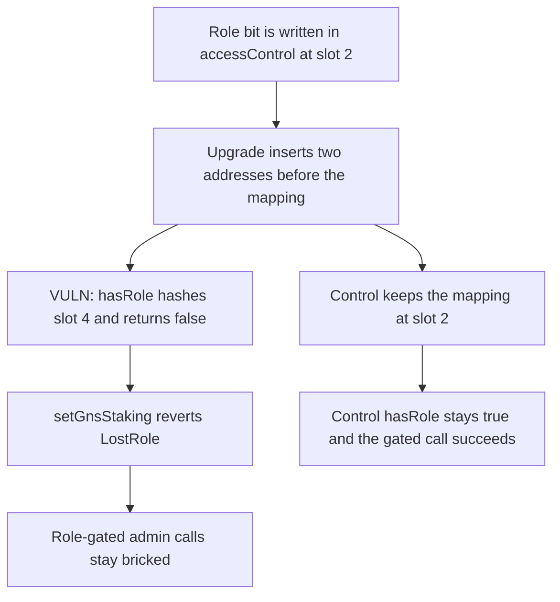

# Gains Network: proxy upgrade moves accessControl and drops every role

> **Vulnerability classes:** `vuln/access-control/proxy-storage-collision` · `vuln/access-control/missing-auth`

<!-- non-defihacklabs -->
<!-- source-auditvault: https://github.com/Auditware/AuditVault/blob/main/findings/37790-h-01-lost-roles-after-the-proxy-upgrade-pashov-audit-group-n.md -->
<!-- date: 2024-02 -->

## Key info

| Field | Value |
|---|---|
| **Loss** | No tokens move. The ROLES_MANAGER gate stops working |
| **Vulnerable contract** | `StoreV2.hasRole` (upgraded `AddressStore`) |
| **Attacker EOA** | `0x1111111111111111111111111111111111111111` (stands in for the proxy admin) |
| **Attack contract** | `Exploit` |
| **Attack tx** | `Exploit.run()` |
| **Chain / block / date** | Ethereum model of the Arbitrum diamond · block 0 · 2024-02 |
| **Compiler** | solc 0.8.27, cancun, via IR |
| **Bug class** | Storage layout shift of a mapping across an upgrade |

## TL;DR

The live `GNSMultiCollatDiamond` keeps `accessControl` at storage slot 2. The upgrade inserts `gnsStaking` and `linkErc677` in front of that mapping, so `hasRole` hashes slot 4. The manager's role bit is still in the proxy, but every role-gated call reverts until a later upgrade puts the mapping back.

## Background

Pashov Audit Group's February 2024 Gains Network review, finding H-01. The deployed diamond on Arbitrum is `0xFF162c694eAA571f685030649814282eA457f169`. The report's test grants `Role.ROLES_MANAGER` to `0x1632C38cB208df8409753729dBfbA5c58626F637` and shows `hasRole` flipping after `upgradeTo`. This reduction uses the same slot arithmetic with a minimal EIP-1967 proxy. No funds move; the harm is that role-gated admin calls brick.

## The vulnerable code

```solidity
function hasRole(address account, uint8 role) external view returns (bool) {
    return accessControl[account][role]; // @> VULN: hasRole now hashes slot 4; the granted role is still stored at slot 2
}
```

`StoreV1` packs the initializer into slot 0, `gns` into slot 1, and the mapping into slot 2. `StoreV2` adds two addresses before the mapping, so the mapping base becomes slot 4. The recommended fix appends the new addresses after the mapping.

```diff
- address gnsStaking;
- address linkErc677;
  mapping(address => mapping(uint8 => bool)) accessControl;
+ address gnsStaking;
+ address linkErc677;
```

## Root cause

Mapping keys are hashed with the mapping's own slot. Moving the slot makes every previously written key read as empty. The upgrade does not copy the old slots.

## Preconditions

- The proxy already stores a role grant under the slot-2 layout.
- The new implementation inserts variables ahead of `accessControl`.
- A role-gated function is called after the upgrade.

## Attack walkthrough

1. The proxy is pointed at `StoreV1` and the manager is granted `ROLES_MANAGER`. `setGnsStaking` succeeds.
2. The proxy is upgraded to `StoreV2` with no storage migration.
3. `hasRole` reads slot 4 and returns false.
4. `setGnsStaking` hits the same empty mapping and reverts `LostRole`.

## Diagrams



## Impact

The manager who could call role-gated functions before the upgrade cannot call them after it. Trading admin actions that depend on `ROLES_MANAGER` are unavailable until another upgrade restores the layout. The report states that funds are not at risk; this run shows the same thing: the role bit is stranded and the gate reverts.

## Remediation

Add `gnsStaking` and `linkErc677` after `accessControl`, which is the layout in `StoreFixed`. The control upgrade keeps `hasRole` true and `setGnsStaking` succeeds.

## How to reproduce

```bash
cd 37790-h-01-lost-roles-after-the-proxy-upgrade-pashov-audit-group-n_exp
forge test -vv
```

`test_exploit_upgrade_drops_role_and_bricks_gate` asserts the role is true before the upgrade and false after, and that the gated call reverts. `test_control_mapping_kept_at_slot_2` asserts the fixed layout keeps the role. Captured output is `output.txt`.

## Sources

- AuditVault finding: https://github.com/Auditware/AuditVault/blob/main/findings/37790-h-01-lost-roles-after-the-proxy-upgrade-pashov-audit-group-n.md
- Pashov report: https://github.com/pashov/audits/blob/master/team/md/GainsNetwork-security-review-February.md
- Audited tree: https://github.com/GainsNetwork-org/gTrade-contracts/tree/725b997cfc632361a0e01b3d996f63bc09783e3c
- Blamed struct: `IAddressStore.sol` `Addresses` / `AddressStore.accessControl`
