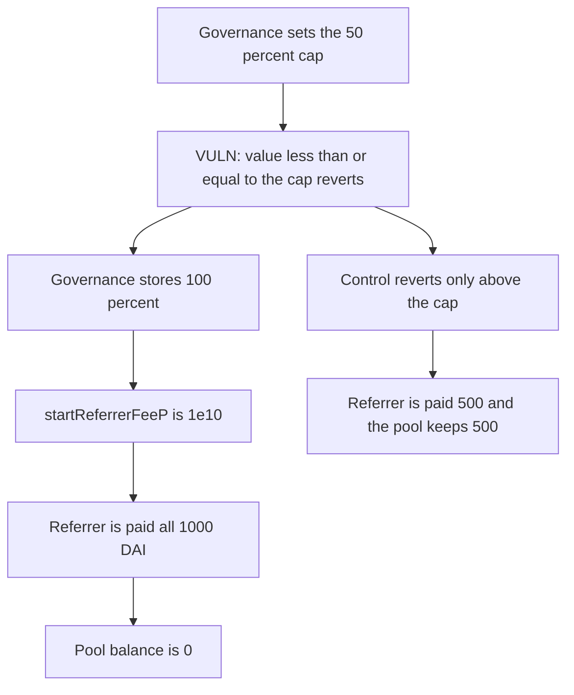

# Gains Network: updateStartReferrerFeeP rejects every in-range fee

> **Vulnerability classes:** `vuln/logic/wrong-condition` · `vuln/logic/fee-calculation`

<!-- non-defihacklabs -->
<!-- source-auditvault: https://github.com/Auditware/AuditVault/blob/main/findings/37791-h-02-referralsutilsupdatestartreferrerfeep-implements-wrong.md -->
<!-- date: 2024-02 -->

## Key info

| Field | Value |
|---|---|
| **Loss** | The referrer is paid 1000 DAI of a 1000 DAI referral budget. The 50% cap would have paid 500 and left 500 in the pool |
| **Vulnerable contract** | `ReferralsUtils.updateStartReferrerFeeP` |
| **Attacker EOA** | `0x1111111111111111111111111111111111111111` (governance caller) |
| **Attack contract** | `Exploit` |
| **Attack tx** | `Exploit.run()` |
| **Chain / block / date** | Ethereum model · block 0 · 2024-02 |
| **Compiler** | solc 0.8.27, cancun, via IR |

## TL;DR

The setter reverts when `_value <= MAX_START_REFERRER_FEE_P` and stores every larger value. The published cap is 50% (`5e9` on the `1e10` scale). Setting that cap reverts with `AboveMax`. Setting 100% (`1e10`) succeeds. `distributeReferralReward` then pays `budget * startReferrerFeeP / 1e10`, which is the entire 1000 DAI budget. The capped formula pays 500.

## The vulnerable code

```solidity
function updateStartReferrerFeeP(uint256 _value) external {
    require(msg.sender == gov, "gov");
    if (fixedMode) {
        if (_value > MAX_START_REFERRER_FEE_P) revert AboveMax();
    } else if (_value <= MAX_START_REFERRER_FEE_P) {
        revert AboveMax(); // @> VULN: in-range fees revert and above-cap fees are stored
    }
    startReferrerFeeP = _value;
}
```

The review's change is the comparison direction:

```diff
- if (_value <= MAX_START_REFERRER_FEE_P) revert AboveMax();
+ if (_value > MAX_START_REFERRER_FEE_P) revert AboveMax();
```

`MAX_START_REFERRER_FEE_P` in this reduction is `5e9` (50%) and `PRECISION` is `1e10`, matching gTrade's 1e10 percentage scale. The audited function is `internal` and is reached from the referrals facet.

## Root cause

The error name `AboveMax` describes the check that was intended. The operator is `<=`, so every value inside the cap, including the cap itself, takes the revert, and every value the cap was meant to reject is written. `startReferrerFeeP` is the fraction of the referral budget paid when referred volume is still zero.

## Preconditions

- Governance can call the setter. The bug is the bound, not an open function.
- The referrals contract holds a 1000 DAI referral budget.
- The referrer is a separate account from the pool.

## Attack walkthrough

1. Governance sets `MAX_START_REFERRER_FEE_P` (`5e9`). The call reverts.
2. Governance sets `PRECISION` (`1e10`). The inverted check accepts it.
3. `startReferrerFeeP` is `1e10`.
4. `distributeReferralReward(1000 ether)` computes `1000 * 1e10 / 1e10` and transfers 1000 DAI to the referrer.
5. The pool balance is 0.
6. The control accepts `5e9`, reverts on `1e10`, and pays the referrer 500 DAI.

## Diagrams



## Impact

The referrer receives 1000 DAI. Half of that budget was supposed to stay in the referrals pool under the published cap. The same inverted comparison is reported on `updateReferralsOpenFeeP` in the same review. This run shows the start-referrer setter only.

## How to reproduce

```bash
cd 37791-h-02-referralsutilsupdatestartreferrerfeep-implements-wrong_exp
forge test -vv
```

`test_exploit_above_cap_fee_pays_the_whole_budget` asserts the 50% write reverts, 100% is stored, and the referrer receives 1000 DAI. `test_control_cap_is_accepted_and_100_percent_reverts` asserts the cap is stored, 100% reverts, and the referrer receives 500 DAI.

## Sources

- AuditVault finding: https://github.com/Auditware/AuditVault/blob/main/findings/37791-h-02-referralsutilsupdatestartreferrerfeep-implements-wrong.md
- Pashov review: https://github.com/pashov/audits/blob/master/team/md/GainsNetwork-security-review-February.md
- Reviewed tree: https://github.com/GainsNetwork-org/gTrade-contracts/tree/725b997cfc632361a0e01b3d996f63bc09783e3c
- The review file is named February and was in the pashov repo before 2024-09, so the date marker is 2024-02.
