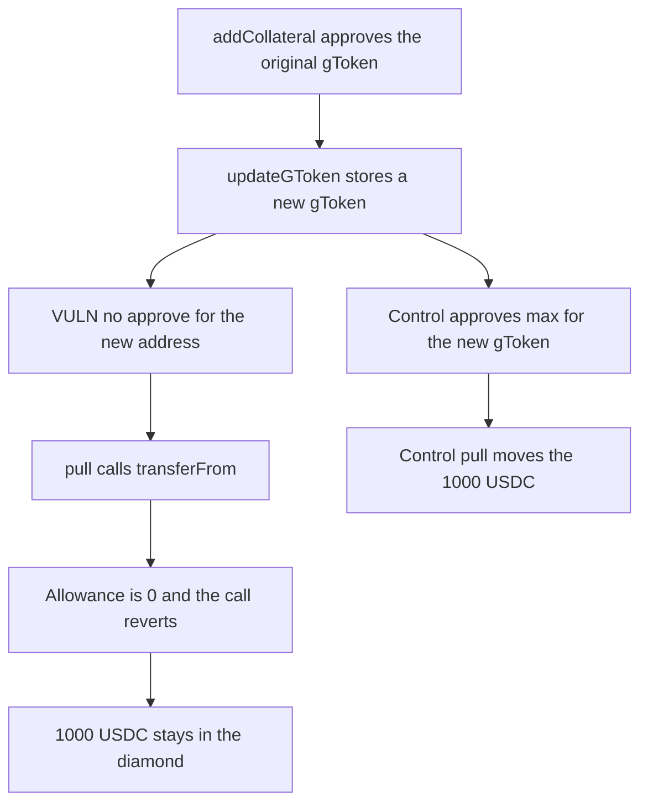

# Gains Network: updateGToken never approves the new gToken

> **Vulnerability classes:** `vuln/logic/missing-allowance`

<!-- non-defihacklabs -->
<!-- source-auditvault: https://github.com/Auditware/AuditVault/blob/main/findings/37793-h-04-collateral-not-approved-after-updating-of-gtoken-addres.md -->
<!-- date: 2024-02 -->

## Key info

| Field | Value |
|---|---|
| **Loss** | 1,000 USDC stays in the diamond. The new gToken allowance is 0 and pull reverts |
| **Vulnerable contract** | `TradingStorage.updateGToken` |
| **Attacker EOA** | `0x1111111111111111111111111111111111111111` |
| **Attack contract** | `Exploit` |
| **Attack tx** | `Exploit.run()` |
| **Chain / block / date** | Ethereum model · block 0 · 2024-02 |
| **Compiler** | solc 0.8.27, cancun |
| **Bug class** | gToken pointer is replaced without collateral.approve |

## TL;DR

`addCollateral` approves the gToken for `type(uint256).max`. `updateGToken` writes the new address into `gTokens[index]` and does not approve it. The new gToken's `transferFrom` of the 1,000 USDC sitting in the diamond reverts. The collateral cannot move.

## The vulnerable code

```solidity
gTokens[index] = _gToken; // @> VULN: new gToken stored, collateral.approve is never called
```

```diff
  gTokens[index] = _gToken;
+ collateral.approve(_gToken, type(uint256).max);
```

## Root cause

The allowance is granted only in `addCollateral`, to the address passed at that moment. Replacing the stored gToken does not move or extend that allowance. The old gToken remains approved. The new one has allowance 0.

## Preconditions

- The diamond holds `1000e6` collateral.
- `addCollateral` already approved the old gToken and the staking address.
- Governance calls `updateGToken` with a non-zero new gToken.

## Attack walkthrough

1. `updateGToken` passes the index and zero-address checks.
2. `gTokens[1]` becomes the new gToken. No `approve` runs.
3. The new gToken calls `pull` for `1000e6`.
4. `transferFrom` reverts on allowance.
5. The diamond still holds `1000e6` and the new gToken holds 0.
6. The control approves during `updateGToken` and the pull succeeds.

## Diagrams



## Impact

After a gToken rotation, the new vault cannot pull collateral out of the diamond. The 1,000 USDC in this run stays put. Users who depend on the new gToken to move that collateral cannot withdraw or settle through it.

## How to reproduce

```bash
cd 37793-h-04-collateral-not-approved-after-updating-of-gtoken-addres_exp
forge test -vv
```

`output.txt` is the captured passing run. The control test checks the recommended fix.

## Sources

- AuditVault finding: https://github.com/Auditware/AuditVault/blob/main/findings/37793-h-04-collateral-not-approved-after-updating-of-gtoken-addres.md
- Report: https://github.com/pashov/audits/blob/master/team/md/GainsNetwork-security-review-February.md
- Provenance: Pashov Gains Network February review, TradingStorageUtils.updateGToken. The blamed function is quoted in the finding.
