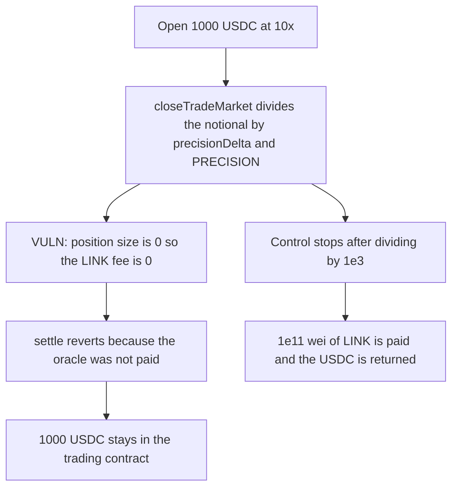

# closeTradeMarket quotes a zero LINK fee and the 1000 USDC close never settles

> **Vulnerability classes:** vuln/logic/fee-calculation · vuln/dos/frozen-funds

<!-- non-defihacklabs -->
<!-- source-auditvault: https://github.com/Auditware/AuditVault/blob/main/findings/37794-h-05-closetrademarket-providing-wrong-value-when-triggering.md -->
<!-- date: 2024-09 -->

## Key info

| Field | Value |
|---|---|
| **Loss** | 1000 USDC stuck pending a close whose oracle fee is 0 instead of 1e11 wei of LINK |
| **Vulnerable contract** | `Trading.closeTradeMarket` |
| **Attacker EOA** | `0x1111111111111111111111111111111111111111` |
| **Attack contract** | `Exploit` |
| **Attack tx** | `Exploit.run()` |
| **Chain / block / date** | Ethereum model · block 0 · 2024-09 |
| **Compiler** | solc 0.8.27, cancun, via IR |
| **Bug class** | Oracle notional is divided by `precisionDelta` and `PRECISION` again |

## TL;DR

`getLinkFee` expects the position size in collateral precision. `closeTradeMarket` passes `(collateral * leverage) / 1e3 / precisionDelta / PRECISION`. For 1000 USDC at 10x, with `precisionDelta` of 1e12 and `PRECISION` of 1e10, that quotient is 0. The LINK fee is 0 instead of 1e11 wei. Settlement refuses an unpaid oracle request, so the 1000 USDC stays in the trading contract. The control passes the notional without those extra divisions, pays 1e11 LINK, and returns the USDC.

## Background

Pashov Audit Group's Gains Network gTrade review, finding H-05. The report file was published to the audits repo on 9 September 2024. `closeTradeMarket` builds a Chainlink request and the node fee is `getLinkFee` of the position size. The same extra division by `precisionDelta` and `PRECISION` is what the report's C-01 shows rounding USDC collateral to 0.

## The vulnerable code

```solidity
uint256 positionSize = (collateralAmount * leverage) / 1e3 / PRECISION_DELTA / PRECISION;
// @> VULN: getPrice is given a notional already divided by precisionDelta and PRECISION, so the LINK fee is 0
linkPaid = getLinkFee(positionSize);
```

`getLinkFee` multiplies that size by the oracle fee, converts it with the 1e12 USDC precision delta, and divides by the LINK/USD price, `PRECISION`, and 100. A zero size produces a zero fee. `settle` requires `linkPaid > 0`.

## Root cause

The recommended argument is `(collateralAmount * leverage) / 1e3`, which keeps collateral precision. The live call divides twice more. `1000e6 * 10000 / 1000 / 1e12 / 1e10` is 0. The undivided notional is 1e10, which is 10000 USDC, and the fee on that notional is 1e11 wei of LINK.

## Preconditions

- Collateral is 6-decimal USDC, so `precisionDelta` is 1e12 and `PRECISION` is 1e10.
- The trade is 1000 USDC at 10x, stored leverage 10000.
- The trading contract holds enough LINK to pay the correct fee. It is not asked to, because the quoted fee is 0.

## Attack walkthrough

1. `fairFee` on the undivided notional is 1e11 wei of LINK.
2. The trader opens the position. 1000 USDC moves into the trading contract.
3. `closeTradeMarket` computes a position size of 0 and stores `linkPaid = 0`. No LINK is sent to the oracle.
4. `settle` reverts on `linkPaid > 0`. The close stays pending.
5. The trader's USDC balance is 0. The trading contract still holds 1000 USDC. The oracle's LINK balance is 0.
6. The control uses `(collateral * leverage) / 1e3`, pays 1e11 LINK to the oracle, and returns the 1000 USDC.

## Diagrams



## Impact

The trader cannot finish the market close. 1000 USDC of margin stays in the trading contract, and the oracle is paid 0 instead of 1e11 wei of LINK. The control pays that fee and returns the full 1000 USDC.

## Remediation

Pass `(collateralAmount * leverage) / 1e3` into `getPrice`, which is the change recommended on H-05. Do not divide by `precisionDelta` or `PRECISION` again.

## How to reproduce

```bash
cd 37794-h-05-closetrademarket-providing-wrong-value-when-triggering_exp
forge test
```

`test_exploit_zero_link_fee_locks_usdc_collateral` asserts a 0 fee, a fair fee of 1e11, a reverted settle, and 1000 USDC locked. `test_control_collateral_precision_pays_link_and_returns_usdc` asserts the oracle receives 1e11 wei and the trader receives the USDC. Captured output is `output.txt`.

## Sources

- AuditVault finding: https://github.com/Auditware/AuditVault/blob/main/findings/37794-h-05-closetrademarket-providing-wrong-value-when-triggering.md
- Report: https://github.com/pashov/audits/blob/master/team/md/GainsNetwork-security-review-February.md
