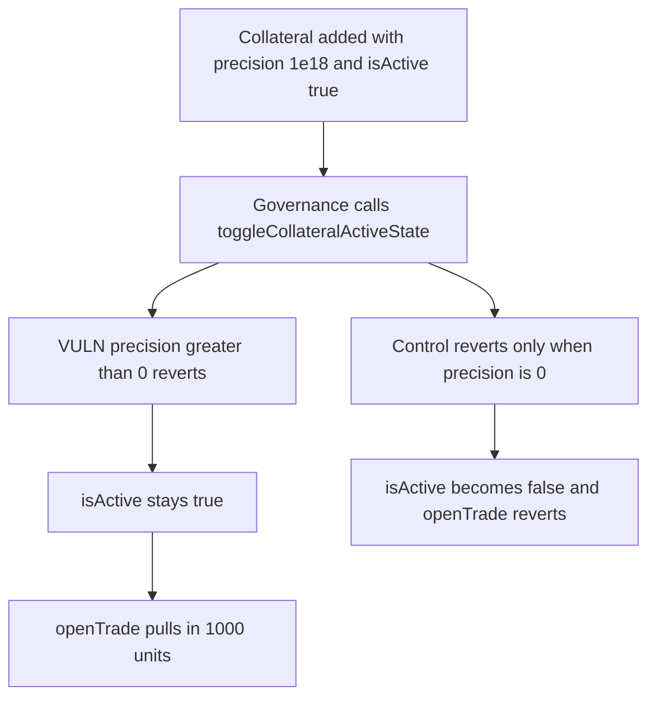

# Gains Network: the collateral kill switch reverts, and a 1000-unit trade still opens

> **Vulnerability classes:** `vuln/logic/wrong-condition` · `vuln/logic/incorrect-state-transition`

<!-- non-defihacklabs -->
<!-- source-auditvault: https://github.com/Auditware/AuditVault/blob/main/findings/37795-h-06-wrong-validation-in-togglecollateralactivestate-pashov.md -->
<!-- date: 2024-02 -->

## Key info

| Field | Value |
|---|---|
| **Loss** | 1000 units of collateral are accepted into a new trade after governance tried to disable it |
| **Vulnerable contract** | `TradingStorage.toggleCollateralActiveState` |
| **Attacker EOA** | `0x1111111111111111111111111111111111111111` (the trader) |
| **Attack contract** | `Exploit` |
| **Attack tx** | `Exploit.run()` |
| **Chain / block / date** | Ethereum model · block 0 · 2024-02 |
| **Compiler** | solc 0.8.27, cancun, via IR |
| **Bug class** | Existence check uses `precision > 0` instead of `precision == 0` |

## TL;DR

`toggleCollateralActiveState` is the emergency switch that should flip `isActive` and stop new trades in a collateral. It reverts with `DoesntExist` when `precision > 0`. Precision is set for every collateral that was added, so the switch never flips `isActive`. A trader then opens a 1000-unit trade and the vault holds the collateral. The fixed check reverts only when precision is 0. The same toggle clears `isActive`, and the same `openTrade` reverts.

## Background

Pashov Audit Group's February 2024 Gains Network review of `GainsNetwork-org/gTrade-contracts` at `725b997cfc632361a0e01b3d996f63bc09783e3c`, finding H-06. The report says governance must be able to disable a collateral in an emergency such as a stablecoin depeg, and that the current check makes that impossible for every existing collateral.

This run calls the toggle the way governance would, then shows the permissionless `openTrade` that the toggle was supposed to block. The trader does not need a privileged role.

## The vulnerable code

```solidity
function toggleCollateralActiveState(uint8 _collateralIndex) external {
    Collateral storage collateral = collaterals[_collateralIndex];
    // @> VULN: precision is > 0 for every collateral that was added, so the toggle always reverts
    if (collateral.precision > 0) revert DoesntExist();
    bool toggled = !collateral.isActive;
    collateral.isActive = toggled;
}
```

The report's fix:

```diff
- if (collateral.precision > 0) revert DoesntExist();
+ if (collateral.precision == 0) revert DoesntExist();
```

## Root cause

`addCollateral` stores a non-zero precision and sets `isActive` true. The toggle treats that non-zero precision as "this collateral does not exist" and reverts before the flip. `openTrade` only checks `isActive`, which is still true.

## Preconditions

- Collateral index 1 exists with precision `1e18` and `isActive` true. That is the state after `addCollateral`.
- Governance calls the toggle. The call reverts. No other role is required for the trade that follows.
- The trader has 1000 units of the collateral and opens a trade on index 1.

## Attack walkthrough

1. Collateral index 1 is added with precision `1e18` and `isActive` true.
2. The toggle is called. `precision > 0` is true, so it reverts with `DoesntExist`.
3. A fresh read still shows precision `1e18` and `isActive` true.
4. The trader approves and calls `openTrade` for 1000 units.
5. `openTrade` sees `isActive` and pulls 1000 units into trading storage.
6. The control uses `precision == 0` for the missing-collateral check. The toggle sets `isActive` false, and `openTrade` reverts with `inactive`.

## Diagrams



## Impact

Trading storage holds 1000 units of a collateral governance tried to disable. New trades in that collateral keep opening. In the depeg case the report describes, the vault keeps taking exposure it was supposed to freeze. The control vault holds 0 and the open reverts.

## Remediation

Revert when `collateral.precision == 0`, which is the empty slot, and flip `isActive` for every collateral that was actually added. That is the one-line change in H-06.

## How to reproduce

```bash
cd 37795-h-06-wrong-validation-in-togglecollateralactivestate-pashov_exp
forge test -vv
```

`test_exploit_toggle_reverts_and_1000_collateral_trade_opens` asserts the toggle reverts, `isActive` stays true, and the vault holds 1000. `test_control_precision_eq_zero_disables_collateral` asserts `isActive` is false and `openTrade` reverts. Captured output is `output.txt`.

## Sources

- AuditVault finding: https://github.com/Auditware/AuditVault/blob/main/findings/37795-h-06-wrong-validation-in-togglecollateralactivestate-pashov.md
- Pashov report: https://github.com/pashov/audits/blob/master/team/md/GainsNetwork-security-review-February.md
- Reviewed tree: https://github.com/GainsNetwork-org/gTrade-contracts/tree/725b997cfc632361a0e01b3d996f63bc09783e3c
