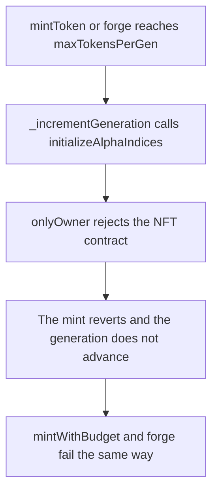

# TraitForge: onlyOwner on initializeAlphaIndices bricks mint, budget mint, and forge

> **Vulnerability classes:** `vuln/access-control/broken-logic`

<!-- non-defihacklabs -->
<!-- source-auditvault: https://github.com/Auditware/AuditVault/blob/main/findings/37920-h-06-minttoken-mintwithbudget-and-forge-in-the-traitforgenft.md -->
<!-- date: 2024-07 -->

## Key info

| Field | Value |
|---|---|
| **Loss** | mintToken, mintWithBudget, and forge all revert. No NFT is issued once a generation fills |
| **Vulnerable contract** | `EntropyGenerator.initializeAlphaIndices` |
| **Attacker EOA** | `0x1111111111111111111111111111111111111111` |
| **Attack contract** | `Exploit` |
| **Attack tx** | `Exploit.run()` |
| **Chain / block / date** | Local synthetic · 2024-07 |
| **Compiler** | solc 0.8.27, cancun, via IR |
| **Bug class** | The NFT contract calls a function gated by onlyOwner |

## TL;DR

`initializeAlphaIndices` is `whenNotPaused onlyOwner`. `TraitForgeNft._incrementGeneration` is what calls it, after `generationMintCounts` reaches `maxTokensPerGen`. The NFT contract is `allowedCaller`, not the owner. With the cap set to 1, the first `mintToken`, `mintWithBudget`, and `forge` each hit the cap, call the entropy contract, and revert on `onlyOwner`. No generation advances and `initialized` stays false. Replacing the modifier with `onlyAllowedCaller` lets the same mint open generation 2.

## The vulnerable code

```solidity
modifier onlyOwner() {
    require(msg.sender == owner, "onlyOwner"); // @> VULN
    _;
}

function initializeAlphaIndices() public whenNotPaused onlyOwner {
    initialized = true;
}
```

```solidity
entropyGenerator.initializeAlphaIndices();
```

The recommended change is `onlyAllowedCaller`. The control sets that path and `tryMint` returns true, `fixedInitialized` is true, and `currentGeneration` is 2.

## Root cause

The function was given the owner's modifier instead of the modifier that names the NFT contract. Every mint path that rolls a generation depends on that call succeeding.

## Preconditions

- `allowedCaller` is the NFT contract. `owner` is a different address.
- `maxTokensPerGen` is reached by the mint being attempted. The audited code uses a large cap; this run sets it to 1 so the roll happens on the first mint. The revert is the same one the report describes.

## Attack walkthrough

1. `tryMint` calls `mintToken`. The generation count becomes 1, which is the cap, so `_incrementGeneration` runs.
2. The NFT calls `initializeAlphaIndices`. `whenNotPaused` passes. `onlyOwner` sees the NFT as `msg.sender` and reverts.
3. The mint rolls back. `tryMintWithBudget` and `tryForge` do the same thing.
4. `failedMints` is 3. Generation is still 1. No index was initialized.

## Diagrams



## Impact

Users cannot mint, mint against a budget, or forge once a generation is full. With a cap of 1 that is immediate: all three entry points revert and the collection cannot issue the next token. This is a liveness break of the core issuance functions, not a token profit, so the Playground profit is 0.

## How to reproduce

```bash
cd 37920-h-06-minttoken-mintwithbudget-and-forge-in-the-traitforgenft_exp
forge test -vv
```

## Sources

- AuditVault finding: https://github.com/Auditware/AuditVault/blob/main/findings/37920-h-06-minttoken-mintwithbudget-and-forge-in-the-traitforgenft.md
- Report: https://code4rena.com/reports/2024-07-traitforge
- Blamed line: https://github.com/code-423n4/2024-07-traitforge/blob/279b2887e3d38bc219a05d332cbcb0655b2dc644/contracts/EntropyGenerator/EntropyGenerator.sol#L206
- Call site: https://github.com/code-423n4/2024-07-traitforge/blob/279b2887e3d38bc219a05d332cbcb0655b2dc644/contracts/TraitForgeNft/TraitForgeNft.sol#L353
