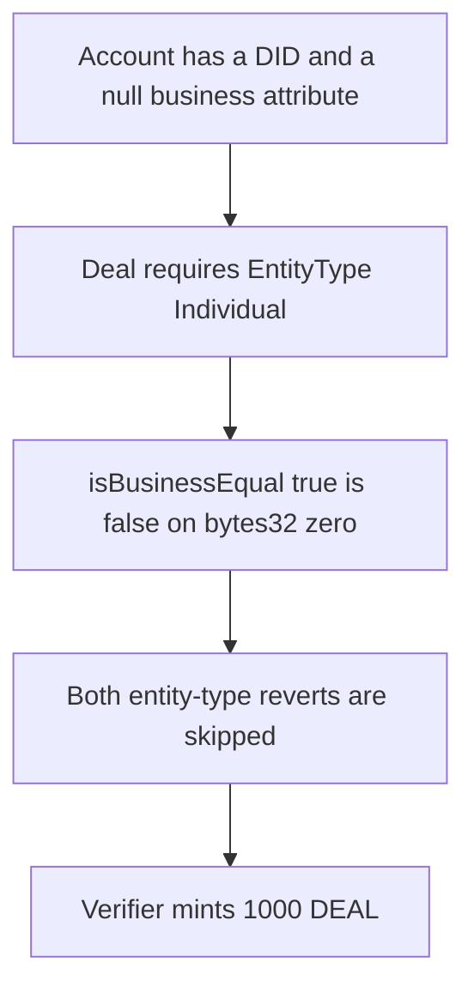

# Tradable — a null Quadrata business attribute passes an Individual-only deal

> **Vulnerability classes:** `vuln/access-control/broken-logic` · `vuln/logic/missing-validation`

> **Reproduction:** a self-contained Foundry PoC that compiles and runs offline
> with only `forge-std` — no fork and no RPC. Trace: [output.txt](output.txt).
> PoC: [test/37958-bypass-of-entitytype-check-when-null-attribute-is-returned-b_exp.sol](test/37958-bypass-of-entitytype-check-when-null-attribute-is-returned-b_exp.sol).

<!-- non-defihacklabs -->
<!-- source-auditvault: https://github.com/Auditware/AuditVault/blob/main/findings/37958-bypass-of-entitytype-check-when-null-attribute-is-returned-b.md -->
<!-- date: 2024-07 -->

---

## Key info

| | |
|---|---|
| **Impact** | **HIGH** — an account with no business attribute receives **1,000 DEAL** from an Individual-only allocation |
| **Protocol** | Tradable onchain v2, `QuadrataKYCVerifier` |
| **Vulnerable code** | `isBusiness = isBusinessEqual(true) && !expired` |
| **Bug class** | Null Quadrata attribute is treated as "not a business" |
| **Finding** | Spearbit / Cergyk — Tradable, July 2024 · id 37958 |
| **Report** | [Tradable Spearbit review](https://github.com/spearbit/portfolio/blob/master/pdfs/Tradable-Spearbit-Security-Review-July2024.pdf) |
| **Source** | [AuditVault finding](https://github.com/Auditware/AuditVault/blob/main/findings/37958-bypass-of-entitytype-check-when-null-attribute-is-returned-b.md) |
| **Compiler** | solc 0.8.27, cancun, via IR |

---

## TL;DR

When a deal requires `EntityType.Individual`, the verifier sets `isBusiness` from `businessAttribute.value.isBusinessEqual(true) && !expired`. A missing attribute is `bytes32(0)`. That value is not "is business", so `isBusiness` is false and neither revert runs. The account is marked eligible and is paid the restricted allocation.

A control verifier reverts on a null attribute, and also reverts when the attribute is an explicit business.

## The vulnerable code

```solidity
bool isBusiness = reader.isBusinessEqual(businessAttribute, true) && !reader.isExpired(account); // @> VULN
if (entityType == EntityType.Individual && isBusiness) {
    revert EntityTypeCheckFailed(account);
}
if (entityType == EntityType.Business && !isBusiness) {
    revert EntityTypeCheckFailed(account);
}
dealToken.mint(account, ALLOCATION);
```

The fix is to reject a null attribute before the flag is interpreted:

```diff
 bytes32 businessAttribute = reader.businessOf(account);
+require(businessAttribute != bytes32(0), "null attribute");
```

## Attack walkthrough

1. The deal's required entity type is Individual.
2. The account has a DID. `businessOf` is left at `bytes32(0)`.
3. `isBusinessEqual(true)` is false, so the expiry check is skipped and `isBusiness` is false.
4. The Individual revert needs `isBusiness == true`. The Business revert needs the deal to be Business. Neither fires.
5. The verifier mints 1,000 DEAL.

## Diagrams



## Impact

An account that never proved it is an individual takes an Individual-only deal allocation. In this reduction that is 1,000 DEAL. A business that simply omitted the attribute is treated the same way.

## Sources

- [AuditVault 37958](https://github.com/Auditware/AuditVault/blob/main/findings/37958-bypass-of-entitytype-check-when-null-attribute-is-returned-b.md)
- [Spearbit Tradable review, July 2024](https://github.com/spearbit/portfolio/blob/master/pdfs/Tradable-Spearbit-Security-Review-July2024.pdf)
- Reduced from the `QuadrataKYCVerifier` lines quoted in that finding (`QuadrataKYCVerifier.sol` L138-L148). The audited repo is not public in the finding; the blamed expression is copied verbatim in behavior.
