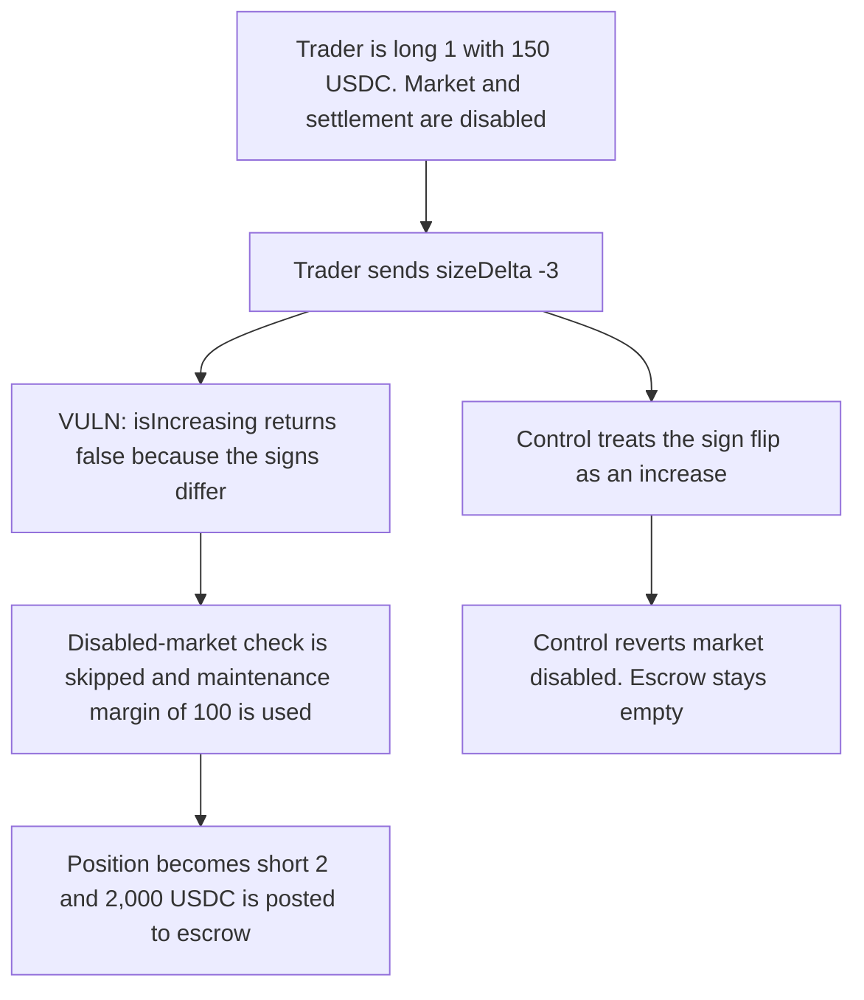

# A Zaros trader flips a long into a larger short while the market is disabled and posts 2,000 USDC

> **Vulnerability classes:** vuln/logic/wrong-condition · vuln/logic/liquidation-logic

<!-- non-defihacklabs -->
<!-- source-auditvault: https://github.com/Auditware/AuditVault/blob/main/findings/37973-inadequate-checking-of-isincreasing-when-trader-adjusts-posi.md -->
<!-- date: 2024-07 -->

## Key info

| Field | Value |
|---|---|
| **Loss** | 2,000 USDC of LP funds posted to a short the trader cannot initially margin |
| **Vulnerable contract** | `Position.isIncreasing` |
| **Attacker EOA** | `0x0000000000000000000000000000000000037973` (the trader) |
| **Attack contract** | `Exploit` |
| **Attack tx** | `Exploit.run()` |
| **Chain / block / date** | Ethereum model · block 0 · 2024-07 |
| **Compiler** | solc 0.8.27, cancun, via IR |
| **Bug class** | A flip through zero is classified as a decrease |

## TL;DR

`isIncreasing` returns true only when `sizeDelta` has the same sign as the open size. A long of +1 with `sizeDelta` of -3 becomes a short of -2, and the function returns false. The disabled-market check is skipped, and the fill uses the 5 percent maintenance margin instead of the 10 percent initial margin. The trader has 150 USDC. Maintenance on the new 2,000 notional is 100, initial is 200, so the order fills and the engine posts 2,000 USDC of LP funds into the short escrow. Treating a sign change as an increase reverts the fill and leaves the escrow empty.

## Background

Cyfrin's July 2024 Zaros contest. When a market or its settlement is disabled, the protocol still wants open positions to be able to shrink or close, and it wants to reject new risk. The helper that makes that decision only looks at the sign of `sizeDelta`, not at `size + sizeDelta`.

## The vulnerable code

```solidity
function isIncreasing(uint128 tradingAccountId, uint128 marketId, int128 sizeDelta) public view returns (bool) {
    Data storage self = positions[tradingAccountId][marketId];
    // @> VULN: isIncreasing ignores a flip through zero, so size + sizeDelta can grow risk in the opposite direction
    return self.size == 0 || (self.size > 0 && sizeDelta > 0) || (self.size < 0 && sizeDelta < 0);
}
```

`self.size` is +1e18 and `sizeDelta` is -3e18. Neither same-direction clause matches, and the size is not zero, so the return value is false. The new size is -2e18.

## Root cause

"Not the same sign" includes both a genuine reduction and a flip that opens a larger position on the other side. The second case is new risk. It is checked with the looser maintenance margin and it bypasses the disabled-market guard.

## Preconditions

- The trader is long 1 unit with 150 USDC of collateral.
- The market and settlement are disabled. That is the state in which new increases are supposed to revert.
- Mark price is 1,000 USDC per unit, so a short of 2 is 2,000 USDC of notional.
- The engine holds 2,000 USDC of LP funds to post as the other side.

## Attack walkthrough

1. The trader submits `sizeDelta` -3 against a long of +1.
2. `isIncreasing` returns false.
3. The disabled-market require is skipped.
4. Required margin is the 100 USDC maintenance number, not the 200 USDC initial number. Collateral of 150 passes.
5. The position is now -2. The engine transfers 2,000 USDC into the short escrow.
6. The control returns true for the same flip, reverts with "market disabled", leaves the long at +1, and posts nothing.

## Diagrams



## Impact

LP funds of 2,000 USDC are locked into a short the disabled market was supposed to reject. The trader's 150 USDC is below the 200 USDC initial margin that an increase requires, so the escrow is backing a position the protocol's own margin rule would not have opened. The control posts 0 and leaves the long unchanged.

## Remediation

Return true from `isIncreasing` when `size + sizeDelta` is zero-crossing or when the absolute size grows, including a flip from long to short or short to long. Keep the disabled-market and initial-margin checks on that path.

## How to reproduce

```bash
cd 37973-inadequate-checking-of-isincreasing-when-trader-adjusts-posi_exp
forge test -vv
```

`test_exploit_flip_opens_a_short_while_the_market_is_disabled` asserts a short of 2, a 100 USDC maintenance requirement, and 2,000 USDC in escrow. `test_control_sign_flip_is_rejected_while_disabled` asserts the flip reverts and the escrow stays empty. Captured output is `output.txt`.

## Sources

- AuditVault finding: https://github.com/Auditware/AuditVault/blob/main/findings/37973-inadequate-checking-of-isincreasing-when-trader-adjusts-posi.md
- Blamed lines: https://github.com/Cyfrin/2024-07-zaros/blob/d687fe96bb7ace8652778797052a38763fbcbb1b/src/perpetuals/leaves/Position.sol#L155-L162
