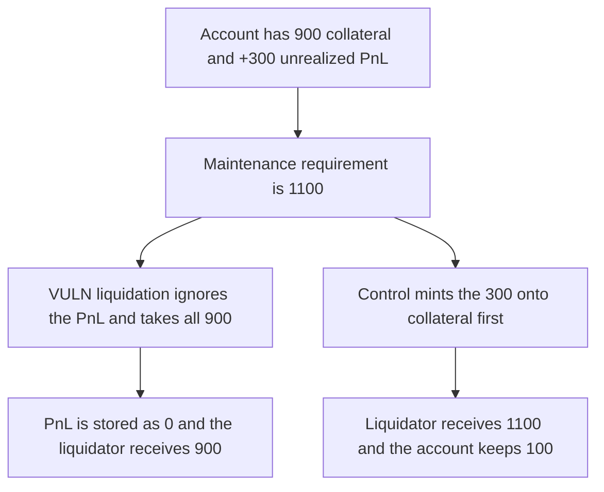

# Zaros liquidation drops positive unrealized PnL and pays the liquidator only the collateral

> **Vulnerability classes:** vuln/logic/unrealized-pnl · vuln/defi/liquidation

<!-- non-defihacklabs -->
<!-- source-auditvault: https://github.com/Auditware/AuditVault/blob/main/findings/37975-positive-pnl-is-lost-for-all-parties-when-liquidating-an-acc.md -->
<!-- date: 2024-07 -->

## Key info

| Field | Value |
|---|---|
| **Loss** | 300 USDZ of positive PnL is discarded. The liquidator is paid 900 instead of 1100, and the account is left at 0 instead of 100 |
| **Vulnerable contract** | `Engine.liquidate` |
| **Attacker EOA** | `0x1111111111111111111111111111111111111111` |
| **Attack contract** | `Exploit` at `0x15452ec016c4dc8c549e7fe6ff4b26324ea8b7a4` |
| **Attack tx** | `Exploit.run()` |
| **Chain / block / date** | Ethereum model · block 0 · 2024-07 |
| **Compiler** | solc 0.8.27, cancun, via IR |
| **Bug class** | Liquidation deducts collateral without minting positive unrealized PnL |



## TL;DR

`liquidate` reads unrealized PnL and then deducts maintenance from collateral only. The positive PnL is never minted.

The account has 900 collateral and +300 PnL. Maintenance is 1100. The vulnerable call treats 900 as the whole balance, transfers that 900 to the liquidator, and stores PnL as 0. The 300 is gone. The account balance is 0.

The fixed call mints 300 USDZ onto the account first. Collateral becomes 1200. It then transfers the 1100 maintenance and leaves 100.

## The vulnerable code

```solidity
int256 pnl = unrealizedPnl[user];
uint256 col = collateral[user];
uint256 margin = col;
require(requiredMaintenance > margin, "healthy");
require(requiredMaintenance > margin && pnl > 0, "healthy");
usdz.transfer(msg.sender, take); // @> VULN: pays the 900 collateral; the +300 PnL was never minted
```

The quoted `liquidateAccounts` path loads unrealized PnL, checks maintenance against margin, and calls `deductAccountMargin` without the mint that `SettlementBranch` performs for a positive PnL.

## Impact

300 USDZ of positive PnL is not minted and is not paid. The liquidator receives 900 instead of 1100. The account is emptied instead of keeping 100.
