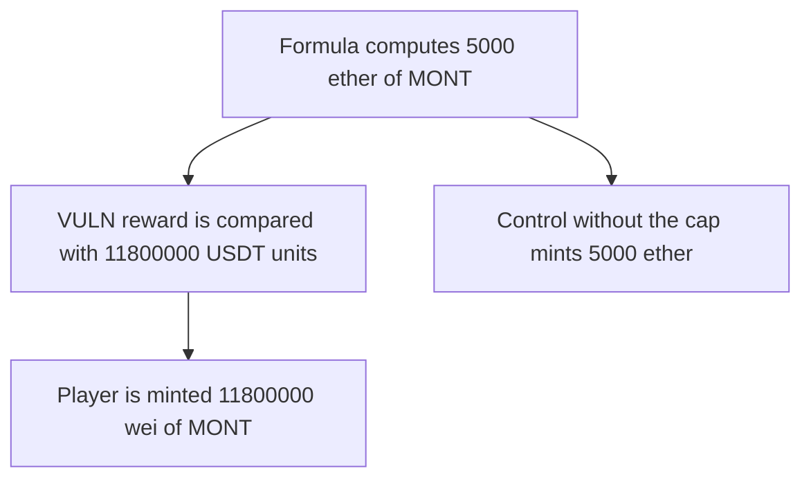

# The house-fee cap pays 11800000 wei of MONT instead of 5000 MONT

> **Vulnerability classes:** `vuln/arithmetic/decimal-mismatch` · `vuln/logic/fee-calculation`

<!-- non-defihacklabs -->
<!-- source-auditvault: https://github.com/Auditware/AuditVault/blob/main/findings/38014-c-01-the-house-fee-cap-mechanism-is-flawed-pashov-audit-grou.md -->
<!-- date: 2024-09 -->

## Key info

| Field | Value |
|---|---|
| **Loss** | Player receives 11800000 wei of MONT instead of 5000 ether |
| **Vulnerable contract** | `MontRewardManager.transferPlayerRewards` |
| **Attacker EOA** | `0x1111111111111111111111111111111111111111` (the winning player) |
| **Attack contract** | `Exploit` |
| **Attack tx** | `Exploit.run()` |
| **Chain / block / date** | Ethereum model · block 0 · 2024-09 |
| **Compiler** | solc 0.8.27, cancun, via IR |
| **Bug class** | MONT reward capped by a USDT amount |

## TL;DR

The report's `test_revealCardWithTheRightData` log is reproduced: USDT bet 1000000, USDT won 11800000, expected MONT reward 5000 ether, actual credit 11800000. Price 8 and house fee 50000 make `((houseFee * 1e18 * 8) / 10) / price` equal 5000 ether. The next line replaces that reward with `_totalAmount` because a wei of MONT is compared with a 6-decimal USDT amount. Without the comparison the same inputs mint 5000 ether.

## Background

Pashov Audit Group's Dumont review, added to the audits repo on 16 September 2024, finding C-01. The reviewed commit is `3165eff301b2fe23a6ca38d785075e507d9ae879` of `dumontgg/dumont-contract-v1`. MONT has 18 decimals and the won amount is USDT.

## The vulnerable code

```solidity
uncapped = reward;
if (reward > totalAmount) {
    reward = totalAmount; // @> VULN: 18-decimal MONT is replaced by the 6-decimal USDT total
    // FIX: delete the cap, or scale totalAmount by 1e12 before comparing
}
```

The change that removes the harm:

```diff
- if (reward > totalAmount) {
-     reward = totalAmount;
- }
```

## Root cause

`reward` is an 18-decimal token amount. `_totalAmount` is the USDT the player won, at 6 decimals. The comparison is true for any ordinary MONT reward, so the player is credited the USDT figure as if it were MONT wei.

## Preconditions

- `getMontPrice` returns 8.
- House fee is 50000, bet is 1000000, and `_totalAmount` is 11800000, the values that reproduce the report's log.
- The player is the caller of `run`.

## Attack walkthrough

1. The formula computes 5000 ether and stores it as `uncapped`.
2. The cap assigns 11800000.
3. The player is minted 11800000 wei of MONT.
4. `transferUncapped` with the same fee and price mints 5000 ether.

## Diagrams



## Impact

The winning player is underpaid by `5000 ether - 11800000` wei of MONT. The report's own log shows the same two numbers.

## Remediation

Remove the cap, which is the report's first recommendation. If a cap is kept, scale the USDT amount to 18 decimals before comparing it with `reward`.

## How to reproduce

```bash
cd 38014-c-01-the-house-fee-cap-mechanism-is-flawed-pashov-audit-grou_exp
forge test -vv
```

`test_exploit` is the harm. The control test is the guarded path. Captured output is `output.txt`.

## Sources

- AuditVault finding: https://github.com/Auditware/AuditVault/blob/main/findings/38014-c-01-the-house-fee-cap-mechanism-is-flawed-pashov-audit-grou.md
- Pashov report: https://github.com/pashov/audits/blob/master/team/md/Dumont-security-review.md
- Reviewed tree: https://github.com/dumontgg/dumont-contract-v1/tree/3165eff301b2fe23a6ca38d785075e507d9ae879
