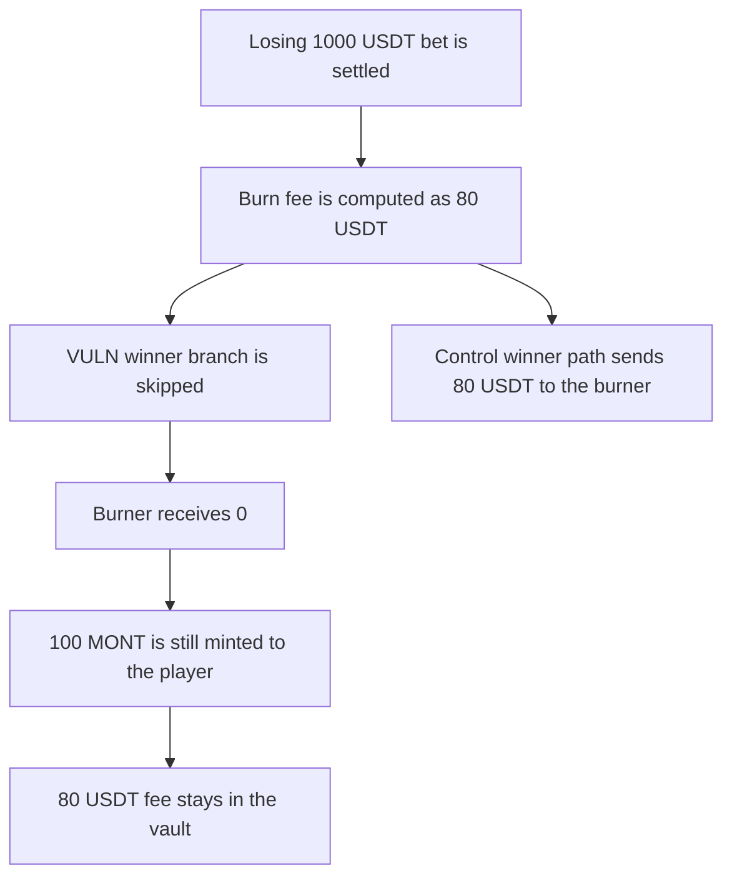

# Dumont: a losing 1000 USDT bet pays the burner 0 and still mints 100 MONT

> **Vulnerability classes:** `vuln/logic/missing-check` · `vuln/logic/fee-calculation`

<!-- non-defihacklabs -->
<!-- source-auditvault: https://github.com/Auditware/AuditVault/blob/main/findings/38015-h-01-fees-are-not-burnt-on-losing-games-pashov-audit-group-n.md -->
<!-- date: 2024-09 -->

## Key info

| Field | Value |
|---|---|
| **Loss** | 80 USDT that should buy and burn MONT stays in the vault; 100 MONT is still minted |
| **Vulnerable contract** | `Vault.transferPlayerRewards` |
| **Attacker EOA** | `0x1111111111111111111111111111111111111111` (the player) |
| **Attack contract** | `Exploit` |
| **Attack tx** | `Exploit.run()` |
| **Chain / block / date** | Ethereum model · block 0 · 2024-09 |
| **Compiler** | solc 0.8.27, cancun, via IR |
| **Bug class** | The burner transfer is inside the winner branch |

## TL;DR

A 10% fee applies to winning and losing bets, and 80% of that fee is supposed to buy and burn MONT. On a 1000 USDT bet the burn amount is 80 USDT. `transferPlayerRewards` sends it only when `_isPlayerWinner` is true. A losing settlement leaves the burner at 0, leaves the 1000 USDT in the vault, and still mints 100 MONT to the player. The same function with a winner sends the 80 USDT to the burner.

## Background

Pashov Audit Group, Dumont security review, report added 16 September 2024, finding H-01. The vault pays the player and the burner together inside `if (_isPlayerWinner)`. `MontRewardManager` still distributes MONT on a loss, sized like 10% of the bet. The missing buy pressure is the 80% of the fee that never reaches the burner.

## The vulnerable code

```solidity
pendingBurn = (1000e6 / 10) * 8 / 10; // 80 USDT
if (_isPlayerWinner) { // @> VULN: the burner transfer is inside this branch
    usdt.transfer(player, _totalAmount);
    usdt.transfer(address(burner), pendingBurn);
}
mont.mint(player, 100 ether);
```

```diff
- if (_isPlayerWinner) {
-     usdt.transfer(player, _totalAmount);
-     usdt.transfer(address(burner), pendingBurn);
- }
+ usdt.transfer(address(burner), pendingBurn);
+ if (_isPlayerWinner) {
+     usdt.transfer(player, _totalAmount);
+ }
```

## Root cause

The burn transfer is on the winner path only. A loss skips the whole branch, including the burner, and the MONT mint sits after the branch so it still runs. The fee that was supposed to fund the burn stays with the stake in the vault.

## Preconditions

- The vault holds the 1000 USDT stake.
- The fee is 10% and the burn share is 80% of that fee, so 80 USDT.
- The settled game is a loss. The control is the same function with `_isPlayerWinner` true.

## Attack walkthrough

1. `transferPlayerRewards(false, ...)` runs.
2. `pendingBurn` is set to 80 USDT.
3. The winner branch is not taken. No USDT is sent to the burner.
4. 100 MONT is minted to the player.
5. The burner's USDT balance is 0.
6. The vault still holds the full 1000 USDT.

## Diagrams



## Impact

The burner does not receive the 80 USDT that should have bought and burned MONT. The player still receives 100 MONT, so the loss creates sell pressure without the buy the token design counted on. The 1000 USDT stake, including that 80 USDT fee, remains in the vault. A winning settlement of the same function does transfer 80 USDT to the burner.

## Remediation

Transfer `burnAmount` to the burner before the winner check, and leave only the player payout inside the winner branch.

## How to reproduce

```bash
cd 38015-h-01-fees-are-not-burnt-on-losing-games-pashov-audit-group-n_exp
forge test -vv
```

`test_exploit_losing_bet_pays_burner_zero_and_mints_mont` asserts a 0 burner balance, 100 MONT minted, and the 1000 USDT still in the vault. `test_control_winning_bet_sends_80_usdt_to_the_burner` asserts the 80 USDT transfer. Captured output is `output.txt`.

## Sources

- AuditVault finding: https://github.com/Auditware/AuditVault/blob/main/findings/38015-h-01-fees-are-not-burnt-on-losing-games-pashov-audit-group-n.md
- Pashov report: https://github.com/pashov/audits/blob/master/team/md/Dumont-security-review.md
