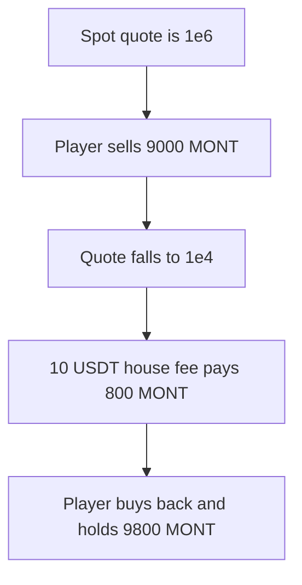

# Dumont: a spot MONT quote inflates player rewards

> **Vulnerability classes:** `vuln/oracle/spot-price` · `vuln/logic/reward-calculation`

<!-- non-defihacklabs -->
<!-- source-auditvault: https://github.com/Auditware/AuditVault/blob/main/findings/38016-h-02-mont-price-can-be-manipulated-to-earn-more-rewards-pash.md -->
<!-- date: 2024-09 -->

## Key info

| Field | Value |
|---|---|
| **Loss** | A 10 USDT house fee pays 800 MONT instead of 8 |
| **Vulnerable contract** | `MontRewardManager.transferPlayerRewards` |
| **Attacker EOA** | `0x1111111111111111111111111111111111111111` |
| **Attack contract** | `Exploit` |
| **Attack tx** | `Exploit.run()` |
| **Chain / block / date** | Local synthetic · 2024-09 |
| **Compiler** | solc 0.8.27, cancun, via IR |
| **Bug class** | Reward divides by a Uniswap spot quote |

## TL;DR

`getMontPrice` is `quoteExactInputSingle` on the current pool. `transferPlayerRewards` pays `((houseFee * 1e18 * 8) / 10) / price`. Selling 9000 MONT moves the spot quote from 1e6 to 1e4. A 10 USDT house fee then pays 800 MONT instead of 8. The player buys the MONT back. The spot quote is 1e6 again and the player holds 9800 MONT.

## The vulnerable code

```solidity
function transferPlayerRewards(address player, uint256 houseFee) external {
    uint256 price = getMontPrice();
    uint256 reward = ((houseFee * 1e18 * 8) / 10) / price;
    mont.transfer(player, reward);
}
```

`getMontPrice` reads the pool's spot reserves. A TWAP or a fixed oracle is the report's recommendation.

## Root cause

The reward denominator is a same-block pool quote. The player can move that quote before the reward is paid and trade back after.

## Preconditions

- The pool quotes 1 MONT at 1e6 before the sale.
- The player can sell 9000 MONT into that pool and buy it back.
- A 10 USDT house fee is converted to MONT at the depressed quote.

## Attack walkthrough

1. The spot quote is 1e6, so a fair reward on 10 USDT is 8 MONT.
2. The player sells 9000 MONT and the quote falls to 1e4.
3. The manager pays 800 MONT.
4. The player buys the sold MONT back. The quote is 1e6 again and the player holds 9800 MONT.

## Diagrams



## Impact

Rewards denominated in MONT are inflated by the same trade that moves the quote. This run pays 800 MONT instead of 8 and leaves the player with 9800 MONT.

## How to reproduce

```bash
cd 38016-h-02-mont-price-can-be-manipulated-to-earn-more-rewards-pash_exp
forge test -vv
```

## Sources

- AuditVault finding: https://github.com/Auditware/AuditVault/blob/main/findings/38016-h-02-mont-price-can-be-manipulated-to-earn-more-rewards-pash.md
- Pashov review: https://github.com/pashov/audits/blob/master/team/md/Dumont-security-review.md
