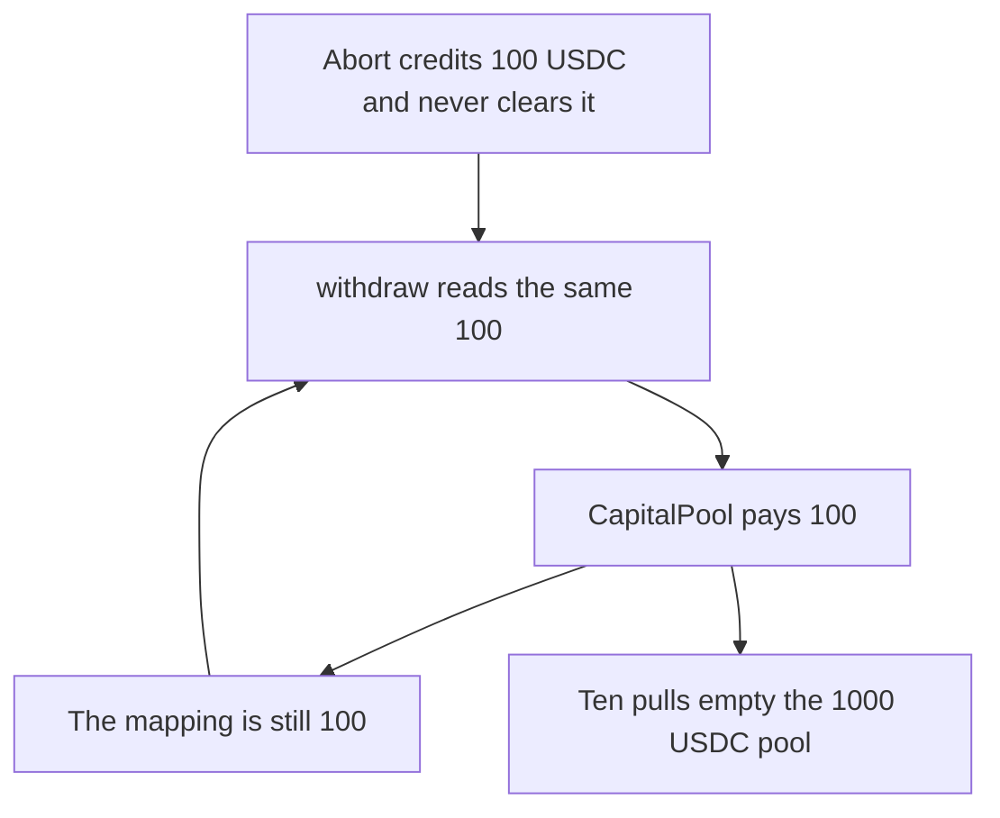

# Tadle: TokenManager.withdraw never clears the claim

> **Vulnerability classes:** `vuln/logic/state-update` · `vuln/logic/missing-check`

<!-- non-defihacklabs -->
<!-- source-auditvault: https://github.com/Auditware/AuditVault/blob/main/findings/38060-tokenmanager-unlimited-withdraw-codehawks-tadle-git.md -->
<!-- date: 2024-08 -->

## Key info

| Field | Value |
|---|---|
| **Loss** | 1000 USDC drained from CapitalPool against a 100 USDC refund credit |
| **Vulnerable contract** | `TokenManager.withdraw` |
| **Attacker EOA** | `0x1111111111111111111111111111111111111111` |
| **Attack contract** | `Exploit` |
| **Attack tx** | `Exploit.run()` |
| **Chain / block / date** | Ethereum model · block 0 · 2024-08 |
| **Compiler** | solc 0.8.27, cancun, via IR |
| **Bug class** | The maker-refund balance is read and paid, then left unchanged |

## TL;DR

`TokenManager.withdraw` loads `userTokenBalanceMap[caller][token][type]` and pulls that amount from `CapitalPool`. It never writes the slot back to zero. A user whose aborted offer credited 100 USDC can call `withdraw` until the pool is empty. Here the pool holds 1000 USDC, ten calls pay 1000 USDC, and the credit is still 100.

## The vulnerable code

```solidity
uint256 claimAbleAmount = userTokenBalanceMap[msg.sender][_tokenAddress][_tokenBalanceType]; // @> VULN
if (claimAbleAmount == 0) {
    return;
}
MockUSDC(_tokenAddress).transferFrom(address(capitalPool), msg.sender, claimAbleAmount);
```

The recommended fix zeros the slot before the transfer:

```diff
  uint256 claimAbleAmount = userTokenBalanceMap[msg.sender][_tokenAddress][_tokenBalanceType];
+ userTokenBalanceMap[msg.sender][_tokenAddress][_tokenBalanceType] = 0;
  if (claimAbleAmount == 0) return;
```

## Root cause

The refund credit written by `addTokenBalance` (the aborted-offer path in the report) is treated as a balance that survives the withdrawal. Every later `withdraw` reads the same number and pulls it again. The pool's approval of the manager is what makes the repeated pull succeed.

## Preconditions

- CapitalPool holds 1000 USDC and has approved TokenManager.
- The attacker has a MakerRefund credit of 100 USDC. The other 900 belongs to other users.

## Attack walkthrough

1. The pool is funded and approves the manager.
2. `creditRefund` writes 100 USDC into the attacker's MakerRefund slot, the same write `addTokenBalance` performs after `abortAskOffer`.
3. `withdraw` is called ten times. Each call reads 100 and pulls 100 from the pool.
4. The attacker holds 1000 USDC. The pool is empty. The mapping still says 100.

## Diagrams



## Impact

Any account with a nonzero claim can take every token the capital pool holds for that asset. Other makers lose the 900 USDC that was not part of the attacker's refund. The control, which zeros the slot, pays 100 once and leaves 900 in the pool.

## How to reproduce

```bash
cd 38060-tokenmanager-unlimited-withdraw-codehawks-tadle-git_exp
forge test -vv
```

`test_withdraw_drains_capital_pool` asserts a 1000 USDC attacker balance, an empty pool, and a credit that is still 100. `test_control_zeroing_the_credit_pays_once` asserts the fixed path pays 100 and stops.

## Sources

- AuditVault finding: https://github.com/Auditware/AuditVault/blob/main/findings/38060-tokenmanager-unlimited-withdraw-codehawks-tadle-git.md
- Audited withdraw: https://github.com/Cyfrin/2024-08-tadle/blob/04fd8634701697184a3f3a5558b41c109866e5f8/src/core/TokenManager.sol#L137
