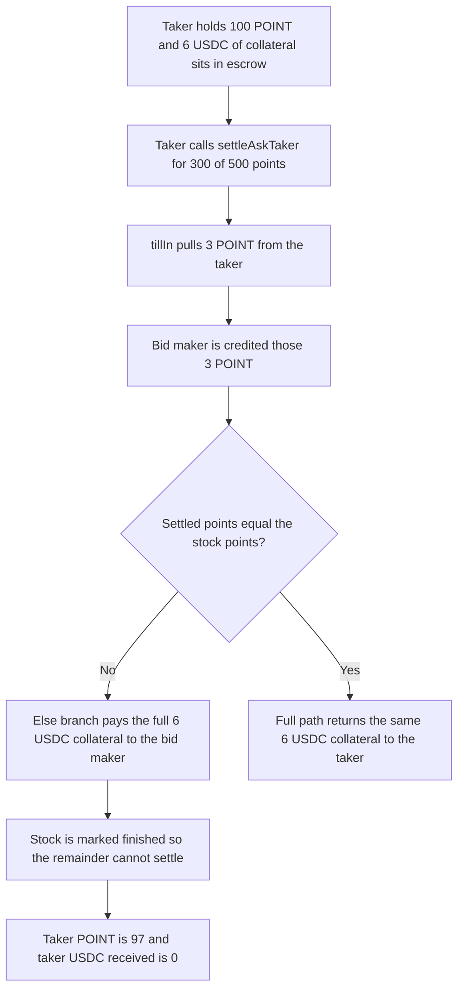

# Tadle — a partial settleAskTaker pays the taker's collateral to the bid maker

> **Vulnerability classes:** vuln/logic/wrong-condition · vuln/logic/fee-calculation · vuln/logic/incorrect-state-transition

> **Reproduction:** cheatcode-free local synthetic. `DeliveryPlace.settleAskTaker` keeps the audited collateral branch. Full trace: [output.txt](output.txt). PoC: [test/38062-taker-of-bid-offer-will-loss-assets-without-any-benefit-if-h_exp.sol](test/38062-taker-of-bid-offer-will-loss-assets-without-any-benefit-if-h_exp.sol).

<!-- non-defihacklabs -->
<!-- source-auditvault: https://github.com/Auditware/AuditVault/blob/main/findings/38062-taker-of-bid-offer-will-loss-assets-without-any-benefit-if-h.md -->
<!-- date: 2024-08 -->

**AuditVault taxonomy:** `lang/solidity` · `sector/lending` · `sector/nft` · `sector/stable` · `platform/codehawks` · `has/github` · `severity/high` · genome: `wrong-condition` · `direct-drain` · `timestamp-dependence`

## Key info

| | |
|---|---|
| **Protocol** | Tadle pre-market delivery |
| **Finding** | CodeHawks 2024-08-tadle, AuditVault 38062 |
| **Vulnerable code** | `DeliveryPlace.settleAskTaker` (the report title says `settleAskMaker`; the cited line and the PoC are `settleAskTaker`) |
| **Harm** | Taker POINT goes from 100e18 to 97e18. Taker USDC received is 0. Bid maker receives that 3e18 POINT plus the taker's full 6e18 USDC collateral. The stock is finished, so the remaining 200 points cannot be settled |
| **Chain** | local synthetic |

## TL;DR

A taker of a bid offer may settle only some of the stock's points. `settleAskTaker` still pulls `tokenPerPoint * _settledPoints` from the taker. The collateral refund is paid to the taker only when `_settledPoints == stockInfo.points`. On any smaller amount the same full fee is credited to the bid maker as `MakerRefund`, and the stock is marked finished. The taker delivered 3 POINT, got no USDC, and lost the 6 USDC collateral a full settlement would have returned.

## The vulnerable code

Audited branch in `DeliveryPlace.settleAskTaker` (`Cyfrin/2024-08-tadle` @ `04fd8634`, the report links L335):

```solidity
uint256 settledPointTokenAmount = marketPlaceInfo.tokenPerPoint * _settledPoints;
if (settledPointTokenAmount > 0) {
    tokenManager.tillIn(
        _msgSender(),
        marketPlaceInfo.tokenAddress,
        settledPointTokenAmount,
        true
    );
    tokenManager.addTokenBalance(
        TokenBalanceType.PointToken,
        offerInfo.authority,
        makerInfo.tokenAddress,
        settledPointTokenAmount
    );
}

uint256 collateralFee = OfferLibraries.getDepositAmount(
    offerInfo.offerType,
    offerInfo.collateralRate,
    stockInfo.amount,
    false,
    Math.Rounding.Floor
);

if (_settledPoints == stockInfo.points) {
    tokenManager.addTokenBalance(
        TokenBalanceType.RemainingCash,
        _msgSender(),
        makerInfo.tokenAddress,
        collateralFee
    );
} else {
    // @> VULN: partial settlement still took the taker's points, then pays the FULL collateral fee to the bid maker
    tokenManager.addTokenBalance(
        TokenBalanceType.MakerRefund,
        offerInfo.authority,
        makerInfo.tokenAddress,
        collateralFee
    );
}
```

`PerMarkets.settleAskTaker` then sets the stock to `Finished` for either branch.

```solidity
// FIX: if (_settledPoints != stockInfo.points) revert PartialSettlement();
// before tillIn. A partial call must not move points or collateral.
```

The report's PoC also corrects a separate authority check (`offerInfo.authority` to `stockInfo.authority`) and a separate token-address bug (`makerInfo.tokenAddress` to the marketplace point token) so this call is reachable and the points arrive. Those two edits are the reporter's stated precondition. This reduction does the same, and leaves the collateral branch as written. The point-credit line in the synthetic therefore passes the point token, which is what the report's log shows (maker point balance up by 3e18).

Collateral uses the audited formula. Bid offer, taker side, rate 12000, scaler 10000: fee = stock notional * 12000 / 10000. The contest harness used offer amount `0.01e18` (fee `6e15` on a 500-point stock). This reduction uses stock notional `5e18`, so the same 120% fee is `6e18`. The point transfer is the logged one: `300 * 0.01e18 = 3e18`.

## Root cause

The equality test gates who receives `collateralFee`, not whether a partial fill is allowed. `_settledPoints > stockInfo.points` reverts, so every smaller positive amount is accepted. Points are pulled before that branch. The else branch does not scale the fee by `settled / points` and does not pay the caller. The following status write closes the stock, so the taker cannot later pass the equality test and take the full-settlement path.

## Preconditions

Market status is already `AskSettling` (no timestamp change inside the attack). The taker is the stock authority, which is the correction the report applies before its PoC. The taker holds 100 POINT and has approved the token manager. The token manager holds the taker's 6 USDC collateral. The stock is 500 points with notional 5e18, collateral rate 12000, token-per-point 0.01e18.

## Attack walkthrough

1. The taker approves POINT and reads a balance of 100e18.
2. The taker calls `settleAskTaker(stock, 300)`.
3. The authority check passes for the stock owner.
4. `tillIn` pulls 3e18 POINT. The maker is credited those 3 POINT.
5. `300 != 500`, so the else branch credits MakerRefund of 6e18 USDC to the bid maker. The taker's USDC balance stays 0.
6. `lastSettledPoints` is stored as 300 and the stock is finished.
7. A second call for the remaining 200 points reverts. The collateral cannot be recovered by settling in full.

The control calls the same function with 500 points. The taker pays 5e18 POINT, receives the 6e18 USDC collateral back, and the maker's USDC stays 0. A fixed function reverts on `(300, 500)` before any transfer, and the taker's 100 POINT does not move.

## Diagrams



## Impact

The taker of the bid loses both assets the report names. Here that is 3 POINT (100e18 down to 97e18, matching the contest log) and 6 USDC of collateral, with 0 USDC paid back. The bid maker is ahead by 6 USDC they did not post for this settlement, on top of the 3 POINT the settlement delivered. Because the stock is finished, repeating the call cannot take the full-settlement branch that would have returned the collateral.

## Remediation

Revert when `_settledPoints != stockInfo.points` before `tillIn`. If partial settlement is meant to work, pay the taker `collateralFee * _settledPoints / stockInfo.points` and do not mark the stock finished until the remaining points are settled.

## How to reproduce

```bash
cd 38062-taker-of-bid-offer-will-loss-assets-without-any-benefit-if-h_exp
forge test -vv
```

## Sources

- AuditVault finding: https://github.com/Auditware/AuditVault/blob/main/findings/38062-taker-of-bid-offer-will-loss-assets-without-any-benefit-if-h.md
- CodeHawks contest: https://codehawks.cyfrin.io/c/2024-08-tadle
- Same bug, judged valid: https://codehawks.cyfrin.io/c/2024-08-tadle/s/232
- Audited function: https://github.com/Cyfrin/2024-08-tadle/blob/04fd8634701697184a3f3a5558b41c109866e5f8/src/core/DeliveryPlace.sol#L335
- Collateral formula: https://github.com/Cyfrin/2024-08-tadle/blob/04fd8634701697184a3f3a5558b41c109866e5f8/src/libraries/OfferLibraries.sol
