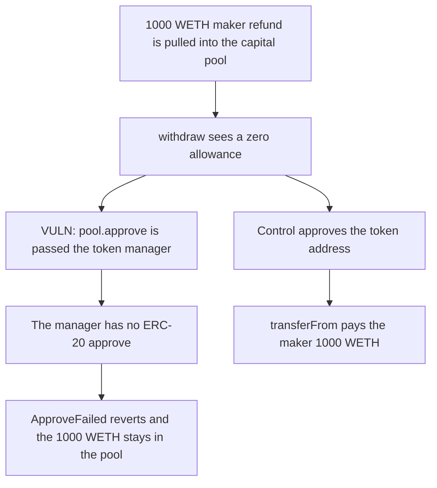

# Native-token withdrawal approves the token manager and the maker refund stays in the pool

> **Vulnerability classes:** vuln/dos/frozen-funds · vuln/logic/missing-check

<!-- non-defihacklabs -->
<!-- source-auditvault: https://github.com/Auditware/AuditVault/blob/main/findings/38064-native-token-withdrawal-fails-until-manually-approved-codeha.md -->
<!-- date: 2024-08 -->

## Key info

| Field | Value |
|---|---|
| **Loss** | 1000 WETH stuck in the capital pool. Withdraw reverts `ApproveFailed` |
| **Vulnerable contract** | `TokenManager._transfer` |
| **Attacker EOA** | `0x1111111111111111111111111111111111111111` |
| **Attack contract** | `Exploit` |
| **Attack tx** | `Exploit.run()` |
| **Chain / block / date** | Ethereum model · block 0 · 2024-08 |
| **Compiler** | solc 0.8.27, cancun, via IR |
| **Bug class** | `CapitalPool.approve` is given the manager address instead of the token |

## TL;DR

A maker refund of 1000 WETH is credited and pulled into the capital pool. `withdraw` sees a zero allowance and calls `CapitalPool.approve(address(this))`. The pool expects a token and calls `approve` on the token manager, which is not an ERC-20. The call reverts `ApproveFailed`. The 1000 WETH stays in the pool and the maker's balance stays 0. Approving the token address lets the same withdrawal pay the 1000 back.

## Background

CodeHawks Tadle contest, 5-12 August 2024. `TokenManager.withdraw` moves funds out of `CapitalPool` with `transferFrom`. When the pool has not approved the manager, `_transfer` is supposed to ask the pool to approve the token. The call passes `address(this)`, the manager, instead of `_token`.

## The vulnerable code

```solidity
if (_from == _capitalPoolAddr && Token(_token).allowance(_from, address(this)) == 0) {
    // @> VULN: CapitalPool.approve is given the token manager, not the token, so the inner approve reverts
    CapitalPool(_capitalPoolAddr).approve(address(this));
}
```

`CapitalPool.approve` does `token.call(approve(tokenManager, max))` and reverts `ApproveFailed` when that call fails.

## Root cause

The argument to `approve` is the spender the pool should approve, not the token the pool should call. The token manager has no `approve` function, so the low-level call returns failure and the withdrawal rolls back.

## Preconditions

- The capital pool's allowance toward the token manager for this token is 0.
- The user has a maker refund. This run credits 1000 WETH and moves it into the pool in the same transaction.

## Attack walkthrough

1. The maker approves the token manager and `credit` pulls 1000 WETH into the pool. `makerRefund` is 1000.
2. `withdraw` calls `_transfer` from the pool to the maker.
3. The allowance is 0, so the manager calls `pool.approve(address(this))`.
4. The pool calls `approve` on the manager. The call fails. `ApproveFailed` reverts the withdrawal.
5. The maker's WETH balance is 0. The pool still holds 1000. `makerRefund` is still 1000 because the write inside `withdraw` was rolled back.
6. The control calls `pool.approve(token)`. The pool approves the manager on the real token and `transferFrom` pays the 1000 back.

## Diagrams



## Impact

The maker cannot withdraw the 1000 WETH refund. It sits in the capital pool until something else approves the real token. The control pays the full 1000 back and leaves the pool empty.

## Remediation

Change `ICapitalPool(_capitalPoolAddr).approve(address(this))` to `approve(_token)`, which is the patch in the CodeHawks report.

## How to reproduce

```bash
cd 38064-native-token-withdrawal-fails-until-manually-approved-codeha_exp
forge test
```

`test_exploit_wrong_approve_target_locks_maker_refund` asserts a reverted withdraw and 1000 WETH in the pool. `test_control_approve_token_pays_the_refund` asserts the maker receives 1000. Captured output is `output.txt`.

## Sources

- AuditVault finding: https://github.com/Auditware/AuditVault/blob/main/findings/38064-native-token-withdrawal-fails-until-manually-approved-codeha.md
- CodeHawks: https://codehawks.cyfrin.io/c/2024-08-tadle/s/252
