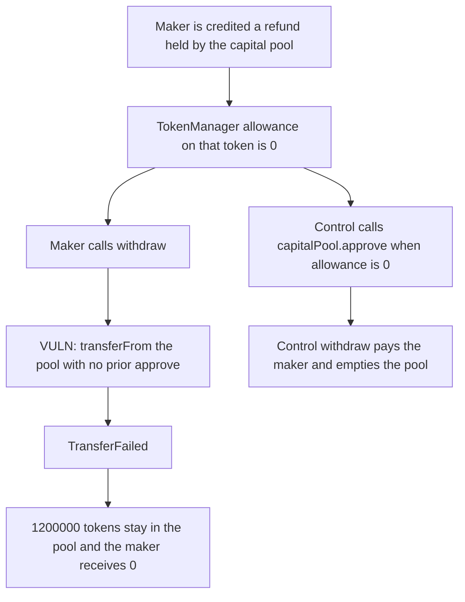

# Tadle: maker refunds revert until someone approves the capital pool

> **Vulnerability classes:** `vuln/dos/frozen-funds` · `vuln/logic/missing-check`

<!-- non-defihacklabs -->
<!-- source-auditvault: https://github.com/Auditware/AuditVault/blob/main/findings/38072-token-withdrawal-fails-until-someone-manually-approves-spend.md -->
<!-- date: 2024-08 -->

## Key info

| Field | Value |
|---|---|
| **Loss** | 1200000 tokens stay in the capital pool. The maker receives 0 |
| **Vulnerable contract** | `TokenManager.withdraw` |
| **Attacker EOA** | `0x1111111111111111111111111111111111111111` |
| **Attack contract** | `Exploit` |
| **Attack tx** | `Exploit.run()` |
| **Chain / block / date** | Ethereum model · block 0 · 2024-08 |
| **Compiler** | solc 0.8.27, cancun, via IR |
| **Bug class** | Missing allowance before `transferFrom` the capital pool |

## TL;DR

`TokenManager.withdraw` credits a maker refund and then pulls the tokens from the capital pool. The ERC20 branch never checks allowance and never calls `capitalPool.approve`. With a fresh token the pull reverts, so the maker cannot withdraw until somebody approves TokenManager by hand.

## Background

CodeHawks Tadle contest, August 2024, reported by p0wd3r. The contest trace shows `transferFrom` reverting `ERC20InsufficientAllowance` for `1200000000000000000000000` units, then `TransferFailed`. `_transfer` already approves the pool when allowance is zero. `withdraw` skips that helper and calls `_safe_transfer_from` directly. The amount in this run is that same 1.2e24.

## The vulnerable code

```solidity
_safe_transfer_from(_tokenAddress, pool, msg.sender, claimAbleAmount); // @> VULN
```

The inner call is `token.transferFrom(capitalPool, maker, amount)` while allowance is 0.

```diff
  address pool = capitalPoolAddr;
+ if (IERC20(_tokenAddress).allowance(pool, address(this)) == 0) {
+     ICapitalPool(pool).approve(_tokenAddress);
+ }
  _safe_transfer_from(_tokenAddress, pool, msg.sender, claimAbleAmount);
```

## Root cause

The withdraw path assumes the capital pool has already approved TokenManager. Nothing in this function creates that approval, and a new whitelisted token starts at allowance 0.

## Preconditions

- The capital pool holds the token.
- TokenManager's allowance on that token is 0.
- The maker's claimable balance is non-zero. This run uses balance type 4, the maker-refund bucket from the trace.

## Attack walkthrough

1. The maker is credited 1200000 tokens. The tokens sit in the pool.
2. Allowance of TokenManager on the pool is 0.
3. The maker calls `withdraw`. The claimable amount is the full refund.
4. `transferFrom` reverts. The maker's wallet stays at 0 and the pool still holds 1200000 tokens.

## Diagrams



## Impact

For a newly whitelisted token, every maker refund reverts until an outside caller approves TokenManager. The 1200000 token refund in this run never leaves the capital pool.

## Remediation

Before the pull, if allowance is 0, call `capitalPool.approve(token)`, which is what `TokenManagerFixed.withdraw` does. The control then pays the full refund.

## How to reproduce

```bash
cd 38072-token-withdrawal-fails-until-someone-manually-approves-spend_exp
forge test -vv
```

`test_exploit_withdraw_reverts_until_allowance` asserts the withdraw fails and the pool still holds 1200000 tokens. `test_control_approve_lets_withdraw_succeed` asserts the approve-then-pull pays the caller. Captured output is `output.txt`.

## Sources

- AuditVault finding: https://github.com/Auditware/AuditVault/blob/main/findings/38072-token-withdrawal-fails-until-someone-manually-approves-spend.md
- Contest: https://codehawks.cyfrin.io/c/2024-08-tadle
- Blamed source: https://github.com/Cyfrin/2024-08-tadle/blob/04fd8634701697184a3f3a5558b41c109866e5f8/src/core/TokenManager.sol
