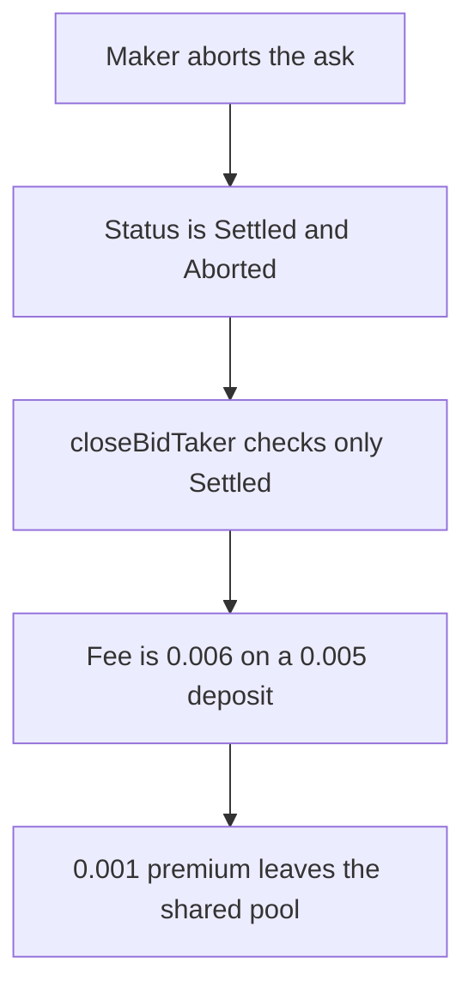

# Tadle — closing an aborted bid pays the collateral premium

> **Vulnerability classes:** vuln/logic/missing-check · vuln/logic/wrong-condition

> **Reproduction:** a self-contained Foundry PoC that compiles and runs offline
> with only `forge-std` — no fork and no RPC. Trace: [output.txt](output.txt).
> PoC: [test/38089-missing-abort-status-check-allows-bid-taker-to-steal-users-f_exp.sol](test/38089-missing-abort-status-check-allows-bid-taker-to-steal-users-f_exp.sol).

<!-- non-defihacklabs -->
<!-- source-auditvault: https://github.com/Auditware/AuditVault/blob/main/findings/38089-missing-abort-status-check-allows-bid-taker-to-steal-users-f.md -->
<!-- date: 2024-08 -->

---

## Key info

| | |
|---|---|
| **Impact** | **HIGH** — the bid taker is credited **0.006** USDC after depositing **0.005**. The extra **0.001** leaves the shared pool |
| **Protocol** | Tadle `DeliveryPlace.closeBidTaker` |
| **Vulnerable code** | `if (offerInfo.offerStatus != OfferStatus.Settled)` |
| **Bug class** | Abort sets `Settled` and the close path never reads `abortOfferStatus` |
| **Finding** | CodeHawks, eeyore — Tadle · id 38089 |
| **Report** | CodeHawks Tadle contest, August 2024, `DeliveryPlace.closeBidTaker` |
| **Source** | [AuditVault finding](https://github.com/Auditware/AuditVault/blob/main/findings/38089-missing-abort-status-check-allows-bid-taker-to-steal-users-f.md) |
| **Status** | The report's diff reverts when `abortOfferStatus` is `Aborted`. Reproduced as a local synthetic. |
| **Compiler** | solc 0.8.27, cancun, via IR |

---

## TL;DR

The finding's PoC creates an ask for amount **0.01 ether**, **1000** points, collateral rate **12000**, then a taker buys **500** points. `abortAskOffer` refunds the maker **0.007** and sets both `abortOfferStatus` to `Aborted` and `offerStatus` to `Settled`. `closeBidTaker` only rejects offers that are not `Settled`, so it still runs. The collateral fee on the used **0.005** at rate **12000 / 10000** is **0.006**. The taker deposited **0.005**. The extra **0.001** is the premium.

After the maker and the taker withdraw, the pool holds **1.004** above a **1** ether deposit from another user. The fair residual is **1.005**. The difference is the **0.001** premium. Refusing an aborted offer and paying only the **0.005** deposit leaves that premium in the pool. `run()` does not warp.

## The vulnerable code

```solidity
// @> VULN: aborted offers are Settled, and abortOfferStatus is never checked
if (status != PreMarkets.OfferStatus.Settled) {
    revert("InvalidOfferStatus");
}
uint256 usedAmount = pre.AMOUNT() * pre.USED() / pre.POINTS();
uint256 collateralFee = usedAmount * pre.RATE() / pre.SCALER();
userCollateralFee = collateralFee * userRemainingPoints / pre.USED();
```

The quoted lines in the finding are the `OfferStatus.Settled` check and the `userCollateralFee` math that follows it. `abortAskOffer` sets:

```solidity
abortOfferStatus = AbortOfferStatus.Aborted;
offerStatus = OfferStatus.Settled;
```

## Root cause

Abort and a real settlement share the `Settled` status. `closeBidTaker` does not read `abortOfferStatus`, so the penalty branch pays the collateral rate on top of a deposit that was already the taker's own principal.

## Preconditions

- Ask amount **0.01 ether**, **1000** points, collateral rate **12000** (scaler **10000**).
- Taker buys **500** points and deposits **0.005** ether.
- The maker aborts before any points are settled.
- Another user's **1** ether sits in the same pool.

## Attack walkthrough

1. The maker aborts. Maker refund is `0.012 - 0.005` = **0.007**. Status becomes `Settled` and `Aborted`.
2. `closeBidTaker` passes the `Settled` check.
3. `userCollateralFee` is **0.006**.
4. The taker withdraws **0.006**. The pool is **0.001** below the fair residual.

## Diagrams



## Impact

The bid taker receives **0.001** USDC more than they deposited. That premium is the amount the finding describes as taken from another user's collateral in the capital pool. The pool's residual above the other user's **1** ether is **0.004** instead of **0.005**.

## Remediation

Revert in `closeBidTaker` when `offerInfo.abortOfferStatus` is `Aborted`, which is the diff in the finding.

## How to reproduce

```bash
cd evm-hack-registry/38089-missing-abort-status-check-allows-bid-taker-to-steal-users-f_exp
forge test -vv
```

## Sources

- AuditVault finding 38089
- CodeHawks Tadle contest, August 2024
- Cyfrin `2024-08-tadle` `src/core/DeliveryPlace.sol` `closeBidTaker` and `src/core/PreMarkets.sol` `abortAskOffer`, commit `04fd8634`
