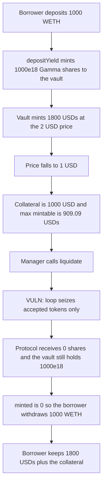

# SmartVaultV4 — Gamma collateral is skipped by liquidation

> **Vulnerability classes:** vuln/logic/liquidation-logic · vuln/logic/missing-check · vuln/logic/state-update

<!-- non-defihacklabs -->
<!-- source-auditvault: https://github.com/Auditware/AuditVault/blob/main/findings/38333-usds-stability-can-be-compromised-as-collateral-deposited-to.md -->
<!-- date: 2024-09 -->

## Key info

| | |
|---|---|
| **Protocol** | The Standard Smart Vault |
| **Finding** | Cyfrin, September 2024, AuditVault 38333 |
| **Vulnerable code** | `SmartVaultV4.liquidate` |
| **Harm** | Liquidation seizes 0 of 1000e18 Gamma shares. The borrower keeps 1800e18 USDs and withdraws the 1000 WETH. |
| **Chain** | local synthetic (audited Ethereum contracts) |

## TL;DR

`liquidate()` marks the vault liquidated and sets `minted` to 0, then sweeps only `TokenManager.getAcceptedTokens()`. Collateral parked in a Gamma hypervisor is a share balance on the vault, and that token is not an accepted collateral token. After a price drop the vault is underwater on 1000 USD of Gamma collateral against 1800 USDs of debt (max mintable 909090909090909090909), but the protocol receives 0 shares. Because `minted` is 0, the borrower withdraws the 1000 WETH and keeps the USDs.

The control runs the same position and also transfers each hypervisor balance to the protocol. The treasury then holds 1000e18 shares and the borrower is left with 0 WETH.

## The vulnerable code

The loop is the audited body. Accepted tokens do not include hypervisor share tokens, because those positions have no Chainlink feed of their own.

```solidity
ITokenManager.Token[] memory tokens =
    ITokenManager(ISmartVaultManagerV3(manager).tokenManager()).getAcceptedTokens();
// @> VULN: accepted-token loop never seizes Gamma hypervisor shares held by this vault.
for (uint256 i = 0; i < tokens.length; i++) {
    if (tokens[i].symbol != NATIVE) liquidateERC20(IERC20(tokens[i].addr));
}
```

Health does count the same shares. `usdCollateral()` adds `yieldVaultCollateral()`, so the vault is liquidatable. Only the seizure list is short.

The control adds the missing pass:

```solidity
for (uint256 j = 0; j < hypervisors.length; j++) {
    uint256 shares = IERC20(hypervisors[j]).balanceOf(address(this));
    if (shares != 0) {
        IERC20(hypervisors[j]).safeTransfer(protocol, shares);
    }
}
```

## Root cause

Gamma deposits replace the vault's WETH balance with hypervisor shares. `liquidate` never reads `hypervisors`. The free WETH balance is 0, so `liquidateERC20` transfers nothing. `minted = 0` then makes `canRemoveCollateral` return true immediately, and the borrower calls `removeCollateral` on the WETH that `withdrawYield` just unwrapped.

## Preconditions

The borrower has moved the whole collateral balance into one Gamma hypervisor and has minted near the maximum. A price move that leaves Gamma collateral value below 110% of the debt makes `undercollateralised()` true. No flash loan and no second block are required. The manager is the caller of `liquidate`, which is its normal role.

## Attack walkthrough

Opening price is $2 per WETH. Collateral ratio is 110% (`10000 / 11000`).

1. The borrower transfers 1000 WETH into the vault and `depositYield` wraps it as 1000e18 hypervisor shares. Collateral value is 2000 USD. Max mintable is 1818.18 USDs.
2. The borrower mints 1800 USDs.
3. The WETH price falls to $1. Gamma collateral value is 1000e18 USD. Max mintable is `1000e18 * 10000 / 11000 = 909090909090909090909`. Debt 1800e18 is above that cap, so the position must be liquidated.
4. `liquidate` sets `liquidated` and `minted = 0`, then loops the accepted-token list. Seized hypervisor shares = 0. Shares left on the vault = 1000e18. Protocol WETH = 0.
5. The borrower calls `withdrawYield` and `removeCollateral`. `canRemoveCollateral` returns true because `minted == 0`. The borrower holds 1000 WETH and 1800 USDs.

Control, same numbers before the call: the extra loop transfers 1000e18 shares to the treasury. Vault share balance is 0. Borrower WETH is 0.

## Diagrams



## Impact

The protocol books a liquidation and wipes the debt record, but it takes none of the 1000e18 Gamma collateral that made the position liquidatable. The borrower keeps 1800e18 USDs that were never repaid and the 1000 WETH that should have gone to the treasury. Repeating that on a new vault, which the report describes, leaves USDs unbacked by the collateral that was supposed to be seized.

A correct seizure does not make the 1800 debt fully solvent — the collateral is only worth 1000 USD after the drop — but it does move that 1000e18 of shares to the protocol. The bug's extra loss versus the control is those 1000e18 shares.

## Remediation

In `liquidate`, after the accepted-token sweep, transfer every hypervisor balance the vault holds to the protocol, the same way `liquidateERC20` transfers free token balances. The Standard's follow-up does this by iterating `hypervisors`.

## How to reproduce

```bash
cd 38333-usds-stability-can-be-compromised-as-collateral-deposited-to_exp
forge test -vv
```

## Sources

- AuditVault finding: https://github.com/Auditware/AuditVault/blob/main/findings/38333-usds-stability-can-be-compromised-as-collateral-deposited-to.md
- Cyfrin report: https://github.com/solodit/solodit_content/blob/main/reports/Cyfrin/2024-09-13-cyfrin-the-standard-smart-vault-v2.0.md
- Audited vault at the cited commit: https://github.com/the-standard/smart-vault/blob/c6837d4a296fe8a6e4bb5e0280a66d6eb8a40361/contracts/SmartVaultV4.sol
