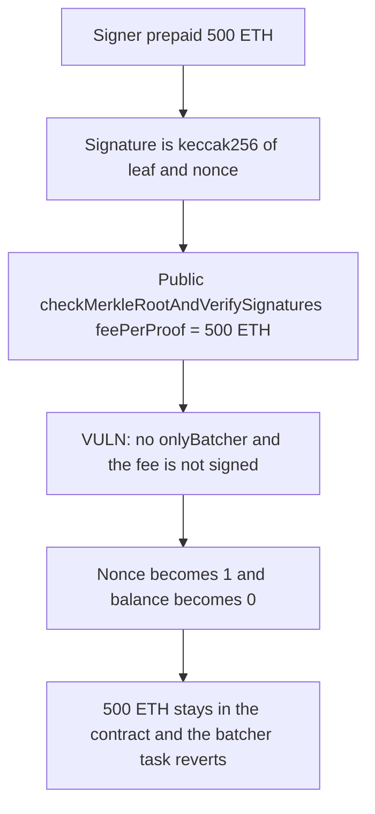

# Aligned Layer: public signature check lets anyone zero a prepaid balance

> **Vulnerability classes:** `vuln/access-control` · `vuln/auth` · `vuln/input-validation` · `vuln/dos`

<!-- non-defihacklabs -->
<!-- source-auditvault: https://github.com/Auditware/AuditVault/blob/main/findings/38363-public-visibility-on-checkmerklerootandverifysignatures-allo.md -->
<!-- date: 2024-08 -->

## Key info

| Field | Value |
|---|---|
| **Loss** | **500 ETH** prepaid balance zeroed (user balance 500 ether → 0). The ether stays in the payment contract and is no longer withdrawable |
| **Vulnerable contract** | `BatcherPaymentService.checkMerkleRootAndVerifySignatures` |
| **Attacker EOA** | `0x1111111111111111111111111111111111111111` |
| **Attack contract** | `Exploit` |
| **Attack tx** | `Exploit.run()` |
| **Chain / block / date** | Ethereum model · block 0 · 2024-08 |
| **Compiler** | solc 0.8.27, cancun, via IR |
| **Bug class** | public balance debit with an unsigned fee |

## TL;DR

`createNewTask` is `onlyBatcher` and computes `feePerProof` from gas. `checkMerkleRootAndVerifySignatures` is public and takes `feePerProof` from the caller. The user signs `keccak256(abi.encodePacked(leaf, nonce))`, which does not include the fee. A permissionless caller replays that signature with `feePerProof` equal to the 500 ETH prepaid balance. The balance becomes 0, the nonce becomes 1, and the batcher's later task reverts.

## The vulnerable code

```solidity
function checkMerkleRootAndVerifySignatures(
    bytes32[] calldata leaves,
    bytes32 batchMerkleRoot,
    SignatureData[] calldata signatures,
    uint256 feePerProof
) public virtual { // @> VULN: no onlyBatcher; feePerProof is a free argument
    _checkMerkleRootAndVerifySignatures(leaves, batchMerkleRoot, signatures, feePerProof);
}

bytes32 noncedHash = keccak256(abi.encodePacked(hash, signatureData.nonce));
require(user_data.nonce == signatureData.nonce, "Invalid Nonce");
user_data.nonce++;
user_data.balance -= feePerProof; // @> VULN: caller-chosen feePerProof drains the signer
```

The production fix made the function private (Aligned Layer PR 801). The control contract keeps the same body behind `onlyBatcher`. An authorized 1 ETH fee leaves 499 ETH. It does not hit 0.

## Root cause

Signature verification and the balance debit live in a public function. The signed payload does not bind `feePerProof`, and nothing checks `msg.sender`.

## Preconditions

- A user has a prepaid balance (here, 500 ETH).
- The caller has a valid signature over `(leaf, nonce)` for that user. That signature is what the batcher would submit in `createNewTask`.

## Attack walkthrough

1. Recover the signer from `keccak256(leaf, nonce)`. The fee is not in the hash.
2. Credit that signer 500 ETH.
3. Call the public check with `feePerProof = 500 ETH` and the same signature.
4. The nonce increments and the balance becomes 0. The 500 ETH remains in the contract.
5. Reusing the signature reverts with `Invalid Nonce`.

## Diagrams



## Impact

The signer loses the entire prepaid balance. In this PoC that is 500 ETH: `user_balances` is 0 and the contract still holds 500 ETH. The burned nonce also blocks the legitimate `createNewTask` that carried the same signature.

## Remediation

Make `checkMerkleRootAndVerifySignatures` private, as in PR 801, and only call it from `onlyBatcher` `createNewTask`. Bind `feePerProof` into the signed hash.

## How to reproduce

```bash
cd 38363-public-visibility-on-checkmerklerootandverifysignatures-allo_exp
forge test -vv
```

## Sources

- AuditVault finding: https://github.com/Auditware/AuditVault/blob/main/findings/38363-public-visibility-on-checkmerklerootandverifysignatures-allo.md
- Consensys Diligence, Aligned Layer, August 2024: https://consensys.net/diligence/audits/2024/08/aligned-layer/
- Fix: https://github.com/yetanotherco/aligned_layer/pull/801
