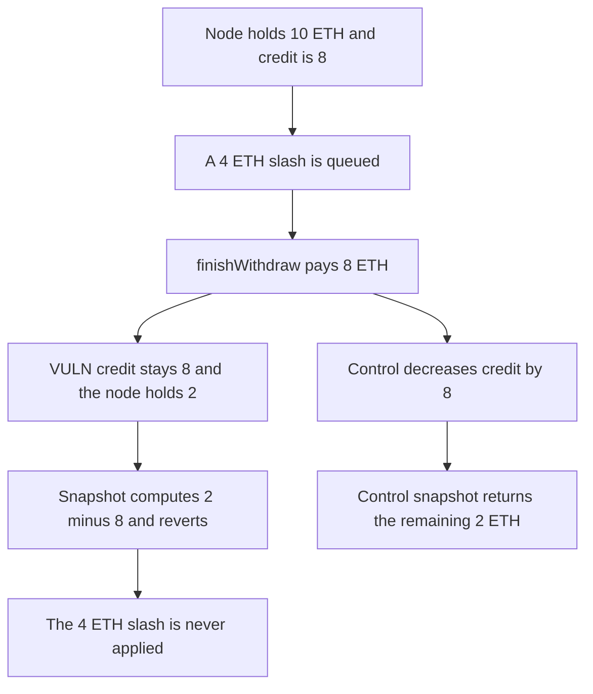

# Karak: finishWithdraw pays 8 ETH and the slash snapshot underflows

> **Vulnerability classes:** `vuln/arithmetic/underflow` · `vuln/logic/state-update`

<!-- non-defihacklabs -->
<!-- source-auditvault: https://github.com/Auditware/AuditVault/blob/main/findings/38489-h-01-user-can-prevent-balance-updates-by-withdrawing-pashov.md -->
<!-- date: 2024-06 -->

## Key info

| Field | Value |
|---|---|
| **Loss** | 8 ETH is paid and a queued 4 ETH slash is never applied. The snapshot reverts on 2 ETH minus 8 ETH |
| **Vulnerable contract** | `NativeVault.finishWithdraw` |
| **Attacker EOA** | `0x1111111111111111111111111111111111111111` |
| **Attack contract** | `Exploit` |
| **Attack tx** | `Exploit.run()` |
| **Chain / block / date** | Ethereum model · block 0 · 2024-06 |
| **Compiler** | solc 0.8.27, cancun, via IR |
| **Bug class** | Withdrawal leaves `creditedNodeETH` unchanged, so `balance - creditedNodeETH` underflows |

## TL;DR

The node holds 10 ETH and `creditedNodeETH` is 8. A 4 ETH slash is queued for the next snapshot. `finishWithdraw` sends the 8 ETH and does not decrease `creditedNodeETH`. The node then holds 2 ETH against 8 ETH of credit. `_startSnapshot`'s `nodeBalanceWei = balance - creditedNodeETH` underflows, so the slash stays queued at 4 ETH. Decreasing `creditedNodeETH` in `finishWithdraw` lets the snapshot return the 2 ETH still in the node.

## Background

Pashov Audit Group, Karak security review, June 2024, finding H-01. The report's line is `uint256 nodeBalanceWei = node.nodeAddress.balance - node.creditedNodeETH` inside `_startSnapshot`, and the missing update is in `finishWithdraw`. The review says a user who is about to be slashed can withdraw and block the balance update. This reduction uses an ETH token so the playground can read the balance. The subtraction is the one in the report.

## The vulnerable code

```solidity
function finishWithdraw(address to, uint256 amount) external {
    node.withdraw(to, amount); // @> VULN: creditedNodeETH is not decreased by amount
}

function startSnapshot() external returns (uint256 nodeBalanceWei) {
    nodeBalanceWei = eth.balanceOf(address(node)) - creditedNodeETH;
    // slash is applied only if this subtraction succeeds
}
```

The report's fix is to decrease `creditedNodeETH` by the amount just withdrawn.

## Root cause

The node's token balance and `creditedNodeETH` are a pair. `finishWithdraw` updates only the balance. The next snapshot subtracts the stale credit from the smaller balance and reverts, so no later slash or reward update can be recorded.

## Preconditions

- The node holds 10 ETH, of which 8 is credited.
- A 4 ETH slash is waiting on the snapshot. It is not applied inside `finishWithdraw`.
- The credited user can call `finishWithdraw`. That is the path the report calls out.

## Attack walkthrough

1. Credit is set to 8 ETH and a 4 ETH slash is queued.
2. `finishWithdraw` pays 8 ETH. Credit stays 8. The node holds 2 ETH.
3. `startSnapshot` computes 2 minus 8 and reverts.
4. `pendingSlash` is still 4 ETH. The 8 ETH payment is not reduced.
5. The control subtracts the 8 ETH from credit first. The snapshot then returns 2 ETH and does not revert.

## Diagrams



## Impact

The withdrawer receives 8 ETH. A fair payout after the queued 4 ETH slash would have been 4 ETH, so 4 ETH of the slash is not taken. The snapshot that would have applied it reverts, and it keeps reverting until credit is repaired. The 2 ETH left in the node cannot be attributed. The control snapshot completes and returns that 2 ETH.

## Remediation

In `finishWithdraw`, subtract the paid amount from `creditedNodeETH` before the next snapshot reads it.

## How to reproduce

```bash
cd 38489-h-01-user-can-prevent-balance-updates-by-withdrawing-pashov_exp
forge test -vv
```

`test_exploit_withdraw_bricks_the_slash_snapshot` asserts an 8 ETH payment, credit still 8, the slash still 4, and a reverted snapshot. `test_control_decrement_lets_the_snapshot_finish` asserts credit is 0 after the withdraw and the snapshot returns 2 ETH.

## Sources

- AuditVault finding: https://github.com/Auditware/AuditVault/blob/main/findings/38489-h-01-user-can-prevent-balance-updates-by-withdrawing-pashov.md
- Pashov review: https://github.com/pashov/audits/blob/master/team/md/Karak-security-review-June.md
- Quoted line: `_startSnapshot`, `node.nodeAddress.balance - node.creditedNodeETH`
