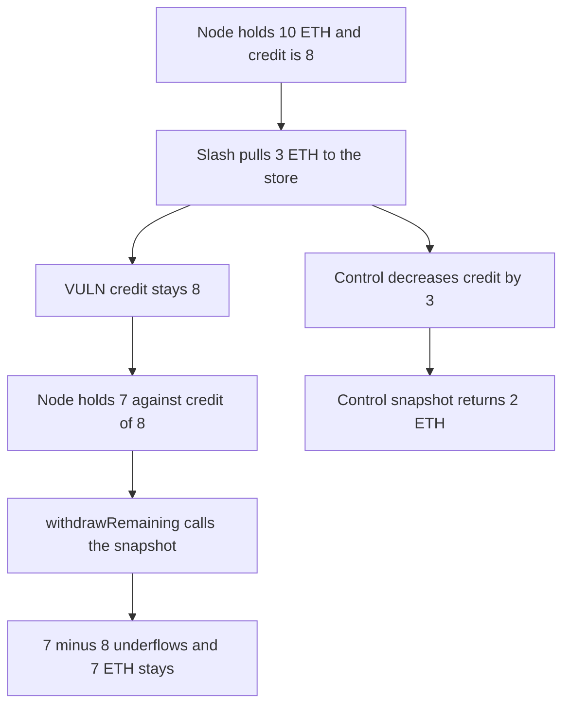

# Karak: a slash moves 3 ETH and freezes the 7 ETH left in the node

> **Vulnerability classes:** `vuln/arithmetic/underflow` · `vuln/dos/frozen-funds`

<!-- non-defihacklabs -->
<!-- source-auditvault: https://github.com/Auditware/AuditVault/blob/main/findings/38490-h-02-broken-balance-update-if-a-slash-event-happens-pashov-a.md -->
<!-- date: 2024-06 -->

## Key info

| Field | Value |
|---|---|
| **Loss** | 7 ETH cannot leave the node. Credit stays 8 against a balance of 7, and the snapshot underflows |
| **Vulnerable contract** | `NativeVault.transferToSlashStore` |
| **Attacker EOA** | `0x1111111111111111111111111111111111111111` |
| **Attack contract** | `Exploit` |
| **Attack tx** | `Exploit.run()` |
| **Chain / block / date** | Ethereum model · block 0 · 2024-06 |
| **Compiler** | solc 0.8.27, cancun, via IR |
| **Bug class** | Slash transfer does not decrease `creditedNodeETH` |

## TL;DR

`_transferToSlashStore` sends the slash ETH off the node and does not decrease `creditedNodeETH`. A node with 10 ETH and 8 ETH of credit slashes 3 ETH. The slash store holds 3. The node holds 7. Credit is still 8. `withdrawRemaining` calls `_startSnapshot` first, `7 - 8` underflows, and the 7 ETH stays in the node. Decreasing credit by the 3 ETH lets the snapshot return the 2 ETH of unattributed balance (`7 - 5`).

## Background

Pashov Audit Group, the same June 2024 Karak review, finding H-02. H-01 is the withdraw path. This one is the slash path, and the underflow line is the same: `node.nodeAddress.balance - node.creditedNodeETH`. The fix the review asks for is to update `creditedNodeETH` inside `_transferToSlashStore`. The two findings do not share a function, so they are separate reductions.

## The vulnerable code

```solidity
function transferToSlashStore(uint256 amount) external {
    node.withdraw(address(slashStore), amount); // @> VULN: creditedNodeETH is not decreased by the slash
}

function startSnapshot() external returns (uint256 nodeBalanceWei) {
    nodeBalanceWei = eth.balanceOf(address(node)) - creditedNodeETH;
}
```

## Root cause

The slash moves ETH and leaves the credit that described that ETH in place. The snapshot's subtraction assumes credit is never larger than the balance. After the slash it is, so every snapshot reverts, and the withdraw path that starts with a snapshot cannot pay the remainder.

## Preconditions

- The node holds 10 ETH and `creditedNodeETH` is 8.
- A 3 ETH slash is transferred to the slash store.
- The remaining balance is withdrawn only through a function that snapshots first.

## Attack walkthrough

1. Credit is 8 ETH on a 10 ETH node.
2. `transferToSlashStore(3)` pays the slash store. Credit stays 8. The node holds 7.
3. The books are short 1 ETH: 8 of credit against 7 of balance.
4. `withdrawRemaining` calls `startSnapshot`. The subtraction reverts.
5. The node still holds 7 ETH.
6. The control sets credit to 5 and the snapshot returns 2.

## Diagrams



## Impact

The slash store correctly holds 3 ETH. The other 7 ETH is frozen: the only withdraw calls the snapshot, and the snapshot reverts. Stakers cannot be debited for the slash and cannot exit. The shortfall between credit and balance is 1 ETH. The control snapshot completes.

## Remediation

Subtract the slashed amount from `creditedNodeETH` inside `_transferToSlashStore`, before any snapshot reads the pair.

## How to reproduce

```bash
cd 38490-h-02-broken-balance-update-if-a-slash-event-happens-pashov-a_exp
forge test -vv
```

`test_exploit_slash_freezes_the_remaining_eth` asserts the withdraw reverts, the node holds 7 ETH, the store holds 3, and credit is 8. `test_control_slash_decrements_credit_and_snapshot_works` asserts credit is 5 and the snapshot returns 2 ETH.

## Sources

- AuditVault finding: https://github.com/Auditware/AuditVault/blob/main/findings/38490-h-02-broken-balance-update-if-a-slash-event-happens-pashov-a.md
- Pashov review: https://github.com/pashov/audits/blob/master/team/md/Karak-security-review-June.md
- Quoted line: `_startSnapshot`, `node.nodeAddress.balance - node.creditedNodeETH`, missing update in `_transferToSlashStore`
