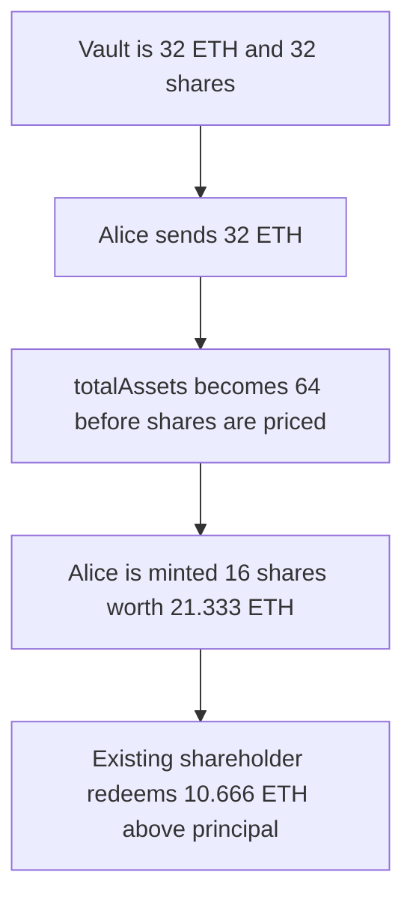

# Karak: _increaseBalance mints shares after the deposit is already in totalAssets

> **Vulnerability classes:** `vuln/logic/price-calculation`

<!-- non-defihacklabs -->
<!-- source-auditvault: https://github.com/Auditware/AuditVault/blob/main/findings/38492-h-04-increasebalance-mints-fewer-shares-than-expected-pasho.md -->
<!-- date: 2024-06 -->

## Key info

| Field | Value |
|---|---|
| **Loss** | Alice pays 32 ETH and receives shares worth 21.333 ETH. The existing shareholder extracts 10.666 ETH |
| **Vulnerable contract** | `NativeVault._increaseBalance` |
| **Attacker EOA** | `0x1111111111111111111111111111111111111111` |
| **Attack contract** | `Exploit` (existing shareholder) |
| **Attack tx** | `Exploit.run()` |
| **Chain / block / date** | Local synthetic · 2024-06 |
| **Compiler** | solc 0.8.27, cancun, via IR |
| **Bug class** | Share price is read after the new assets are added |

## TL;DR

The vault starts at 32 ETH and 32 shares, a 1:1 rate. `_increaseBalance` does `totalAssets += assets` before `convertToShares`. Alice's 32 ETH is priced against 64 ETH of assets and 32 shares, so she is minted 16 shares. Those shares are worth 21.333 ETH. The original 32 shares redeem for 42.666 ETH. After parking the 32 ETH principal, the shareholder's profit is 10.666 ETH, which is Alice's loss aside from 1 wei of rounding left in the vault.

## The vulnerable code

```solidity
if (assets + totalAssets > maxDeposit(_of)) revert DepositMoreThanMax();
totalAssets += assets; // @> VULN
uint256 shares = convertToShares(assets);
_mint(_of, shares);
ownerToNode[_of] += assets;
```

`increaseBalanceFixed` mints the shares first, then adds the assets. Alice receives 32 shares. The original holder redeems exactly 32 ETH, and Alice's remaining shares are worth 32 ETH.

## Root cause

`convertToShares` is `assets * supply / totalAssets`. Including the deposit in `totalAssets` before the division charges the depositor the post-deposit price, so part of their assets is donated to existing shareholders.

## Preconditions

- The vault is already open at a 1:1 rate (the report's 32 ETH / 32e18 shares).
- `maxDeposit` is above the post-deposit total (1000 ETH here), so the guard does not revert.
- An existing shareholder can redeem after the mispriced mint.

## Attack walkthrough

1. Bootstrap 32 ETH and 32 shares to the existing shareholder.
2. Alice calls `increaseBalance` with 32 ETH.
3. `totalAssets` becomes 64 before the share calculation. Shares minted = `32 * 32 / 64 = 16`.
4. Supply is 48. Alice's 16 shares preview to `16 * 64 / 48 = 21.333 ETH`.
5. The shareholder redeems 32 shares for `32 * 64 / 48 = 42.666 ETH` and returns 32 ETH of principal. Profit is 10.666 ETH.

## Diagrams



## Impact

The depositor loses 10.666 ETH of the 32 ETH they just added. That value accrues to whoever already held shares. The report's arithmetic is the same: 32 ETH of new assets produces 16e18 shares worth 21.33 ETH.

## How to reproduce

```bash
cd 38492-h-04-increasebalance-mints-fewer-shares-than-expected-pasho_exp
forge test -vv
```

## Sources

- AuditVault finding: https://github.com/Auditware/AuditVault/blob/main/findings/38492-h-04-increasebalance-mints-fewer-shares-than-expected-pasho.md
- Report: https://github.com/pashov/audits/blob/master/team/md/Karak-security-review-June.md
- Blamed line: `NativeVault._increaseBalance` `totalAssets += assets` before `convertToShares`
