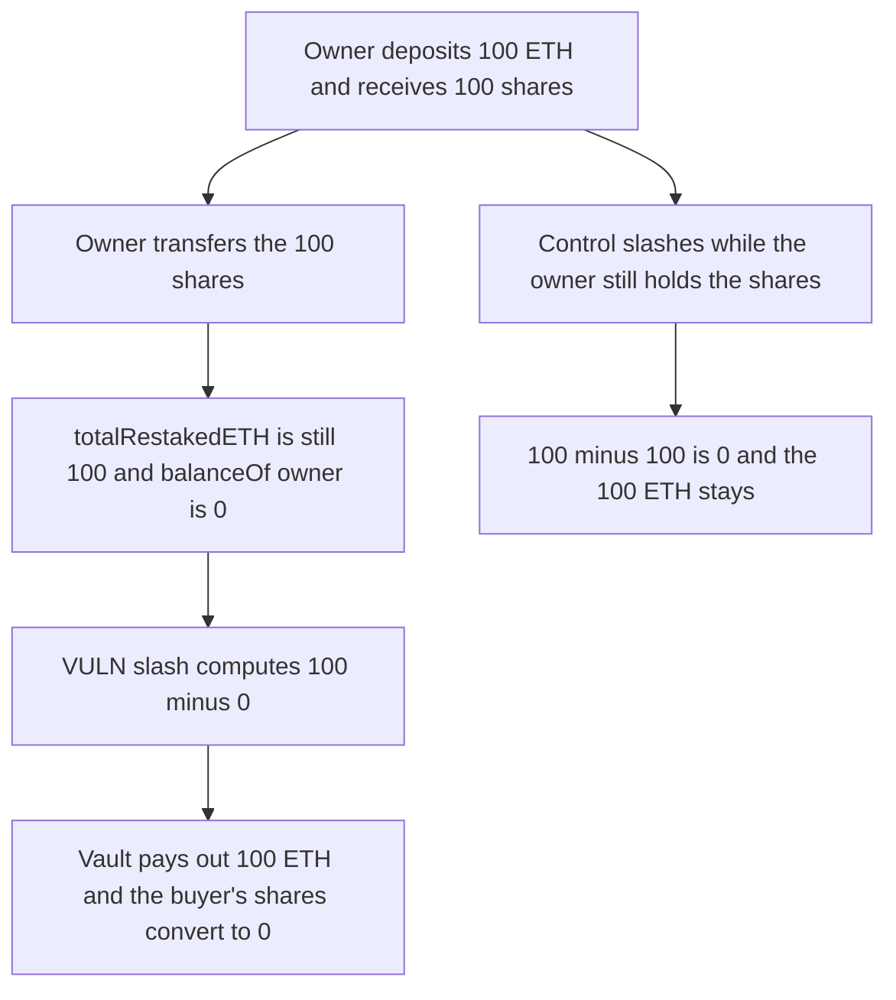

# Karak slash charges a node owner for shares that were already transferred

> **Vulnerability classes:** vuln/logic/share-slash · vuln/arithmetic/restaked-balance

<!-- non-defihacklabs -->
<!-- source-auditvault: https://github.com/Auditware/AuditVault/blob/main/findings/38493-h-05-transferring-nativevault-tokens-can-break-some-function.md -->
<!-- date: 1970-01 -->

## Key info

| Field | Value |
|---|---|
| **Loss** | 100 ETH of share backing is slashed. The buyer still holds 100 shares and those shares convert to 0 |
| **Vulnerable contract** | `NativeVault.slash` |
| **Attacker EOA** | `0x1111111111111111111111111111111111111111` |
| **Attack contract** | `Exploit` at `0x15452ec016c4dc8c549e7fe6ff4b26324ea8b7a4` |
| **Attack tx** | `Exploit.run()` |
| **Chain / block / date** | Ethereum model · block 0 · 1970-01 |
| **Compiler** | solc 0.8.27, cancun, via IR |
| **Bug class** | Slash uses totalRestakedETH minus convertToAssets of the owner's remaining balance |



## TL;DR

`slash` computes `totalRestakedETH[owner] - convertToAssets(balanceOf(owner))`. A share transfer changes `balanceOf` and does not change `totalRestakedETH`.

The owner deposits 100 ETH and receives 100 shares, then transfers them. `balanceOf` is 0, so the slash is 100 ETH. The vault pays that 100 out. The buyer still has 100 shares, and `convertToAssets` of those shares is 0.

Calling `slash` while the owner still holds the 100 shares computes 100 - 100 = 0. The vault keeps the 100 ETH.

## The vulnerable code

```solidity
uint256 held = balanceOf[nodeOwner];
uint256 backed = convertToAssets(held);
uint256 restaked = totalRestakedETH[nodeOwner];
slashedAssets = restaked - backed; // @> VULN: a transferred balance slashes the ETH that backs the recipient's shares
totalAssets -= slashedAssets;
```

The quoted line is `node.totalRestakedETH - convertToAssets(balanceOf(nodeOwner))`.

## Impact

100 ETH that backs the transferred shares is slashed. The recipient keeps the shares and the shares are worth 0.
