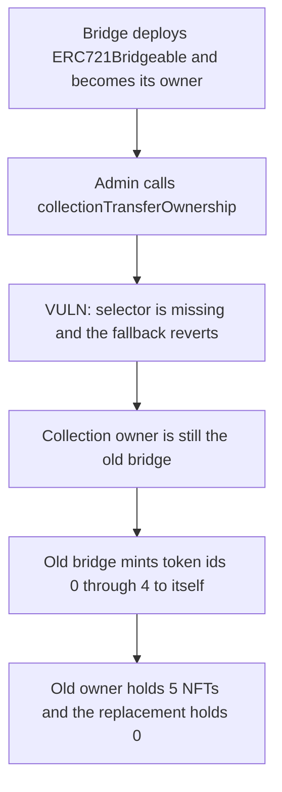

# Starklane — the L1 bridge cannot hand off its ERC721

> **Vulnerability classes:** vuln/dependency/upgradeable-contract · vuln/access-control/centralization

<!-- non-defihacklabs -->
<!-- source-auditvault: https://github.com/Auditware/AuditVault/blob/main/findings/38512-bridge-is-unable-to-transfer-ownership-and-upgrade-on-erc721.md -->
<!-- date: 2024-07 -->

## Key info

| | |
|---|---|
| **Protocol** | ArkProject NFT Bridge (Starklane) |
| **Finding** | CodeHawks, July 2024, AuditVault 38512 |
| **Vulnerable code** | `Starklane` fallback — missing `collectionTransferOwnership` / `collectionUpgrade` |
| **Harm** | Ownership transfer reverts. The old bridge then mints 5 NFTs to itself. |
| **Chain** | local synthetic (audited Ethereum contracts) |

## TL;DR

L2 `Bridge` can call `collection_transfer_ownership` and `collection_upgrade` on a collection. L1 `Starklane` deploys `ERC721Bridgeable` and `initialize` sets that bridge as the owner, but the L1 bridge has no function that forwards `transferOwnership` or `upgradeToAndCall`. The admin call hits `UUPSOwnableProxied.fallback` and reverts with `NotSupportedError`. The compromised bridge remains the minter and mints 5 token ids to itself.

The control adds the missing forwarder. After `transferOwnership`, the same `mintToSelf` reverts and the old bridge's balance stays 0.

## The vulnerable code

`ERC721Bridgeable.mintFromBridge` is `onlyOwner`. The owner is the bridge, because `initialize` does `_transferOwnership(msg.sender)` and the proxy is deployed by the bridge.

```solidity
function mintFromBridge(address to, uint256 id) public onlyOwner {
    _mint(to, id);
}
```

L2 already has the admin forwarders. L1 does not. An unknown selector hits the fallback copied from `UUPSOwnableProxied`:

```solidity
fallback() external payable {
    // @> VULN: collectionTransferOwnership and collectionUpgrade are not implemented, so the call reverts.
    revert NotSupportedError();
}
```

The fix the report asks for:

```solidity
function collectionTransferOwnership(address collection, address newOwner) external onlyOwner {
    ERC721Bridgeable(collection).transferOwnership(newOwner);
}
```

## Root cause

`Deployer.deployERC721Bridgeable` runs in the bridge's context, so the collection owner is the bridge contract, not an EOA. Only that contract can call `transferOwnership` or `upgradeToAndCall`. Starklane never exposes a function that makes those calls. Replacing the bridge admin, or deploying a new bridge proxy, does not move the collection.

## Preconditions

An `ERC721Bridgeable` has already been deployed by the L1 bridge, which is the normal first-withdraw path. The caller is the bridge admin trying to point the collection at a replacement. No L2 message and no second block are required. The failure is the missing L1 function.

## Attack walkthrough

1. The collection owner is the bridge.
2. The admin calls `collectionTransferOwnership(collection, 0xB0B)` on the bridge.
3. The fallback reverts. `owner()` is still the bridge.
4. The bridge calls `mintToSelf` for ids 0 through 4. `mintFromBridge` writes each id to the bridge.
5. `balanceOf(bridge)` is 5. `balanceOf(0xB0B)` is 0. `ownerOf(0)` and `ownerOf(4)` are the bridge.

Control, same collection shape: `collectionTransferOwnership` sets the owner to `0xB0B`. The old bridge's `mintToSelf(0)` reverts inside `mintFromBridge`, and `balanceOf(old bridge)` stays 0.

## Diagrams



## Impact

A compromised or retired bridge cannot be removed as the collection owner, and it cannot upgrade the collection implementation. It keeps `mintFromBridge`. In this run that is 5 NFTs minted to the old owner after the transfer reverted. Every later withdraw from L2 can keep minting under the same stuck owner.

## Remediation

Add `collectionTransferOwnership` and `collectionUpgrade` on the L1 bridge, gated by the bridge admin, matching the L2 `collection_transfer_ownership` and `collection_upgrade` entry points. `collectionUpgrade` should call `upgradeToAndCall` on the collection proxy.

## How to reproduce

```bash
cd 38512-bridge-is-unable-to-transfer-ownership-and-upgrade-on-erc721_exp
forge test -vv
```

## Sources

- AuditVault finding: https://github.com/Auditware/AuditVault/blob/main/findings/38512-bridge-is-unable-to-transfer-ownership-and-upgrade-on-erc721.md
- L1 bridge: https://github.com/Cyfrin/2024-07-ark-project/blob/main/apps/blockchain/ethereum/src/Bridge.sol
- L1 collection: https://github.com/Cyfrin/2024-07-ark-project/blob/main/apps/blockchain/ethereum/src/token/ERC721Bridgeable.sol
- L2 admin forwarders the L1 bridge lacks: https://github.com/Cyfrin/2024-07-ark-project/blob/main/apps/blockchain/starknet/src/bridge.cairo
