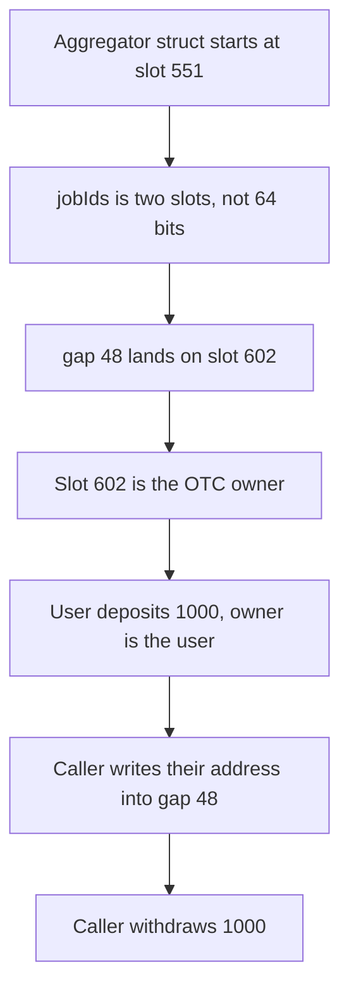

# Gains — aggregator storage overwrites the OTC owner

> **Vulnerability classes:** vuln/access-control/proxy-storage-collision · vuln/logic/state-update

> **Reproduction:** a self-contained Foundry PoC that compiles and runs offline
> with only `forge-std` — no fork and no RPC. Trace: [output.txt](output.txt).
> PoC: [test/40194-h-01-storage-slot-collision-pashov-audit-group-none-gainsnet_exp.sol](test/40194-h-01-storage-slot-collision-pashov-audit-group-none-gainsnet_exp.sol).

<!-- non-defihacklabs -->
<!-- source-auditvault: https://github.com/Auditware/AuditVault/blob/main/findings/40194-h-01-storage-slot-collision-pashov-audit-group-none-gainsnet.md -->
<!-- date: 2024-07 -->

---

## Key info

| | |
|---|---|
| **Impact** | **HIGH** — `gap[48]` is slot **602**, the OTC owner. The caller overwrites the owner and withdraws **1000** collateral |
| **Protocol** | Gains Network `PriceAggregatorStorage` / `OtcStorage` |
| **Vulnerable code** | `bytes32[2] jobIds` counted as 64 bits, so the struct at slot 551 overlaps slot 601 |
| **Bug class** | A two-slot miscount collides the aggregator tail with OTC storage |
| **Finding** | Pashov Audit Group — Gains Network, July 2024 · id 40194, H-01 |
| **Report** | [Gains Network security review, July](https://github.com/pashov/audits/blob/master/team/md/GainsNetwork-security-review-July.md) |
| **Source** | [AuditVault finding](https://github.com/Auditware/AuditVault/blob/main/findings/40194-h-01-storage-slot-collision-pashov-audit-group-none-gainsnet.md) |
| **Status** | The report says shrink `__gap` to 39 or start `GLOBAL_OTC_SLOT` at 603. Reproduced here as a local synthetic. |
| **Compiler** | solc 0.8.27, cancun, via IR |

---

## TL;DR

`PriceAggregatorStorage` is placed at slot **551**. `jobIds` is `bytes32[2]`. That is two full slots, not the 64 bits the layout comment assumed. With a 49-word gap after the packed header and those two words, the struct occupies slots **551** through **602**.

`OtcStorage` starts at **601**. Its balance is slot **601** and its owner is slot **602**. Those are `gap[47]` and `gap[48]`. A Forge `vm.load` after writing the gap reads the same words back from slots 601 and 602.

The user deposits **1000**. The caller writes `gap[48]` to their own address, passes the owner check, and withdraws **1000**.

`run()` does not warp.

## The vulnerable code

```solidity
struct PriceAggregatorStorage {
    address linkUsdPriceFeed; // slot 551, packed with the next two fields
    uint24 twapInterval;
    uint8 minAnswers;
    bytes32[2] jobIds; // slots 552 and 553, not 64 bits
    uint256[49] __gap; // gap[47] is slot 601, gap[48] is slot 602
}

// @> VULN: gap[48] is slot 602, which is OtcStorage.owner
p.__gap[index] = value;
```

`GLOBAL_PRICE_AGGREGATOR_SLOT` is **551**. `GLOBAL_OTC_SLOT` is **601**. The fixed layout starts the OTC struct at **603**. The same `gap[48]` write then leaves the owner as the depositor, and the caller's withdraw reverts. The **1000** stays in the diamond.

## Root cause

The layout comment treats `bytes32[2]` as 64 bits that pack into the first slot. A `bytes32` does not pack into the 64 bits left beside an address, a `uint24`, and a `uint8`. The array takes the next two slots, and the gap is pushed onto the OTC struct.

## Preconditions

- Aggregator storage starts at **551** and OTC storage starts at **601**.
- The gap is 49 words after `jobIds`.
- A user has deposited **1000**, so slot 601 is **1000** and slot 602 is the user's address.
- The tail write is reachable in the same transaction as the withdraw.
- No timestamp change happens inside `run()`.

## Attack walkthrough

1. The user deposits **1000**. Slot 601 is **1000**. Slot 602 is the user.
2. The caller writes `gap[48]` with their own address. That store is slot **602**.
3. `withdraw` reads the OTC owner, sees the caller, and transfers **1000**.
4. The caller holds **1000**. The diamond's token balance is **0**.

Control: OTC storage starts at **603**. The same `gap[48]` write does not change the owner. `withdraw` reverts with `"owner"`. The diamond still holds **1000**.

## Diagrams



## Impact

The depositor's **1000** collateral is withdrawn by the caller who overwrote the owner. The balance and the owner are the first two OTC slots, and both sit inside the aggregator's gap.

## Remediation

Shrink `__gap` so the struct ends at slot **600**, or start `GLOBAL_OTC_SLOT` at **603**. The control uses 603.

## Sources

- [AuditVault finding 40194](https://github.com/Auditware/AuditVault/blob/main/findings/40194-h-01-storage-slot-collision-pashov-audit-group-none-gainsnet.md)
- [Pashov Gains Network security review, July, H-01](https://github.com/pashov/audits/blob/master/team/md/GainsNetwork-security-review-July.md)

### Taxonomy

- `severity/high`
- `vuln/access-control/proxy-storage-collision`
- `vuln/logic/state-update`
