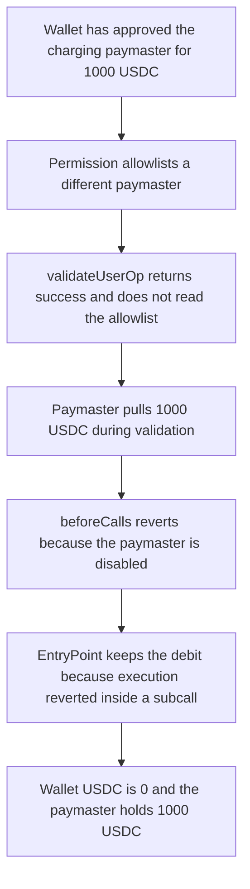

# Coinbase Session Keys — a permission drains an approval given to a non-allowlisted paymaster

> **Vulnerability classes:** vuln/logic/incorrect-order-of-operations · vuln/access-control/broken-logic · vuln/logic/missing-check

> **Reproduction:** cheatcode-free local synthetic. `PermissionManager.beforeCalls` keeps the audited allowlist check. Full trace: [output.txt](output.txt). PoC: [test/40196-permissions-can-drain-approvals-given-to-certain-paymasters_exp.sol](test/40196-permissions-can-drain-approvals-given-to-certain-paymasters_exp.sol).

<!-- non-defihacklabs -->
<!-- source-auditvault: https://github.com/Auditware/AuditVault/blob/main/findings/40196-permissions-can-drain-approvals-given-to-certain-paymasters.md -->
<!-- date: 2024-09 -->

**AuditVault taxonomy:** `lang/solidity` · `sector/account` · `sector/options` · `sector/token` · `platform/spearbit` · `has/github` · `severity/high` · genome: `missing-signer` · `variant` · `direct-drain` · `access-roles` · `account-signer`

## Key info

| | |
|---|---|
| **Protocol** | Coinbase Smart Wallet session-key permissions |
| **Finding** | Spearbit, September 2024, AuditVault 40196 |
| **Vulnerable code** | `PermissionManager.beforeCalls` |
| **Harm** | A non-allowlisted ERC-20 paymaster pulls the wallet's full 1,000 USDC approval during validation. `beforeCalls` then reverts. The wallet is left at 0 and the user operation does not execute |
| **Chain** | local synthetic |

## TL;DR

Session-key user operations are supposed to use an allowlisted paymaster, so a permission cannot spend the account's ETH on gas. The allowlist is checked in `beforeCalls`, which is the execution-phase hook. `validateUserOp` does not look at the paymaster. An ERC-20 paymaster that debits the account inside `validatePaymasterUserOp` therefore gets paid even though execution reverts. Any pre-approval the account gave that paymaster, outside the permission system, can be drained by setting a large gas cost.

## The vulnerable code

Quoted from the Spearbit review (the check the report blames):

```solidity
function beforeCalls(Permission calldata permission, address paymaster, address userOpCosigner)
    external
    whenNotPaused
{
    // ...
    // @> VULN: paymaster allowlist is enforced only in this execution-phase hook, after a paymaster can already have charged
    if (!isPaymasterEnabled[paymaster]) revert DisabledPaymaster(paymaster);
    // ...
}
```

```solidity
// FIX: if (!isPaymasterEnabled[paymaster]) revert DisabledPaymaster(paymaster);
// inside validateUserOp, before the EntryPoint calls validatePaymasterUserOp.
```

The cosigner check lives in the same execution hook, so the cosigner cannot block the charge either. The report's temporary fix moved the cosigner into validation (an immutable cosigner) so an honest cosigner can refuse user operations whose paymaster is not approved.

## Root cause

ERC-4337 runs validation and execution in one `handleOps` transaction, but a revert of the execution call does not roll back the validation calls. `beforeCalls` is on the wrong side of that boundary. The paymaster allowlist is a validation concern: once `validatePaymasterUserOp` returns, the paymaster has already been authorized to charge.

## Preconditions

The account has approved an ERC-20 paymaster for 1,000 USDC outside the permission system. That paymaster is not in `isPaymasterEnabled`. A different paymaster is allowlisted. A session-key permission can submit a user operation and choose the paymaster. The charging paymaster transfers its fee in `validatePaymasterUserOp` and does not refund on a reverted execution.

## Attack walkthrough

1. The wallet approves the charging paymaster for 1,000 USDC (1,000e6).
2. The permission allowlist is turned on for a different paymaster. The charger stays disabled.
3. EntryPoint calls `validateUserOp`. It returns success.
4. The charger `transferFrom`s 1,000 USDC from the wallet to itself.
5. EntryPoint calls `beforeCalls` with a low-level call. The allowlist check reverts `DisabledPaymaster`.
6. `executionReverted` is true. Wallet USDC is 0. Paymaster USDC is 1,000.

The control runs the same allowlist test inside `validateUserOp`, before any transfer. The call reverts `DisabledPaymaster` and the wallet still holds 1,000 USDC. The paymaster balance stays 0.

## Diagrams



## Impact

The session key spends an approval the user gave to a paymaster for a different purpose. In this reduction the whole 1,000 USDC allowance moves, and the intended calls never run. Repeating the pattern against the same approval is limited by the remaining allowance; the report notes a permission can set the gas cost high enough to empty it in one validation.

## Remediation

Reject a disabled paymaster inside validation, before `validatePaymasterUserOp`. The Spearbit note records that making the cosigner immutable and checking it in validation is enough when that cosigner only signs operations with approved paymasters. Later Coinbase spend permissions avoid this class by not routing spends through an ERC-4337 paymaster at all.

## How to reproduce

```bash
cd 40196-permissions-can-drain-approvals-given-to-certain-paymasters_exp
forge test -vv
```

## Sources

- AuditVault finding: https://github.com/Auditware/AuditVault/blob/main/findings/40196-permissions-can-drain-approvals-given-to-certain-paymasters.md
- Spearbit report: https://github.com/spearbit/portfolio/blob/master/pdfs/Coinbase-Session-Keys-Spearbit-Security-Review-September-2024.pdf
- Session-key permissions repo, later replaced by spend permissions: https://github.com/coinbase/smart-wallet-permissions
- Why the successor design avoids ERC-4337 paymasters: https://github.com/coinbase/spend-permissions
