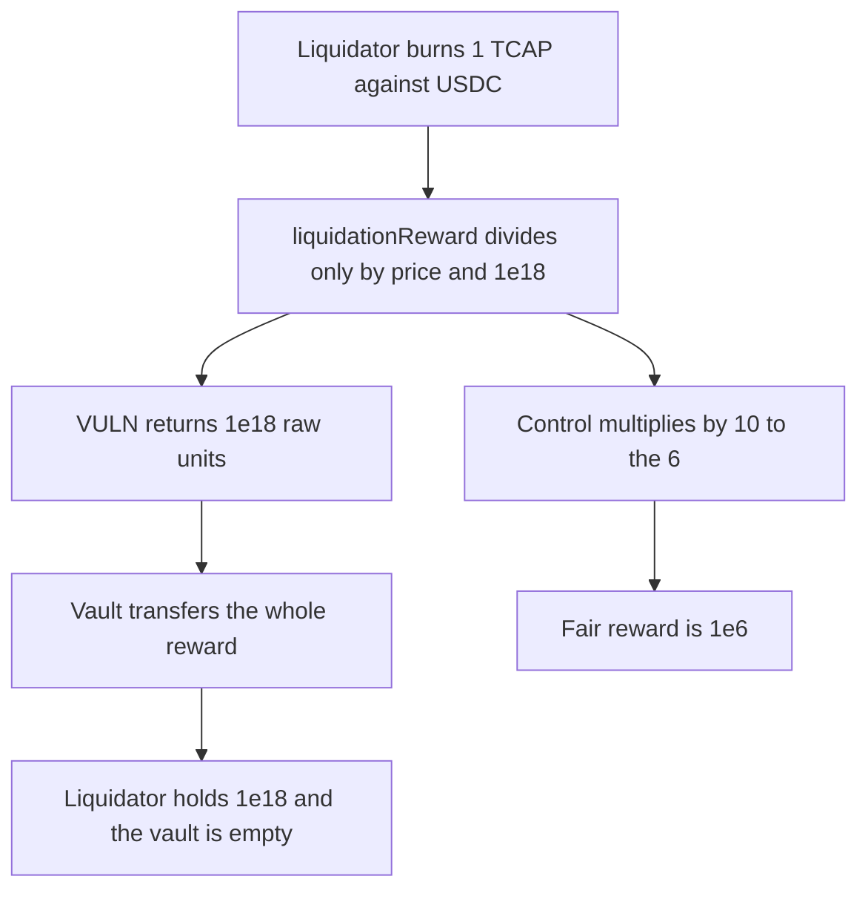

# Cryptex: liquidationReward pays a 6-decimal collateral as if it had 18 decimals

> **Vulnerability classes:** `vuln/arithmetic/decimal-mismatch`

<!-- non-defihacklabs -->
<!-- source-auditvault: https://github.com/Auditware/AuditVault/blob/main/findings/40209-calculating-liquidationreward-without-considering-collateral.md -->
<!-- date: 2024-09 -->

## Key info

| Field | Value |
|---|---|
| **Loss** | Liquidator receives 1e18 raw USDC units for 1 TCAP. The fair 6-decimal amount is 1e6. The vault is emptied |
| **Vulnerable contract** | `LiquidationLib.liquidationReward` |
| **Attacker EOA** | `0x1111111111111111111111111111111111111111` |
| **Attack contract** | `Exploit` |
| **Attack tx** | `Exploit.run()` |
| **Chain / block / date** | Ethereum model · block 0 · 2024-09 |
| **Compiler** | solc 0.8.27, cancun |
| **Bug class** | reward formula omits collateral decimals |

## TL;DR

`liquidationReward` computes `burnAmount * tcapPrice * (1e18 + penalty) / collateralPrice / 1e18` and never scales by the collateral's decimals. Burning 1 TCAP priced at $1 against $1 USDC returns `1e18` raw units instead of `1e6`. The vault, seeded with that buggy amount, pays all of it to the liquidator.

## The vulnerable code

```solidity
function liquidationReward(uint256 burnAmount, uint256 tcapPrice, uint256 collateralPrice, uint64 liquidationPenalty) public pure returns (uint256) {
    return burnAmount * tcapPrice * (1e18 + liquidationPenalty) / collateralPrice / 1e18; // @> VULN: ignores collateral decimals
}
```

The Cantina fix multiplies by `10 ** collateralDecimals` and divides by `10 ** 18`:

```diff
- return burnAmount * tcapPrice * (1e18 + liquidationPenalty) / collateralPrice / 1e18;
+ return burnAmount * tcapPrice * (1e18 + liquidationPenalty) * 10 ** collateralDecimals / collateralPrice / 1e18 / 10 ** 18;
```

## Root cause

TCAP amounts and both prices are 18-decimal wads. Dividing only by `collateralPrice` and `1e18` leaves an 18-decimal token amount. USDC has 6 decimals, so the same number is `1e12` times too many units. The control with `collateralDecimals = 6` returns `1e6`.

## Preconditions

- Collateral is USDC, 6 decimals, price `1e18` per token.
- The liquidator burns `1e18` TCAP units at `tcapPrice = 1e18` with a zero penalty.
- The vault holds `1e18` raw USDC units, which is exactly the buggy reward.

## Attack walkthrough

1. `CollateralVault.liquidate` asks `LiquidationLib` for the reward.
2. The return expression yields `1e18`.
3. The vault transfers that balance to the liquidator.
4. The fair amount, scaled by `10 ** 6 / 10 ** 18`, is `1e6`.
5. The vault balance is 0.

## Diagrams



## Impact

The liquidator is paid `1e18` raw USDC units, which is `1e12` whole tokens, for one dollar of TCAP. Every other depositor in that collateral vault funds the difference. With a 6-decimal collateral the overpayment is `10 ** (18 - decimals)`.

## How to reproduce

```bash
cd 40209-calculating-liquidationreward-without-considering-collateral_exp
forge test -vv
```

`output.txt` is the captured passing run. The control test checks the recommended fix.

## Sources

- AuditVault finding: https://github.com/Auditware/AuditVault/blob/main/findings/40209-calculating-liquidationreward-without-considering-collateral.md
- Report: https://cdn.cantina.xyz/reports/cantina_cryptex_sep2024.pdf
- Provenance: Cantina Cryptex review, September 2024. Function quoted in the finding as LiquidationLib.sol lines 17-19. Fixed in Cryptex PR 9.
