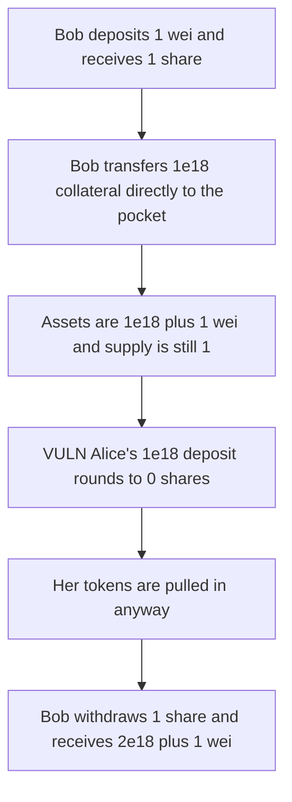

# Cryptex: a 1 wei Pocket deposit plus a donation takes the next 1e18

> **Vulnerability classes:** `vuln/arithmetic/rounding` · `vuln/arithmetic/precision-loss`

<!-- non-defihacklabs -->
<!-- source-auditvault: https://github.com/Auditware/AuditVault/blob/main/findings/40210-depositing-to-pocket-is-vulnerable-to-inflation-attacks-cant.md -->
<!-- date: 2024-09 -->

## Key info

| Field | Value |
|---|---|
| **Loss** | 1e18 collateral. Alice receives 0 shares and Bob withdraws her deposit |
| **Vulnerable contract** | `Pocket.deposit` |
| **Attacker EOA** | `0x1111111111111111111111111111111111111111` (Bob) |
| **Attack contract** | `Exploit` |
| **Attack tx** | `Exploit.run()` |
| **Chain / block / date** | Ethereum model · block 0 · 2024-09 |
| **Compiler** | solc 0.8.27, cancun, via IR |
| **Bug class** | Share price reads token.balanceOf, so a donation rounds the next deposit to 0 |

## TL;DR

`Pocket.deposit` mints `assets * supply / token.balanceOf(pocket)` once supply is non-zero. Bob deposits 1 wei, receives 1 share, and transfers 1e18 collateral straight to the pocket. Alice then deposits 1e18. The division is `1e18 * 1 / (1e18 + 1)`, which is 0. Her tokens are still pulled in. Bob withdraws his 1 share and receives `2e18 + 1`. His profit is Alice's 1e18. A virtual-share denominator leaves Alice with shares and stops Bob from taking her deposit.

## Background

Cantina's September 2024 Cryptex review, reported by cccz, on `BasePocket.sol` around line 50. The report walks the classic ERC-4626 inflation: a 1 wei first deposit, a direct donation of the victim's size, and a victim deposit that rounds to 0 shares. Cryptex fixed it in commit `18949206`. The report's mitigations are an ERC-4626 router with `minSharesOut`, internal asset accounting, dead shares, or virtual shares plus a decimals offset.

## The vulnerable code

```solidity
uint256 supply = totalSupply;
uint256 assetsBefore = token.balanceOf(address(this));
if (supply == 0) {
    shares = assets;
} else {
    shares = assets * supply / assetsBefore; // @> VULN: rounds to 0 after a donation inflates assetsBefore
}
token.transferFrom(msg.sender, address(this), assets);
```

`assetsBefore` includes any tokens sent to the pocket outside `deposit`. The victim's own deposit is not in that denominator, which matches the report's `1 * 1e18 / (1e18 + 1)`.

Virtual shares, one of the report's mitigations, keep the next deposit non-zero:

```diff
- shares = assets * supply / assetsBefore;
+ shares = assets * (supply + 1000) / (assetsBefore + 1);
```

## Root cause

The share price is the raw token balance, not an internal asset counter. A transfer that is not a deposit raises the price without minting shares. With 1 share outstanding, any donation of `1e18` or more makes a `1e18` deposit round down to 0, and the vault still takes the tokens. The 1 share then owns the whole balance.

## Preconditions

- The pocket has no shares yet.
- Bob can deposit 1 wei and transfer 1e18 collateral to the pocket before Alice's deposit.
- Alice deposits 1e18 and the vault does not revert on a 0-share mint.

## Attack walkthrough

1. Bob deposits 1 wei. Supply is 0, so he receives 1 share. The pocket holds 1 wei.
2. Bob transfers 1e18 collateral to the pocket. Supply is still 1. Assets are `1e18 + 1`.
3. Alice deposits 1e18. Shares compute to 0. `transferFrom` still moves her 1e18. The pocket holds `2e18 + 1`.
4. Bob withdraws 1 share. `1 * (2e18 + 1) / 1 = 2e18 + 1` is paid to him.
5. Alice's token balance is 0 and her share balance is 0. Bob's balance rose by 1e18.
6. The control uses virtual shares. After the same donation Alice's share balance is non-zero, and Bob's withdraw is under `1.5e18`, so he cannot take her deposit.

## Diagrams



## Impact

Alice loses 1e18 collateral. She holds no shares, so she has no claim on the pocket. Bob's net profit is that 1e18: he put in 1 wei plus a 1e18 donation and withdrew `2e18 + 1`. The virtual-share control leaves a claim for Alice and returns Bob less than `1.5e18`.

## Remediation

Do not price shares off `token.balanceOf`. Use internal asset accounting, dead shares, or virtual shares with a decimals offset, and revert when minted shares are 0. Cryptex applied the fix in commit `18949206`.

## How to reproduce

```bash
cd 40210-depositing-to-pocket-is-vulnerable-to-inflation-attacks-cant_exp
forge test -vv
```

`test_exploit_alice_receives_zero_shares` asserts Alice minted 0, her balance is 0, and Bob's profit is 1e18. `test_control_virtual_shares_leave_alice_a_balance` asserts Alice receives shares and Bob cannot withdraw her deposit. Captured output is `output.txt`.

## Sources

- AuditVault finding: https://github.com/Auditware/AuditVault/blob/main/findings/40210-depositing-to-pocket-is-vulnerable-to-inflation-attacks-cant.md
- Cantina report: https://cdn.cantina.xyz/reports/cantina_cryptex_sep2024.pdf
- Fix: Cryptex commit `18949206`, as cited in the finding. The finding does not publish the full hash.
