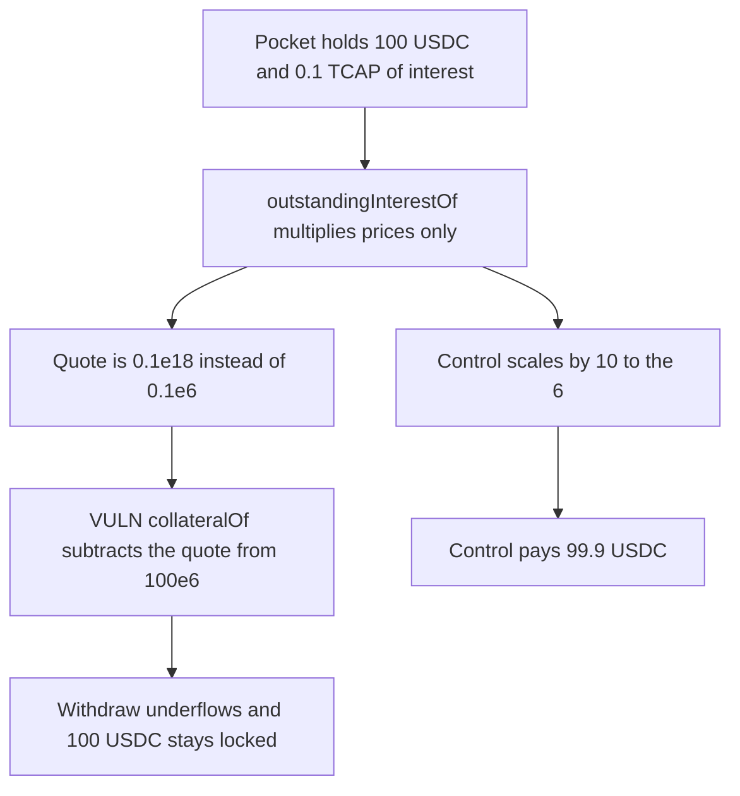

# Cryptex: unscaled interest underflows a 100 USDC withdrawal

> **Vulnerability classes:** `vuln/arithmetic/decimal-mismatch` · `vuln/dos/frozen-funds`

<!-- non-defihacklabs -->
<!-- source-auditvault: https://github.com/Auditware/AuditVault/blob/main/findings/40211-calculating-interest-without-considering-the-collateral-deci.md -->
<!-- date: 2024-09 -->

## Key info

| Field | Value |
|---|---|
| **Loss** | 100 USDC stays in the vault. Withdrawal underflows |
| **Vulnerable contract** | `Vault.outstandingInterestOf` / `Vault.collateralOf` |
| **Attacker EOA** | `0x1111111111111111111111111111111111111111` |
| **Attack contract** | `Exploit` |
| **Attack tx** | `Exploit.run()` |
| **Chain / block / date** | Ethereum model · block 0 · 2024-09 |
| **Compiler** | solc 0.8.27, cancun, via IR |
| **Bug class** | 18-decimal TCAP interest is charged against 6-decimal collateral |

## TL;DR

`outstandingInterestOf` returns `interest * tcapPrice / collateralPrice` and never scales to the collateral's 6 decimals. Stored interest of 0.1 TCAP is `0.1e18`. Both prices are `1e18`, so the quote is `0.1e18`. `collateralOf` subtracts that from a 100e6 USDC deposit and underflows, so withdraw reverts and the 100 USDC stays in the vault. Multiplying by `10**6` and dividing by `1e18` charges 0.1 USDC and pays 99.9 USDC back.

## Background

Cantina's September 2024 Cryptex review. The report's proof logged `outstandingInterest` as `0.1e18` when collateral was 6 decimals, then `collateralOf` panicked. Interest is already stored here. The conversion does not read the clock, so no time warp is used.

## The vulnerable code

```solidity
uint256 interestAmount = interestOf[_toMintId(user, pocketId)];
uint256 quoted = interestAmount * tcapLatestPrice() / latestPrice();
return quoted;
```

`collateralOf` then does:

```solidity
// @> VULN: TCAP interest is converted without collateral decimals, so 0.1e18 is charged instead of 0.1e6
return deposits[_toMintId(user, pocketId)] - outstandingInterestOf(user, pocketId);
```

`100e6 - 0.1e18` does not fit in a uint256 subtraction.

## Root cause

TCAP amounts are 18 decimals and this collateral is 6. The price ratio is 1, so the decimal gap is left in the interest charge.

## Preconditions

- Collateral decimals are 6. The pocket deposit is 100e6.
- Accrued interest is 0.1e18. TCAP price and collateral price are both 1e18.
- The user calls withdraw.

## Attack walkthrough

1. `outstandingInterestOf` returns `0.1e18`.
2. That quote is larger than the 100 USDC deposit.
3. `withdraw` calls `collateralOf`. The subtraction underflows and the call reverts.
4. The vault still holds 100e6. The user holds 0.
5. The control charges `0.1e18 * 10**6 / 10**18 = 0.1e6` and pays `100e6 - 0.1e6`.

## Diagrams



## Impact

The borrower cannot withdraw the 100 USDC. Any pocket whose unscaled interest exceeds the 6-decimal deposit reverts the same way. The interest that should have been taken is 0.1 USDC, not 0.1e18.

## Remediation

Return `interestAmount * tcapPrice * 10**assetDecimals / collateralPrice / 10**18`, with `assetDecimals` equal to 6 for this collateral.

## How to reproduce

```bash
cd 40211-calculating-interest-without-considering-the-collateral-deci_exp
forge test -vv
```

`test_exploit_interest_scale_locks_usdc` asserts a `0.1e18` quote, a reverting withdraw, and 100e6 still in the vault. `test_control_scaled_interest_releases_usdc` asserts a `0.1e6` charge and a payout of `99900000`. Captured output is `output.txt`.

## Sources

- AuditVault finding: https://github.com/Auditware/AuditVault/blob/main/findings/40211-calculating-interest-without-considering-the-collateral-deci.md
- Cantina report: https://cdn.cantina.xyz/reports/cantina_cryptex_sep2024.pdf
