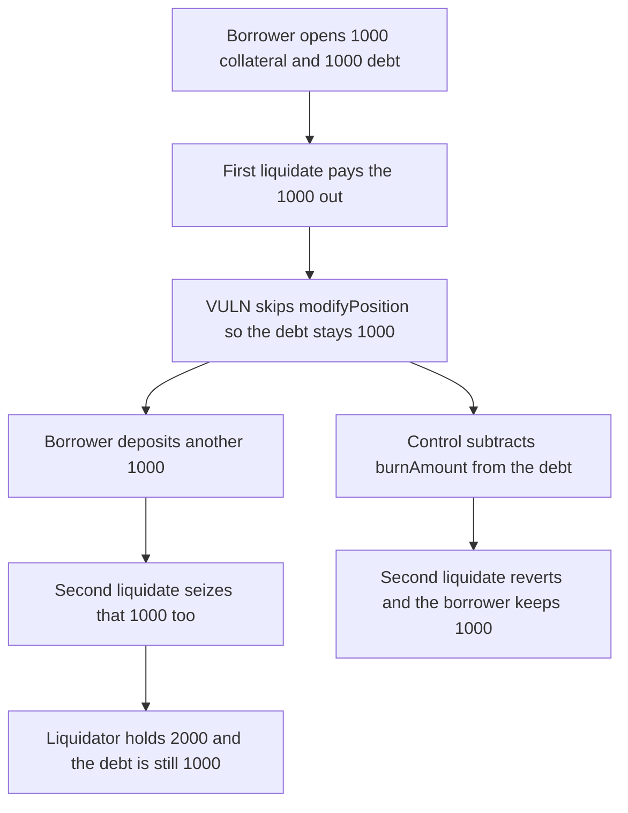

# Cryptex: liquidation seizes collateral twice because the debt is never reduced

> **Vulnerability classes:** `vuln/logic/liquidation-logic` · `vuln/logic/state-update`

<!-- non-defihacklabs -->
<!-- source-auditvault: https://github.com/Auditware/AuditVault/blob/main/findings/40212-liquidated-person-s-debts-are-not-reduced-in-liquidation-can.md -->
<!-- date: 2024-09 -->

## Key info

| Field | Value |
|---|---|
| **Loss** | 2000 collateral taken while the borrower still owes 1000 |
| **Vulnerable contract** | `Vault.liquidate` |
| **Attacker EOA** | `0x1111111111111111111111111111111111111111` |
| **Attack contract** | `Exploit` |
| **Attack tx** | `Exploit.run()` |
| **Chain / block / date** | Ethereum model · block 0 · 2024-09 |
| **Compiler** | solc 0.8.27, cancun, via IR |
| **Bug class** | Missing `modifyPosition` after a liquidation payout |

## TL;DR

`liquidate` sends the user's collateral to the liquidator and burns TCAP. It never calls `modifyPosition`, so `debtOf` stays 1000. The borrower can deposit another 1000 and be liquidated again. The liquidator finishes with 2000 collateral. The borrower still owes 1000 and has none. The control subtracts the burned amount from the debt, so the second liquidation reverts and the borrower keeps the second 1000.

## Background

Cantina's September 2024 Cryptex review of `Vault.sol`. The proof logs collateral at 0 after `liquidate` while `mintedValueOfUser` is unchanged. The recommended line is `modifyPosition(_toMintId(user, pocketId), -burnAmount)`. Cryptex fixed it in commits 50c7925a and 441a8137.

## The vulnerable code

```solidity
// @> VULN: modifyPosition is skipped, so debtOf[user] stays and the position can be liquidated again
pocket.withdraw(user, liquidationReward, msg.sender);
TCAPV2.burn(msg.sender, burnAmount);
emit Liquidated(msg.sender, user, pocketId, liquidationReward, burnAmount);
```

## Root cause

The payout and the burn are not paired with an update of the liquidated position. The position stays underwater for as long as any collateral is added later.

## Preconditions

- The borrower has 1000 collateral and 1000 debt, and the position is liquidatable.
- The liquidator holds TCAP equal to the burn amount, as in the report's proof, which mints TCAP to the caller.
- `liquidate` is callable by that liquidator. It is not an owner action.

## Attack walkthrough

1. The borrower opens a 1000 collateral / 1000 debt position. The pocket holds the 1000.
2. The first `liquidate` burns 1000 TCAP and sends the 1000 collateral to the liquidator. Debt stays 1000.
3. The borrower deposits another 1000. Debt is still 1000, so the position is liquidatable.
4. The second `liquidate` sends that 1000 as well.
5. The liquidator holds 2000. The borrower holds 0 and still owes 1000.

## Diagrams



## Impact

The liquidator receives 2000 collateral for a 1000 debt that is never cleared. The extra 1000 is collateral the control leaves with the borrower. The borrower has no collateral and still owes 1000.

## Remediation

Before the payout, call `modifyPosition` with `-burnAmount`, as in the Cantina recommendation, and refuse a second liquidation once the debt is zero.

## How to reproduce

```bash
cd 40212-liquidated-person-s-debts-are-not-reduced-in-liquidation-can_exp
forge test -vv
```

`test_exploit_second_liquidation_seizes_another_1000` asserts 2000 seized and debt still 1000. `test_control_clearing_debt_stops_the_second_seizure` asserts the second call reverts and the borrower keeps 1000. Captured output is `output.txt`.

## Sources

- AuditVault finding: https://github.com/Auditware/AuditVault/blob/main/findings/40212-liquidated-person-s-debts-are-not-reduced-in-liquidation-can.md
- Cantina report: https://cdn.cantina.xyz/reports/cantina_cryptex_sep2024.pdf
