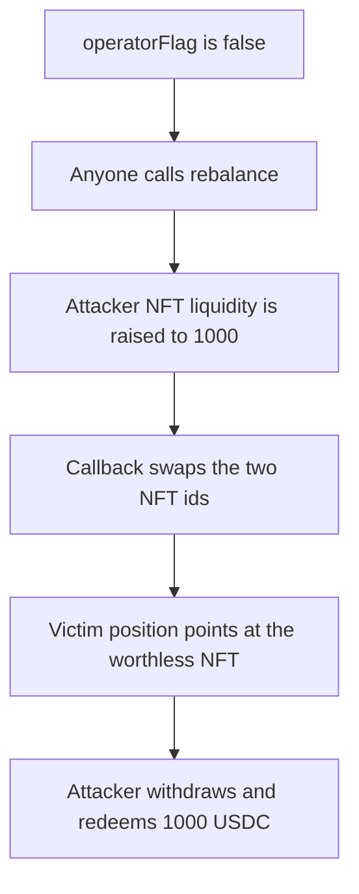

# Mellow — a permissionless rebalance swaps out the victim NFT

> **Vulnerability classes:** vuln/access-control/missing-modifier · vuln/logic/missing-check

> **Reproduction:** a self-contained Foundry PoC that compiles and runs offline
> with only `forge-std` — no fork and no RPC. Trace: [output.txt](output.txt).
> PoC: [test/40578-if-operatorflag-false-attacker-can-steal-all-nfts-within-the_exp.sol](test/40578-if-operatorflag-false-attacker-can-steal-all-nfts-within-the_exp.sol).

<!-- non-defihacklabs -->
<!-- source-auditvault: https://github.com/Auditware/AuditVault/blob/main/findings/40578-if-operatorflag-false-attacker-can-steal-all-nfts-within-the.md -->
<!-- date: 2024-04 -->

---

## Key info

| | |
|---|---|
| **Impact** | **HIGH** — the victim's position NFT, backing **1000** USDC, is withdrawn by the attacker and redeemed |
| **Protocol** | Mellow `Core.rebalance` |
| **Vulnerable code** | `if (operatorFlag) _requireAtLeastOperator()` |
| **Bug class** | With the flag clear, any caller can rebalance and the callback chooses the replacement NFT ids |
| **Finding** | Cantina, Kaden — Mellow · id 40578 |
| **Report** | [Cantina Mellow, April 2024](https://cdn.cantina.xyz/reports/cantina_mellow_apr2024.pdf) |
| **Source** | [AuditVault finding](https://github.com/Auditware/AuditVault/blob/main/findings/40578-if-operatorflag-false-attacker-can-steal-all-nfts-within-the.md) |
| **Status** | The report says commit `736eef90` kept the operator flag in use and stopped the callback path that takes the NFT. Reproduced as a local synthetic. |
| **Compiler** | solc 0.8.27, cancun, via IR |

---

## TL;DR

`Core.rebalance` checks the operator only when `operatorFlag` is true. The flag is false. The attacker raises the liquidity number on their own NFT from **1** to **1000** so it passes the victim position's `minLiquidity` check. The callback returns the two ids swapped. The victim's managed position now points at the attacker's NFT, which has value **0**. The attacker's position points at NFT **1**, which custodies **1000** USDC. `withdraw` sends that NFT to the attacker, and `redeem` pays the **1000** USDC.

When `operatorFlag` is true and the caller is not an operator, `rebalance` reverts. `run()` does not warp.

## The vulnerable code

```solidity
function rebalance(uint256[] calldata ids, address callback) external {
    if (operatorFlag) {
        require(isOperator[msg.sender], "operator");
    }
    // @> VULN: operatorFlag is false, so the operator check above does not run
    permissionlessRebalances += 1;
    // NFTs are transferred to callback, which returns the replacement ids
}
```

The gate matches `Core.sol` in mellow-alm-toolkit: `if (operatorFlag) _requireAtLeastOperator()`.

## Root cause

The report says that with `operatorFlag == false` an attacker can rebalance positions, pass `minLiquidity` by increasing liquidity on their own NFT, and end holding the victim's position NFT.

## Preconditions

- `operatorFlag` is false.
- Position 0 is the victim's. Its NFT custodies **1000** USDC and its minimum liquidity is **1000**.
- Position 1 is the attacker's. Its NFT has liquidity **1** and value **0**.

## Attack walkthrough

1. `setLiquidity` raises the attacker's NFT liquidity to **1000**. Its USDC value stays **0**.
2. `rebalance` does not check the operator.
3. Both NFTs are sent to the attacker. The callback returns them swapped.
4. The core stores the new ids. The victim position now points at the worthless NFT.
5. The attacker withdraws their position and redeems **1000** USDC.

## Diagrams



## Impact

The victim's **1000** USDC leaves with NFT **1**. Their managed position remains, but it now points at an NFT worth **0**.

## Remediation

Keep `operatorFlag` set so rebalance requires an operator, which is the report's recommendation, and do not let the callback choose an NFT the position does not already control.

## How to reproduce

```bash
cd evm-hack-registry/40578-if-operatorflag-false-attacker-can-steal-all-nfts-within-the_exp
forge test -vv
```

## Sources

- AuditVault finding 40578
- Cantina, Mellow, April 2024, `Core.sol`
- mellow-finance/mellow-alm-toolkit `src/Core.sol`, the `if (operatorFlag)` gate, fix noted as commit `736eef90`
