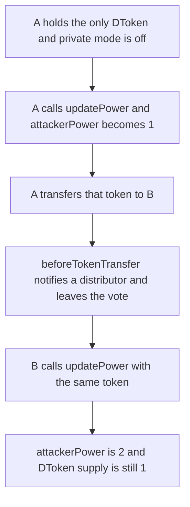

# Goat Tech — one DToken is counted as two votes when private mode is off

> **Vulnerability classes:** vuln/governance/proposal-manipulation · vuln/logic/incorrect-state-transition · vuln/logic/missing-check

> **Reproduction:** cheatcode-free local synthetic. `DToken._beforeTokenTransfer` is the body quoted in the finding. Full trace: [output.txt](output.txt). PoC: [test/40664-anyone-can-vote-multiple-times-by-using-multiple-addresses-a_exp.sol](test/40664-anyone-can-vote-multiple-times-by-using-multiple-addresses-a_exp.sol).

<!-- non-defihacklabs -->
<!-- source-auditvault: https://github.com/Auditware/AuditVault/blob/main/findings/40664-anyone-can-vote-multiple-times-by-using-multiple-addresses-a.md -->
<!-- date: 2024-03 -->

**AuditVault taxonomy:** `lang/solidity` · `sector/governance` · `platform/cantina` · `severity/high` · genome: `proposal-manipulation` · `access-roles`

## Key info

| | |
|---|---|
| **Protocol** | Goat Tech DToken voting |
| **Finding** | Cantina Goat competition, March 2024, AuditVault 40664 |
| **Vulnerable code** | `DToken._beforeTokenTransfer` and `Voting.updatePower` |
| **Harm** | 1 DToken is snapshotted, transferred, and snapshotted again. `attackerPower` goes from 1 to 2. Supply stays 1 |
| **Chain** | local synthetic |

## TL;DR

Voting power is the caller's DToken balance at the moment they call `updatePower`. Private mode blocks transfers. With private mode off, a transfer only notifies Distributor contracts. The sender's snapshot is left in `vote.attackerPower`, and the recipient's later `updatePower` adds the same token again. One token, two votes. N addresses make it N votes.

## The vulnerable code

Quoted `_beforeTokenTransfer` from the finding. The loop is the whole body:

```solidity
function _beforeTokenTransfer(address from_, address to_, uint256 amount_) internal {
    uint256 i = 0;
    uint256 n = _totalDistributors;
    while (i < n) {
        // @> VULN: the transfer hook updates distributors only, so snapshotted voting power stays with the sender
        _distributors[i].beforeTokenTransfer(from_, to_, amount_);
        // FIX: voting.movePower(from_, to_, amount_) so the same tokens cannot be counted again
        i++;
    }
}
```

`updatePower` does what the report describes. It reads the live balance and adds it. It does not subtract a snapshot that a previous holder already added:

```solidity
uint256 bal = token.balanceOf(msg.sender);
if (forAttacker) {
    vote.attackerPower += bal;
}
powerOf[msg.sender] = bal;
```

Goat's response in the finding: private mode was removed. While the flag exists and is off, transfers are allowed and this sequence works.

## Root cause

Voting power is an additive snapshot of a balance, and the token's transfer hook is not one of the writers of that snapshot. The distributors get `beforeTokenTransfer`. `vote.attackerPower` does not. After the transfer the sender's `powerOf` entry is still the old balance until someone explicitly clears it, and clearing it in this `updatePower` still would not subtract the already-added votes.

## Preconditions

Private mode is off, so `transfer` does not revert. The voter holds 1 DToken. A challenge is open and `updatePower(true)` adds to `attackerPower`. The voter controls a second address.

## Attack walkthrough

1. A calls `updatePower`. Balance is 1. `attackerPower` is 1. `powerOf[A]` is 1.
2. A transfers the token to B. The hook calls the distributor once and does not touch the vote.
3. A now holds 0. A's recorded power is still 1. Supply is still 1.
4. B calls `updatePower`. Balance is 1. `attackerPower` is 2.
5. The counted-vote balance mirrors that total: 2.

The control runs the same transfer and then `movePower`, which is what the hook should have called. B's snapshot brings the total back to 1, not 2. A second control turns private mode on: the transfer reverts and the token never moves.

## Diagrams



## Impact

One holder with one token and a second address doubles their side of a challenge. The report's case is `vote.attackerPower += power` or the defender side, repeated for every extra address. Here the numbers are 2 votes from 1 token. A quorum or a close challenge moves by that extra vote, and the token supply the UI would show is still 1.

## Remediation

On transfer, subtract the moved amount from the sender's counted power before the recipient can snapshot it. Removing the ability to turn private mode off also closes the path, which is the fix Goat recorded, but only if transfers stay disabled.

## How to reproduce

```bash
cd 40664-anyone-can-vote-multiple-times-by-using-multiple-addresses-a_exp
forge test -vv
```

## Sources

- AuditVault finding: https://github.com/Auditware/AuditVault/blob/main/findings/40664-anyone-can-vote-multiple-times-by-using-multiple-addresses-a.md
- Cantina report: https://cdn.cantina.xyz/reports/cantina_competition_goat_mar2024.pdf
- Contest repo named by Cantina: https://github.com/cantina-forks/goattechlabs-smart-contracts/tree/ab6e96370ea6cf823ec1ac268521722b0e1f2d35
- Contest page: https://cantina.xyz/competitions/f214cf86-cc80-40c0-a70b-e9bb25d7ac80
