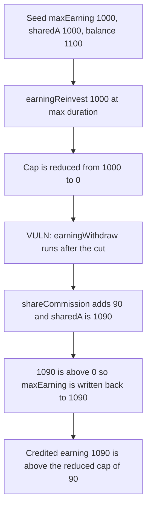

# Goat Tech — reinvesting ETH earnings does not keep the maxEarning cut

> **Vulnerability classes:** vuln/logic/incorrect-order-of-operations · vuln/logic/reward-calculation · vuln/logic/wrong-condition

<!-- non-defihacklabs -->
<!-- source-auditvault: https://github.com/Auditware/AuditVault/blob/main/findings/40666-when-stake-eth-in-earningreinvest-the-reduction-of-maxearnin.md -->
<!-- date: 2024-03 -->

## Key info

| | |
|---|---|
| **Protocol** | Goat Tech |
| **Finding** | Cantina, March 2024, AuditVault 40666 |
| **Vulnerable code** | `earningReinvest` calls `earningWithdraw` after it reduces `maxEarning` |
| **Harm** | Credited earning is 1090. The reduced cap is 90. Stored `maxEarning` is put back to 1090. |
| **Chain** | local synthetic (audited Ethereum contracts) |

## TL;DR

`earningReinvest` cuts `maxEarning` by `amount * duration / maxDuration` so that staking ETH earnings does not leave the user an unbounded claim. It then calls `earningWithdraw`. Withdraw calls `shareCommission`, and if `sharedA` is now above `maxEarning` it writes `maxEarning = sharedA`. The cut is overwritten.

With the report's figures the cut takes the cap from 1000 to 0, commission raises `sharedA` from 1000 to 1090, and the cap is restored to 1090. Doing the withdraw first and then the same subtraction leaves the cap at 90. The user is credited 1090 against a cap of 90.

## The vulnerable code

The order below is the audited function. The fix moves `earningWithdraw` above the `if (isEth_)` block.

```solidity
uint256 maxEarning = earning.maxEarningOf(account);
maxEarning -= amount_ * realDuration / maxDuration;
earning.updateMaxEarning(account, maxEarning);
// @> VULN: withdraw runs after the reduction, and shareCommission writes maxEarning back up.
earningWithdraw(isEth_, amount_, payable(address(this)), 0);
```

`withdraw` then does:

```solidity
shareCommission(account_);
if (sharedA[account_] > maxEarningOf[account_]) {
    updateMaxEarning(account_, sharedA[account_]);
}
```

`shareCommission` adds the uncommissioned balance times `(100 - sPercent) / 100`. Here that is `100 * 90 / 100 = 90`.

## Root cause

Two writers touch `maxEarning` in one call, and the second one wins. The reduction is computed from the pre-commission cap. `shareCommission` then raises `sharedA`, and the `sharedA > maxEarning` branch treats that as a reason to raise the cap, not as a reason the user is over it.

## Preconditions

The account already has `maxEarning = 1000`, `sharedA = 1000`, and an earning balance of 1100, with `sPercent = 10`. The user reinvests 1000 at `duration = maxDuration`. Those are the figures in the report. No second transaction is required.

## Attack walkthrough

1. Seed those three numbers.
2. `earningReinvest(true, …, duration=100, amount=1000)` with `maxDuration = 100`.
3. `maxEarning` becomes `1000 - 1000 = 0`.
4. `earningWithdraw` runs `shareCommission`. `sharedA` becomes `1000 + 90 = 1090`.
5. `1090 > 0`, so `maxEarning` is set to 1090.
6. Credited earning is 1090. The cap a post-withdraw reduction would have stored is `1090 - 1000 = 90`.

Control, same seed: withdraw first (`sharedA = 1090`, cap raised to 1090), then subtract 1000. Stored cap is 90. Credited earning 1090 is above that cap, which is what the cut is for.

The report's follow-on score `fs = ((1090 - 1000) + 1000 * 2%) / 1090` is about 0.1 because it still sees the restored 1090. The number this PoC locks is the cap itself: 1090 versus 90.

## Diagrams



## Impact

The stability cut does not bind. The user keeps a 1090 earning cap instead of 90, so the 1000 that was supposed to come off the cap is still available. Credited earning 1090 sits above the 90 cap the fixed order would have stored.

## Remediation

Call `earningWithdraw` before reading and reducing `maxEarning`, which is the patch Goat applied. The subtraction then uses the post-commission value and is not overwritten by it.

## How to reproduce

```bash
cd 40666-when-stake-eth-in-earningreinvest-the-reduction-of-maxearnin_exp
forge test -vv
```

## Sources

- AuditVault finding: https://github.com/Auditware/AuditVault/blob/main/findings/40666-when-stake-eth-in-earningreinvest-the-reduction-of-maxearnin.md
- Cantina report: https://cdn.cantina.xyz/reports/cantina_competition_goat_mar2024.pdf
