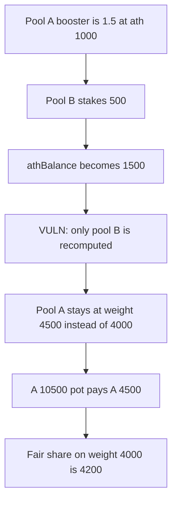

# Goat Tech — a higher athBalance leaves other pools on a stale booster

> **Vulnerability classes:** vuln/logic/reward-calculation · vuln/logic/state-update

<!-- non-defihacklabs -->
<!-- source-auditvault: https://github.com/Auditware/AuditVault/blob/main/findings/40668-when-dp2pdtokenathbalance-is-increased-the-power-of-almost.md -->
<!-- date: 2024-03 -->

## Key info

| | |
|---|---|
| **Protocol** | Goat Tech |
| **Finding** | Cantina, March 2024, AuditVault 40668 |
| **Vulnerable code** | `stake` recomputes only the caller's booster after `athBalance` grows |
| **Harm** | Pool A is paid 4500 of a 10500 pot. The fair share is 4200. |
| **Chain** | local synthetic (audited Ethereum contracts) |

## TL;DR

Booster is `1 + balance / athBalance`, and it is an input to pool power. `athBalance` is the largest `_dP2PDToken` balance. When pool B stakes and sets a new high, only B is recomputed. Pool A keeps the booster it had against the old high.

The report's numbers: A is 500 against an ath of 1000, so booster 1.5. B moves from 1000 to 1500 and the ath becomes 1500. B's booster stays 2. A's should become `1 + 500/1500 = 4/3`, but it stays 1.5. A pot of 10500 then pays A 4500 instead of 4200.

Weights are stored times 3000 so the fractions are integers: 1.5 is 4500, 2 is 6000, 4/3 is 4000.

## The vulnerable code

```solidity
tokenBalance[msg.sender] += amount;
if (tokenBalance[msg.sender] > athBalance) {
    athBalance = tokenBalance[msg.sender];
}
// @> VULN: athBalance just moved, but only the staking pool's booster is recomputed.
_reCalBooster(msg.sender);
```

`_reCalBooster` is the audited shape: read `athBalance`, read that account's balance, store `calBooster`. Nothing walks the other pools. The fix Goat shipped is a public wrapper so anyone can refresh a pool:

```solidity
function reCalBooster(address account_) external {
    _reCalBooster(account_);
}
```

## Root cause

Booster is cached per pool, and the cache is refreshed only for the pool that stakes or withdraws. `athBalance` is global. Raising it changes the denominator of every other pool, and those caches are not invalidated.

## Preconditions

At least two pools, and one of them can increase the all-time-high balance. No role beyond staking in your own pool. The payout then reads the cached boosters.

## Attack walkthrough

1. Pool A is configured at balance 500 with `athBalance = 1000`. Weight 4500 (booster 1.5).
2. Pool B is configured at balance 1000 with the same ath. Weight 6000 (booster 2).
3. Pool B stakes 500. Its balance is 1500 and `athBalance` becomes 1500. Only B is recomputed, and B's weight stays 6000.
4. Pool A's stored weight is still 4500. `calBooster(500, 1500)` is 4000.
5. `claim` pays `10500 * 4500 / (4500 + 6000) = 4500` to A.
6. The fair payout is `10500 * 4000 / (4000 + 6000) = 4200`.

Control calls `reCalBooster(A)` after the stake. A's weight is 4000 and the same claim pays 4200.

## Diagrams



## Impact

Pool A is paid 4500 reward units out of 10500 on a booster of 1.5. The booster consistent with the new ath is 4/3, and that share is 4200. The extra 300 comes out of the other pools. Every pool that is not the one setting the new high is in the same position.

## Remediation

Expose `_reCalBooster` (and the power helper the report names) as a public function, and refresh a pool before it is paid. Goat wrapped the existing internal function so anyone can do that as `athBalance` grows.

## How to reproduce

```bash
cd 40668-when-dp2pdtokenathbalance-is-increased-the-power-of-almost_exp
forge test -vv
```

## Sources

- AuditVault finding: https://github.com/Auditware/AuditVault/blob/main/findings/40668-when-dp2pdtokenathbalance-is-increased-the-power-of-almost.md
- Cantina report: https://cdn.cantina.xyz/reports/cantina_competition_goat_mar2024.pdf
