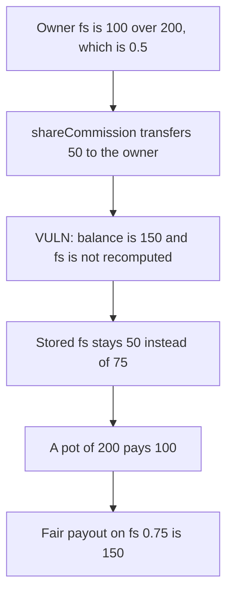

# Goat Tech — shared earnings leave that pool's fs stale

> **Vulnerability classes:** vuln/logic/reward-calculation · vuln/logic/state-update

<!-- non-defihacklabs -->
<!-- source-auditvault: https://github.com/Auditware/AuditVault/blob/main/findings/40669-when-the-poolowner-gets-shared-earnings-the-power-of-that-po.md -->
<!-- date: 2024-03 -->

## Key info

| | |
|---|---|
| **Protocol** | Goat Tech |
| **Finding** | Cantina, March 2024, AuditVault 40669 |
| **Vulnerable code** | `shareCommission` moves earnings and does not call `_reCalFs` |
| **Harm** | The owner is paid 100. The fair payout on the updated fs is 150. |
| **Chain** | local synthetic (audited Ethereum contracts) |

## TL;DR

`fs = earning balance / maxEarning`, and pool power is derived from `fs`. `fs` is cached. `shareCommission` can transfer a sponsor share onto the pool owner, which changes that balance, and it never refreshes the cache.

The report's example: balance 100, max earning 200, so `fs = 0.5`. The owner then receives 50. `fs` should be `150/200 = 0.75` and stays `0.5`. A pot of 200 pays `200 * 0.5 = 100` instead of `200 * 0.75 = 150`.

Hundredths are the stored unit: 50 and 75.

## The vulnerable code

`shareCommission` is the audited shape. The sponsor receives `sAmount`. `_reCalFs` is not called for the sponsor or the payer.

```solidity
if (sAmount > 0) {
    _transfer(account_, sponsor, sAmount);
}
sharedA[account_] = balanceOf[account_];

function _transfer(address from, address to, uint256 amount) internal {
    // @> VULN: shared earnings change balances here and fs is not recomputed.
    balanceOf[from] -= amount;
    balanceOf[to] += amount;
}
```

`_reCalFs` is what a stake or withdraw would have run:

```solidity
function _reCalFs(address account_) internal {
    uint256 maxEarning = maxEarningOf[account_];
    uint256 earning = balanceOf[account_];
    fsOf[account_] = earning * SCALE / maxEarning;
}
```

The fix is a public wrapper, which is what Goat added:

```solidity
function reCalFs(address poolOwner_) external {
    _reCalFs(poolOwner_);
}
```

## Root cause

`fs` is an input to power and it is stored, not derived at payout. The writers that change `balanceOf` or `maxEarningOf` outside the stake and withdraw paths do not update it. A commission transfer is one of those writers. The owner's power stays at the pre-commission value until somebody stakes or withdraws in that pool.

## Preconditions

The pool owner is the sponsor of an account that has unshared earnings, and `maxEarning` is already above the post-commission balance so the ratio changes rather than the cap moving with the balance. The report uses 100, 200, and a 50 credit. No second block.

## Attack walkthrough

1. The owner is configured at balance 100, sharedA 100, max earning 200. Stored fs is 50.
2. The payer is configured at balance 50, sharedA 0. Pending commission is 50, and `getSponsorPart` gives all 50 to the owner.
3. `shareCommission` transfers 50. The owner's balance is 150. max earning is still 200. Stored fs is still 50.
4. The live ratio is `150 * 100 / 200 = 75`.
5. `claim` pays `200 * 50 / 100 = 100`.
6. The fair payout is `200 * 75 / 100 = 150`.

Control calls `reCalFs` after the commission. Stored fs becomes 75 and the same pot pays 150.

## Diagrams



## Impact

The pool is paid 100 reward units on a stale fs of 0.5. The fs after the 50 credit is 0.75, and that payout is 150. The owner is short 50 on this pot, and every later distribution that reads the cache repeats the same stale power until the pool stakes or withdraws.

## Remediation

Call `_reCalFs` for the sponsor and the payer at the end of `shareCommission`, or expose the public `reCalFs` Goat added and invoke it before a pool is paid.

## How to reproduce

```bash
cd 40669-when-the-poolowner-gets-shared-earnings-the-power-of-that-po_exp
forge test -vv
```

## Sources

- AuditVault finding: https://github.com/Auditware/AuditVault/blob/main/findings/40669-when-the-poolowner-gets-shared-earnings-the-power-of-that-po.md
- Cantina report: https://cdn.cantina.xyz/reports/cantina_competition_goat_mar2024.pdf
