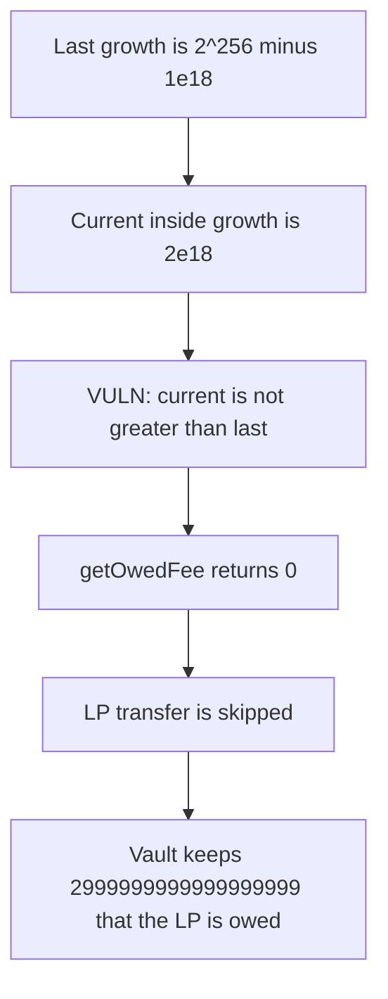

# Particle getOwedFee — wrapped fee growth pays the LP 0 instead of 2999999999999999999

> **Vulnerability classes:** vuln/arithmetic/underflow · vuln/logic/fee-calculation

<!-- non-defihacklabs -->
<!-- source-auditvault: https://github.com/Auditware/AuditVault/blob/main/findings/40714-getowedfee-can-incorrectly-return-zero-because-of-fee-growth.md -->
<!-- date: 2024-02 -->

## Key info

| | |
|---|---|
| **Protocol** | Particle |
| **Finding** | Cantina Particle February 2024, AuditVault 40714 |
| **Vulnerable code** | `Base.getOwedFee` |
| **Harm** | A position owes 2999999999999999999 of token0 and pays 0. The unchecked fix pays that amount |
| **Chain** | local synthetic (audited Ethereum contracts) |

## TL;DR

Uniswap V3 fee growth is a uint256 that is allowed to wrap. `getFeeGrowthInside` accounts for that. `getOwedFee` does not. It only accrues a fee when `feeGrowthInside0X128 > feeGrowthInside0LastX128`. After a wrap, the current inside growth can be smaller than the stored last value even though fees were earned.

The finding's numbers: last = `type(uint256).max - 1e18 + 1`, current = `2e18`. The unchecked delta is `3e18`. At `uint128` max liquidity, `mulDiv(3e18, liquidity, 2^128)` is `2999999999999999999`. The strict comparison is false, so the LP is paid 0 and that balance stays on the vault. The fixed function subtracts unchecked and pays the LP `2999999999999999999`.

## The vulnerable code

The comparison is the audited line. The body is the Uniswap fee formula, and it does not run.

```solidity
// @> VULN: wrapped growth is not greater than last, so the owed fee stays 0.
if (_feeGrowthInside0X128 > _feeGrowthInside0LastX128) {
    token0Owed = uint128(
        FullMath.mulDiv(_feeGrowthInside0X128 - _feeGrowthInside0LastX128, _liquidity, FixedPoint128.Q128)
    );
}
```

The report's fix, which the control runs:

```solidity
unchecked {
    if (_feeGrowthInside0X128 != _feeGrowthInside0LastX128) {
        token0Owed = uint128(
            FullMath.mulDiv(_feeGrowthInside0X128 - _feeGrowthInside0LastX128, _liquidity, FixedPoint128.Q128)
        );
    }
}
```

## Root cause

Solidity 0.8 reverts on underflow, so the authors guarded the subtraction with `>`. Uniswap's growth math is defined with wrapping subtraction. `2e18 - (2^256 - 1e18)` is `3e18` in unchecked arithmetic and is not greater than the last snapshot, so the guard returns 0.

`2999999999999999999` rather than a round `3e18` is the integer result of scaling that delta by `type(uint128).max / 2^128`. It is one wei under `3e18`.

## Preconditions

A position snapshot was stored while inside growth sat at `type(uint256).max - 1e18 + 1`. Later inside growth is `2e18`. Liquidity is `type(uint128).max`. Closing the position calls `getOwedFee`. No special caller is required beyond whoever can close.

## Attack walkthrough

1. `2999999999999999999` of token0 is credited to the vault as the accrued fee.
2. `close` calls `getOwedFee` with the wrapped snapshot.
3. The comparison fails. `paid` is 0. The LP transfer does not run.
4. The unchecked quote of the same inputs returns `2999999999999999999`. The vault still holds it. The LP holds 0.

The control close pays the LP `2999999999999999999` and leaves the vault at 0.

## Diagrams



## Impact

The LP is owed `2999999999999999999` of token0 for this position and receives nothing. The fee stays in the vault. Every later close that crosses the same wrap underpays the same way. The fixed close forwards that amount to the LP.

## Remediation

Subtract the growth values in `unchecked` and skip the accrual only when the two snapshots are equal, which is what Uniswap's `Position.update` does.

## How to reproduce

```bash
cd 40714-getowedfee-can-incorrectly-return-zero-because-of-fee-growth_exp
forge test -vv
```

The exploit test asserts paid 0 and fair fee `2999999999999999999`. The control test asserts the LP receives that amount.

## Sources

- AuditVault finding: https://github.com/Auditware/AuditVault/blob/main/findings/40714-getowedfee-can-incorrectly-return-zero-because-of-fee-growth.md
- Cantina report: https://cdn.cantina.xyz/reports/cantina_competition_particle_feb2024.pdf
- Audited function: https://github.com/code-423n4/2023-12-particle/blob/main/contracts/libraries/Base.sol
