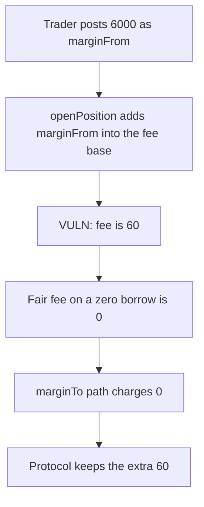

# Particle — openPosition charges a fee on the user's own marginFrom

> **Vulnerability classes:** vuln/logic/fee-calculation · vuln/defi/fee-manipulation

<!-- non-defihacklabs -->
<!-- source-auditvault: https://github.com/Auditware/AuditVault/blob/main/findings/40715-openposition-should-not-charge-fees-on-marginfrom-or-charge.md -->
<!-- date: 2024-02 -->

## Key info

| | |
|---|---|
| **Protocol** | Particle |
| **Finding** | Cantina, February 2024, AuditVault 40715 |
| **Vulnerable code** | `openPosition` fees `marginFrom + amountFromBorrowed` |
| **Harm** | A 6000 marginFrom with nothing borrowed pays 60. The fair fee is 0. |
| **Chain** | local synthetic (audited Ethereum contracts) |

## TL;DR

`openPosition` sets the fee base to `marginFrom + amountFromBorrowed`. `marginFrom` is collateral the user posts, not a borrow. At ETH 3000, a long that posts 6000 of the quote asset is charged on that 6000. With `feeFactor` 100 and `BASIS_POINT` 10000 the fee is 60.

The same open with `marginFrom` 0 and `marginTo` 2 charges 0. Users who follow the marginFrom path pay 60 that the borrowed-only formula does not charge.

## The vulnerable code

```solidity
if (cache.feeFactor > 0) {
    // @> VULN: marginFrom is the user's own collateral, but it is added into the fee base.
    cache.feeAmount = ((params.marginFrom + cache.amountFromBorrowed) * cache.feeFactor) / Base.BASIS_POINT;
}
```

Fair base, which is what the report recommends:

```solidity
cache.feeAmount = (cache.amountFromBorrowed * cache.feeFactor) / Base.BASIS_POINT;
```

## Root cause

The fee is described as a charge on borrowed principal, but the product also includes `marginFrom`. Supplying the other side as `marginTo` zeroes `marginFrom` and drops that part of the fee. The two ways of posting the same collateral do not pay the same fee.

## Preconditions

`feeFactor` is 100. The open borrows nothing, so `amountFromBorrowed` is 0. The user holds 6000 of the margin token. One transaction.

## Attack walkthrough

1. The trader is minted 6000 and approves the book.
2. `openPosition` with `marginFrom` 6000 and `marginTo` 0.
3. The fee line computes `(6000 + 0) * 100 / 10000 = 60`.
4. The book pulls 60. Its balance is 60. `fairFee(0)` is 0.
5. A second open with `marginFrom` 0 and `marginTo` 2 returns 0. The book still holds 60.

Control opens with `marginTo` only. The fee is 0.

## Diagrams



## Impact

The trader pays 60 units that a borrowed-only fee would not take. The marginTo path pays 0 for the same shape of position, so marginFrom users are the ones overcharged.

## Remediation

Drop `marginFrom` from the fee base, or charge `marginTo` as well so the two paths match.

## How to reproduce

```bash
cd 40715-openposition-should-not-charge-fees-on-marginfrom-or-charge_exp
forge test -vv
```

## Sources

- AuditVault finding: https://github.com/Auditware/AuditVault/blob/main/findings/40715-openposition-should-not-charge-fees-on-marginfrom-or-charge.md
- Cantina report: https://cdn.cantina.xyz/reports/cantina_competition_particle_feb2024.pdf
- Reduced from the `feeAmount` expression quoted in that finding. Particle's server-side signature is not what this reduction exercises. The fee product itself is.
