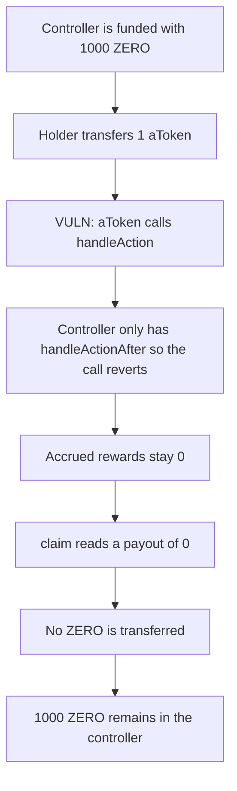

# ZeroLend — the reward controller pays 0 while 1,000 ZERO sits in it

> **Vulnerability classes:** vuln/logic/reward-calculation · vuln/dos/frozen-funds

<!-- non-defihacklabs -->
<!-- source-auditvault: https://github.com/Auditware/AuditVault/blob/main/findings/40817-zlrewardscontroller-contract-is-incompatible-with-zerolend-s.md -->
<!-- date: 2024-01 -->

## Key info

| | |
|---|---|
| **Protocol** | ZeroLend |
| **Finding** | Cantina competition Jan 2024, AuditVault 40817 |
| **Vulnerable code** | `ZeroLendAToken._transfer` calls `handleAction`; `ZLRewardsController` only has `handleActionAfter` |
| **Harm** | Claim pays 0; 1,000 ZERO stays in the controller |
| **Chain** | local synthetic |

## TL;DR

ZeroLend aTokens are an Aave fork. After a balance change they call `handleAction`. `ZLRewardsController` was taken from Radiant and only implements `handleActionAfter`. The hook reverts, the holder's accrued rewards stay 0, and `claim` pays 0 while 1,000 ZERO sits in the controller.

## The vulnerable code

The controller's hook, which the aToken never calls:

```solidity
function handleActionAfter(address _user, uint256 _balance, uint256 _totalSupply) external {
    if (!validRTokens[msg.sender] && msg.sender != address(streamedVesting)) revert NotRTokenOrMfd();

    if (_user == address(streamedVesting)) return;

    _handleActionAfterForToken(msg.sender, _user, _balance, _totalSupply);
}
```

The aToken calls a different function:

```solidity
IAaveIncentivesController incentivesControllerLocal = IAaveIncentivesController(controller);
if (address(incentivesControllerLocal) != address(0)) {
    uint256 currentTotalSupply = _totalSupply;
    // @> VULN: ZeroLend calls handleAction; ZLRewardsController only implements handleActionAfter
    incentivesControllerLocal.handleAction(sender, currentTotalSupply, oldSenderBalance);
}
```

There is no `handleAction` on the controller, so the external call reverts. `accrued` is only written inside `_handleActionAfterForToken`. `claim` therefore reads 0 and transfers nothing.

The control adds `handleAction` with the Aave argument order and the same accrual. The same transfer then succeeds, and `claim` pays the holder 1,000 ZERO.

## Root cause

Radiant's reward-bearing tokens call `handleActionAfter` after the balances have changed. ZeroLend's tokens still call Aave's `handleAction(user, totalSupply, userBalance)`. The controller was copied from Radiant without that function, so every hooked balance change reverts and no user is ever accrued.

## Preconditions

The controller holds reward tokens. The user holds the reward-bearing aToken. The aToken's incentives controller is the `ZLRewardsController`. A transfer, mint, or burn is the action that should update the user's reward index.

## Attack walkthrough

1. The holder approves the controller and deposits 1,000 ZERO. The controller's balance becomes 1,000. Accrued rewards for the holder are still 0.
2. The holder transfers 1 aToken. `_transfer` updates balances, then calls `handleAction`.
3. The controller has no `handleAction`. The call reverts and the transfer rolls back. The holder still has the full aToken balance. Accrued rewards stay 0.
4. The holder calls `claim`. `paid` is read from `accrued` and is 0. The transfer branch is skipped.
5. The holder' ZERO balance is 0. The controller still holds 1,000 ZERO.

The control wires the same aToken to a controller that implements `handleAction`. The transfer accrues the holder's share of the 1,000 ZERO, and `claim` pays all 1,000 to the holder. The controller's balance ends at 0.

## Diagrams



## Impact

The holder is owed the reward that was deposited for the aToken supply and receives 0. The 1,000 ZERO stays in `ZLRewardsController`. Every later balance change hits the same missing function, so the index is never updated and later claims stay at 0 as well.

## Remediation

Implement `handleAction(address user, uint256 totalSupply, uint256 userBalance)` on `ZLRewardsController`, and accrue inside it the way `handleActionAfter` already does. The aToken's existing call then updates the user, and `claim` can pay.

## How to reproduce

```bash
cd 40817-zlrewardscontroller-contract-is-incompatible-with-zerolend-s_exp
forge test -vv
```

## Sources

- AuditVault finding: https://github.com/Auditware/AuditVault/blob/main/findings/40817-zlrewardscontroller-contract-is-incompatible-with-zerolend-s.md
- Cantina report: https://cdn.cantina.xyz/reports/cantina_competition_zerolend_jan2024.pdf
- Competition: https://cantina.xyz/competitions/a83eaf73-9cbc-495f-8607-e55d4fdaf407
- Scope commit: https://github.com/zerolend/incentive-contracts/tree/3fbcd817c310d1682d2301d23233f0fc7e7d1f00
