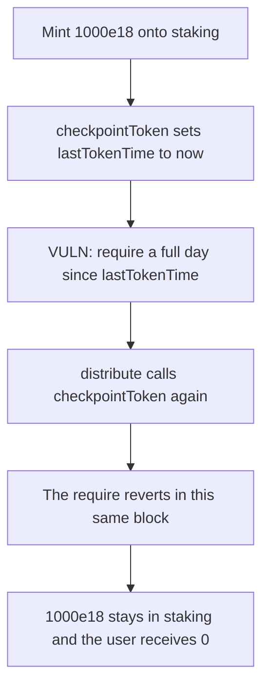

# ZeroLend distribute — a same-day checkpoint sticks 1000e18 of rewards

> **Vulnerability classes:** vuln/dos/frozen-funds · vuln/dos/griefing

<!-- non-defihacklabs -->
<!-- source-auditvault: https://github.com/Auditware/AuditVault/blob/main/findings/40819-dos-in-distribute-cantina-none-zerolend-pdf.md -->
<!-- date: 2024-01 -->

## Key info

| | |
|---|---|
| **Protocol** | ZeroLend |
| **Finding** | Cantina ZeroLend January 2024, AuditVault 40819 |
| **Vulnerable code** | `FeeDistributor.checkpointToken`, called by `StakingEmissions.distribute` |
| **Harm** | 1000e18 of VestedZeroLend stays in staking. The user receives 0. The fixed checkpoint pays the user 1000e18 |
| **Chain** | local synthetic (audited Ethereum contracts) |

## TL;DR

`StakingEmissions.distribute` transfers `amtPerEpoch` to the fee distributor, but only after `checkpointToken()`. That function reverts unless `block.timestamp > lastTokenTime + 1 days`. Anyone can call `checkpointToken` first — a searcher, or a user whose claim already checkpoints. The later `distribute` then hits the same require and reverts, so the transfer never happens.

Here the epoch is 1000e18. After one checkpoint in the block, staking still holds 1000e18 and the staker holds 0. The control turns the require into a skip. The second checkpoint does nothing, `distribute` finishes, and the user receives 1000e18.

## The vulnerable code

The require is the audited line. `distribute` calls it unconditionally.

```solidity
// @> VULN: a checkpoint already taken today makes this revert, so distribute cannot pay.
require(block.timestamp > lastTokenTime + TOKEN_CHECKPOINT_DEADLINE, "cant checkpoint now");
_checkpointToken(block.timestamp);
```

```solidity
function distribute() external {
    feeDistributor.checkpointToken();
    feeDistributor.checkpointTotalSupply();
    token.transfer(address(feeDistributor), amtPerEpoch);
}
```

The report's fix, which the control runs: call `_checkpointToken` only when the deadline has passed, and do not revert when it has not.

## Root cause

`TOKEN_CHECKPOINT_DEADLINE` is one day. `distribute` does not tolerate a checkpoint that already happened inside that window. The window is shared with `claim`, which also checkpoints, so a normal claim and a deliberate front-run have the same effect. One successful checkpoint sets `lastTokenTime` to the current timestamp. The next call in that block reverts.

## Preconditions

`lastTokenTime` starts at 0, so the first checkpoint in a block whose timestamp is past one day succeeds. `amtPerEpoch` is 1000e18 and staking holds that balance. No privilege is required to checkpoint or to call `distribute`. The replay uses one timestamp for the whole transaction. There is no warp inside `run()`.

## Attack walkthrough

1. Staking is minted 1000e18.
2. `checkpointToken` runs. The require passes. `lastTokenTime` becomes the block timestamp.
3. `distribute` calls `checkpointToken` again. The require reverts. The 1000e18 transfer does not run.
4. Staking still holds 1000e18. The user's balance is 0.

The control, at the same timestamp, skips the second checkpoint, transfers 1000e18 to the fee distributor, and the claim pays the user 1000e18.

## Diagrams



## Impact

The epoch's 1000e18 never reaches the fee distributor, so stakers cannot claim it. Repeating the checkpoint each day keeps the rewards stuck. The fixed distributor still checkpoints when a day has passed, and otherwise lets `distribute` pay.

## Remediation

In `checkpointToken`, call `_checkpointToken` only when the deadline has elapsed. Do not revert when it has not. `distribute` can then transfer `amtPerEpoch` either way.

## How to reproduce

```bash
cd 40819-dos-in-distribute-cantina-none-zerolend-pdf_exp
forge test -vv
```

The exploit test warps once, outside `run`, and asserts 1000e18 stuck with a zero user balance. The control test asserts the user receives 1000e18.

## Sources

- AuditVault finding: https://github.com/Auditware/AuditVault/blob/main/findings/40819-dos-in-distribute-cantina-none-zerolend-pdf.md
- Cantina report: https://cdn.cantina.xyz/reports/cantina_competition_zerolend_jan2024.pdf
